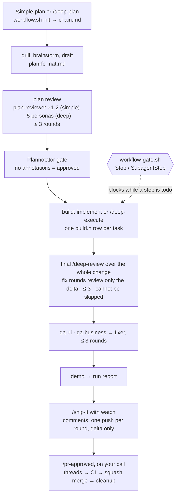

# Claude Code and the agent pipeline

The Claude Code setup, the planning and build chain, its execution order, the hooks, and the limits that keep several agent sessions on one machine.

## Execution order

Each step ends before the next one starts, unless the step says otherwise.

1. **Intake.** A Jira key starts `jira-workflow`, which claims the ticket
   (`_shared/ticket-start.md`). Otherwise you run `/simple-plan` (small or medium change) or
   `/deep-plan` (large or risky change). `_shared/plan-routing.md` holds the criteria.
2. **Repository workflow.** The planning skill reads the repository's own workflow first
   (`_shared/repo-workflow.md`). A stage that the repository covers replaces the matching
   chain step, so one change never goes through two review systems.
3. **Plan.** Grill, brainstorm when the design is open, then draft in
   `_shared/plan-format.md`. The draft lives in the run folder.
4. **Plan review.** `simple-plan` starts one `plan-reviewer` agent per side (backend,
   frontend) in parallel. `deep-plan` runs its 5-persona loop. Three rounds at most.
5. **Gate.** Plannotator shows the plan. No annotations means approved. Only then does the plan
   reach `docs/superpowers/plans/` (the `plan-path-guard.sh` hook refuses it earlier). A new
   change request after a closed run starts a new run with `workflow.sh reopen`.
6. **Build.** `implement` (serial, option B) or `/deep-execute` (parallel lanes, option A),
   under TDD. Each implementer runs only its own focused tests, lint and type check. The
   orchestrator commits each lane's `owns` globs as soon as the lane reports `done`.
7. **Review, once over the whole change.** `/deep-review` runs its personas in parallel. Each
   fix round reviews only the fix delta (`--scope <commit before the fixes>`), never the whole
   PR again. Three fix rounds at most. A separate fixer applies the fixes.
8. **QA.** `qa-ui` compares the screens with the design canvas. `qa-business` runs the flows
   in the real app. Failures go to the fixer, three rounds at most.
9. **Demo and report.** A narrated demo for a user feature, then the HTML run report.
10. **PR.** `/ship-it` writes the body, opens the PR and watches it. Review comments go to
    `address-pr-comments`: one push per round, and after the first round only comments on
    the delta, or CRITICAL and HIGH defects, change the PR. Each push starts the full CI, so
    fewer pushes means a faster PR.
11. **Merge, on your call.** `/pr-approved` resolves the threads, waits for CI, squash-merges
    and removes the worktree.

The whole flow, from the plan to the merge:

## Claude Code
- **`~/.claude/settings.json`** - Claude Code settings with hooks and MCP servers
- **`~/.claude/commands/*.md`** - Custom slash commands:
  - `/test` - Run project tests
  - `/docs` - Generate documentation
  - `/refactor` - Suggest refactorings
  - `/deps` - Analyze dependencies
  - `/deep-plan` - Multi-agent planning pipeline (see below)
  - `/deep-execute` - Runs an approved deep-plan parallel plan as lane workers (see below)
  - `/deep-review` - Multi-persona peer review of a diff
  - `/pr-description` - Conventional-commit PR title/body with requirements matrix, Mermaid,
    decisions and **UI evidence** (flow GIF/recording + before/after screenshots), then opens
    the PR assigned to you
- **`~/.claude/skills/annotated-screenshots`** - Annotated feature screenshots: captures the live
  app or a component rendered with fixture data through `agent-browser`, then draws highlight
  boxes, numbered callouts and a source banner with `annotate.py` (Pillow through `uv run`)
- **`~/.claude/skills/video-demo`** - Short narrated demo video of a feature: a brief introduction,
  then the real flow recorded with Playwright, rendered with Remotion from one `narration.json`,
  with edge-tts voices (English, pt-BR) and word-synced captions. Needs Node, `uv` and `ffmpeg`

## Deep-* Agent Pipeline

Three slash commands chain together for planning and parallel execution of non-trivial work:

- **`/deep-plan`** - Multi-agent planning pipeline (Opus + Codex draft, a 5-persona review
  loop, a Plannotator approval gate). Plan captures ticket/Slack sources, requirements
  coverage, applicable user journey, data-column population, and substantial-UI design
  handoff. After the approval it runs the build chain through to the PR, unless you said to
  stop at the plan. Its last planning phase is an **execution recommendation** (below).
- **`/deep-execute <plan.md>`** - Runs an approved parallel plan as lane workers sharing ONE
  git worktree, one **Orca terminal** per lane (`orca-launch.sh RUN_DIR LANE...`; any terminal
  or `nohup` outside Orca). The orchestrator launches first the lanes with an empty
  `depends_on`, and launches each other lane when all lanes it depends on emitted `done`. A lane
  that starts before its inputs exist can only report `blocked`. Each lane runs `worker-loop.sh`: the first turn sends the lane's rendered
  brief, and each later turn delivers the numbered replies that `reply.sh` published. `done`
  ends a round, not the lane, so review and QA fixes go back to the lane that owns the code.
  Each claude lane is pinned to its own `--session-id`, also across a relaunch, because all
  lanes share one worktree. Coordinates fan-out, an event/reply protocol (`event.sh` /
  `board.sh` / `monitor-events.sh` with `--ack` / `reply.sh`), contract drift
  (`contract-bump.sh`), per-round gating (`round-gate.sh`: round complete → lane tests →
  acceptance → contract → run state), a report-only `/deep-review` per round, a round cap with
  escalation, then steps 2 to 8 of `_shared/after-approval.md`: the final review, QA, frozen
  SHA, the **run report** (below), then the PR with its watch. The orchestrator is the sole `git` committer between
  rounds; lane workers never run `git` themselves. `_shared/plan-routing.md` says when a plan
  qualifies.
- **`/deep-review`** - Multi-persona peer review of a diff (Claude + Codex headless
  reviewers), invoked once per `/deep-execute` run and usable standalone. The `default`
  roster runs 16 lenses; two of them guard against the failure modes an agent writing code
  falls into most: **`code-reuse`** asks whether the repo already does what the diff just
  added, searching by concept through Serena, gitnexus and graphify rather than by guessed
  name; **`type-precision`** flags loose annotations (bare `dict`, `any`,
  `map[string]interface{}`, missing return types, `list[str, str]`) and primitive obsession
  (`str` for an id, `float` for money, swappable same-typed parameters).

### Execution recommendation (how the plan gets built)

The approved plan says *what* to build; how it gets built is a separate call, and it is yours.
deep-plan's last phase reads the plan's `## Execution shape`, picks one of four modes with the
criteria in `dot_claude/skills/_shared/plan-routing.md`, and writes the choice to
`$RUN_DIR/execution-recommendation.md`. The recommended mode runs unless you named another.

Before it offers those options it runs `validate-plan.sh --root` from the project root, the
same check that `/deep-execute`'s `init-run.sh` runs.

The four modes are A `/deep-execute` (parallel lanes), B the `implement` skill (serial, the
default), C Claude `Workflow` and D a Codex implementer. `plan-routing.md` holds the criteria.

**The planning session orchestrates; it does not implement.** It directs workers, answers their
questions, gates rounds, routes review and QA findings back to the owning agent, and commits.
The session writes feature code only when *you* ask for that — never because it judged the
change small enough to just do itself.

Whichever mode runs, the tail is the same and runs **end to end without checking in** — it
halts only on a blocker no agent can settle alone. The run is wrapped in **`/goal`** (built
into Claude Code and Codex) with the objective stated as the finished state — reviewed,
QA-green, PR open — which is what keeps it driving there instead of stopping at the first
natural pause; `/deep-execute` opens its own in Phase 0, and under B, C and D the planning
session opens it. The tail is `dot_claude/skills/_shared/after-approval.md`. Under A the
script `build-run-report.sh` builds the HTML run report; under B, C and D the session writes it.

QA has one route: the chain starts the `qa-ui` and `qa-business` agents. `qa-business` runs the
plan's `qa-plan.yaml` through `/qa-test-plan` when it names one, and drives `agent-browser`
itself otherwise.

The build and the fixes use predefined agents in `dot_claude/agents/`: `implementer-backend`,
`implementer-frontend` and `fixer`. Each agent file fixes the role, the rules, the model
(Sonnet) and the effort (medium). The spawn message carries only the task. In Orca, the chain
starts the agent with `orca terminal create --command "claude --agent <name>"`, then
`orca orchestration worker-start --terminal <handle>`. Outside Orca, it uses the `Agent` tool
with `subagent_type: <name>`. The settings set `subagentPromptCacheTtl` to `1h` and leave agent
teams off.

`simple-plan` reviews each plan with the `plan-reviewer` agent: one per side that the plan
changes (backend, frontend), in parallel. It checks scope drift, the plan format, types, project
patterns, reuse, the callers and flows the plan missed, external systems, architecture and edge
cases.

Plans follow `dot_claude/skills/_shared/plan-format.md`. The plan header points to `implement`
and `after-approval.md`.

### The step file and the workflow gate

Every planning run keeps a step file, `$RUN_DIR/chain.md`, with
`dot_claude/skills/_shared/executable_workflow.sh`. `init` lists every planning phase and every
step of the build chain (`_shared/workflows/*.steps`). The orchestrator marks each step `done`
with evidence, `skip` with a reason, or `wait` and `block` before it ends a turn. Each spawned
agent (`implementer-*`, `fixer`, `plan-reviewer`, `qa-ui`, `qa-business`) keeps its own step
file the same way. The final `review` step cannot be skipped once code was built. An instruction
of the user such as "validate with Codex before you build" becomes its own row before the build.
A step whose id starts with `visual` or `qa-ui` is done only with screenshots as evidence. In a
plan with UI, `qa-ui` checks each screen as soon as it renders, against the PNGs that the
`ui-designer` exports at 1440 and 390 px; a Codex worker gets those PNGs with `codex exec -i`.
Images do not show motion, so the `ui-designer` also writes `motion-spec.md` from the canvas CSS:
easing, durations, keyframes, each state of each interactive component, screen animations,
themes and the reduced-motion fallback. The builder implements it, and `qa-ui` hovers, focuses
and opens each element, records the animations, and compares the computed transitions.

`dot_claude/hooks/executable_workflow-gate.sh` runs on `Stop` and `SubagentStop`. It acts only on
a session whose transcript holds the `[workflow-gate] tracking <file>` line that `init` prints,
so work outside a workflow is never blocked. It blocks the end of a turn while a step is
`todo`, and prints what is done, what is next and what is left. It stands aside for a `waiting`
or `blocked` step, on `stop_hook_active`, for a step file older than 2 days, and when the user
says "encerrar mesmo assim". It trusts only a step file under `~/.claude/*-runs/` that starts
with `# Workflow:`, because any text in a transcript can contain a tracking line. The test is
`_shared/tests/executable_test-workflow-gate.sh`.

### Hooks that keep the chain honest

| Hook | Event | What it does |
|---|---|---|
| `workflow-gate.sh` | `Stop`, `SubagentStop` | Blocks the end of a turn while a step of the step file is `todo`. |
| `plan-path-guard.sh` | `PreToolUse` on `Write` and `Edit` | Refuses a plan in `docs/superpowers/plans/` before its Plannotator gate, so no plan skips the review. |
| `ask-after-approval.sh` | `PreToolUse` on `AskUserQuestion` | After the approval, sends a question to the Inbox instead of stopping the run. The same question asked twice passes. |
| `unfinished-run-gate.sh` | `Stop` | Blocks the end of a session once while a `deep-execute` run has no report. |

### Keeping the machine responsive

Several agent sessions share this machine. These parts keep them from filling memory or
waiting on each other:

- **`~/.local/bin/test-local`** runs focused tests in two slots that all sessions share. A run
  waits in the queue for up to 9 minutes and then exits 75. A repository can set test
  variables for all its worktrees in `<git common dir>/test-local.env`, which lives inside
  `.git` and is never committed. Its values win over the caller's environment, so all agents
  share one setup, for example one test database server with a migrated template. The key
  `TEST_LOCAL_IGNORE_ARGS` lists arguments to drop, such as `--create-db` when the template
  rebuilds itself.
- **A repository's own pre-push checks** go in `<git common dir>/agent-pre-push`, called from
  `.git/hooks/pre-push`. Like `test-local.env`, it stays inside `.git`, so the checks of a
  work repository never enter these dotfiles or that repository's history.
- **Headless agents start without MCP servers.** Every `claude -p` of the planners, reviewers,
  aggregator, PR writer and deep-execute lanes passes `--strict-mcp-config`. A reviewer whose
  persona declares `requires_mcp` keeps them. Lanes use the `gitnexus` CLI instead of its MCP.
- **`~/.local/bin/serena-mcp`** starts Serena only in a folder with `.serena/project.yml`.
  Elsewhere it answers the MCP handshake with no tools. Each Serena server holds about 3 GB.
- **`~/.local/bin/browser-reaper`** runs from launchd every 10 minutes. It stops an agent
  browser older than 2 hours, or one that holds more than `BROWSER_REAPER_MAX_MB` (4096 MB).

### Closing an approved PR — `/pr-approved`

`/pr-approved [<pr>]` runs the `pr-approved` skill when the reviewer approved:

1. **threads** — `address-pr-comments` replies to and resolves every open thread. A thread
   that waits on the user blocks the merge.
2. **ci** — waits for the checks; a red one goes through systematic debugging and starts again.
3. **merge** — `gh pr merge --squash`, only when `pr-approved.sh state` reports `ready`.
4. **tasks** — `pr-approved.sh pending <worktree>` keeps the worktree when it has uncommitted
   or unpushed work, open steps of another run, or a breakdown with more tasks.
5. **cleanup** — deletes the remote branch, then `orca worktree rm --delete-branch` in Orca.

The `/ship-it` watch follows the same rule for each comment: fix or decline, reply, then resolve.

### The Stop hook for the run report

`~/.claude/hooks/unfinished-run-gate.sh` runs as a `Stop` hook. It blocks the end of the session
while a recent `deep-execute` run has a manifest and no `report/index.html`. Each decision goes
to `~/.local/state/deep-execute/stop-gate.log`. It stands aside:

- when you say **`encerrar mesmo assim`** in the session;
- after it blocked once for the run;
- on `stop_hook_active`;
- for a run whose `events.jsonl` did not change in a day.

### Run report

A lane records each decision it takes during the run with `decision.sh RUN_DIR LANE TASK
--title ... --rationale ... --alternative ... --tradeoff ...`. The script writes
`lanes/<lane>/decisions/NNN.json` and emits a `decision` event for the report.

After the final review, QA and the PR, `build-run-report.sh RUN_DIR [--final-sha SHA]
[--review report.md] [--qa index.html] [--pr URL]` renders `RUN_DIR/report/index.html`. The
page shows what was built, the lane table, each decision with its alternatives and tradeoffs,
the drift, the event timeline, the review and QA evidence, and the PR. Every line comes from a
file in the run directory.

An approved plan for `/deep-execute` extends deep-plan's normal plan format with an
**Execution shape** (`Mode: parallel`, exactly one `orchestrator` lane, a lane table of
`owns` path globs / `test_command` / `agent` / `depends_on`) and an **API contract** (a
single materialized, versioned file every lane treats as read-only after fanout).
`validate-plan.sh --root` enforces this shape before `/deep-execute` will accept the plan.
The lane boundary itself is enforced by `changed-files-within-union` — a git-only diff
against the round's baseline commit; per-lane attribution (`worker-<lane>.files.txt`) is
self-declared and unauthenticated, so treat it as a diagnostic, never as proof of who wrote
what.

Run `just test-deep-pipeline` to exercise the whole pipeline's shell test suites (700+
assertions across plan validation, lane/ownership boundaries, the event/reply protocol,
round gating, and an end-to-end integration test walking a real plan through
`validate-plan.sh` → `init-run.sh` → `validate-contract.sh` → `validate-run-state.sh`).
