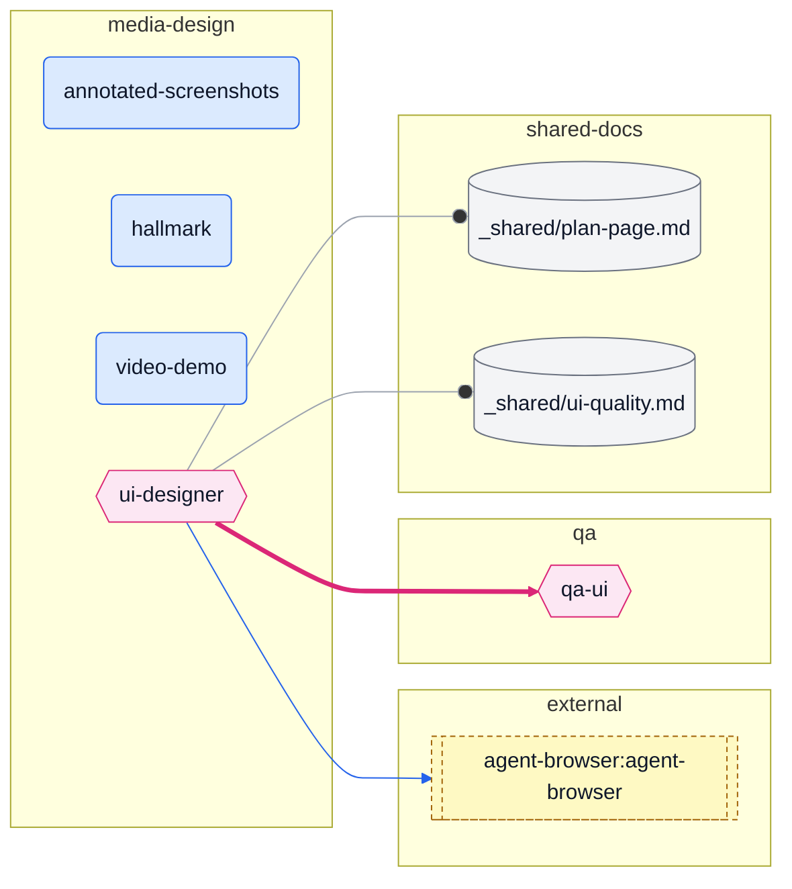
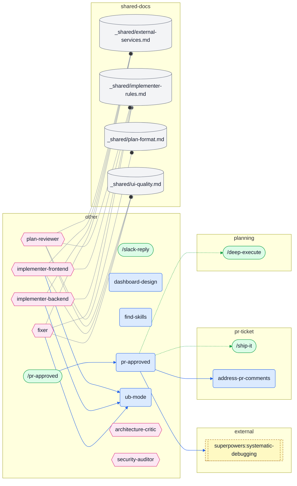
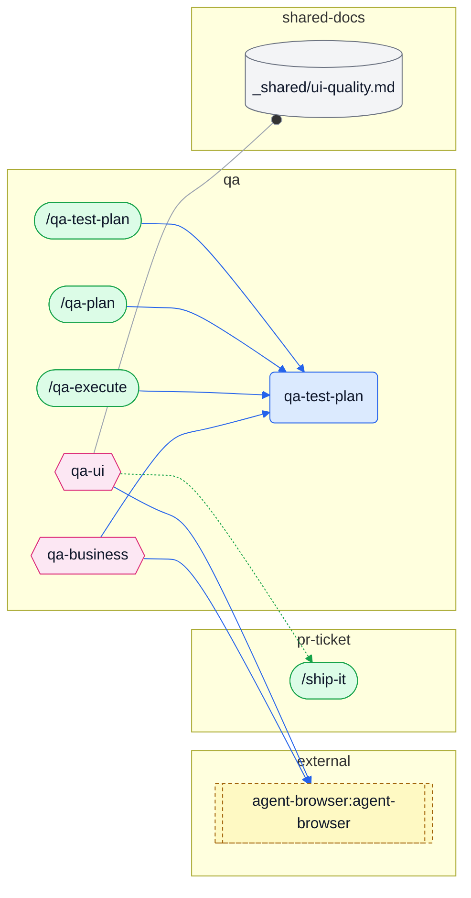
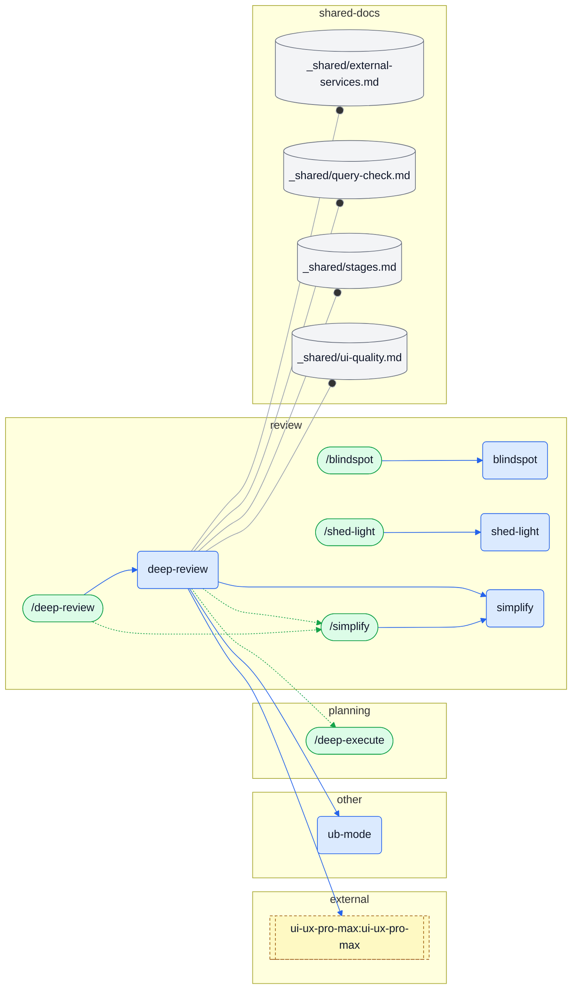
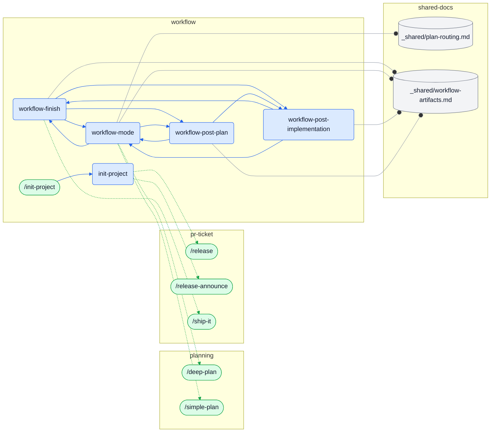

# Skills map

<!-- Generated by docs/skills-map.mjs. Do not edit by hand. Edit docs/skills-map.notes.md for the duplicates section. -->

This page maps the Claude Code skills, commands and agents in this repository, and the flows between them.
A generator reads the source files and draws the graph. The "Possible duplicates" section is hand-written.

## How to regenerate

Run `just skills-map`, or `node docs/skills-map.mjs` from the repository root.
The generator reads `dot_claude/skills/**/*.md`, `dot_claude/commands/*.md`, `dot_claude/agents/*.md` and `dot_agents/skills/**/*.md`.
It writes `docs/skills-map.md` and `docs/skills-map.html`. A second run gives no diff.
Run `node --test docs/skills-map.test.mjs` to test the edge extraction.

Counts: 28 skills, 17 commands, 9 agents, 15 shared docs, 17 external references. 238 edges: 90 invokes skill, 11 spawns agent, 55 runs command, 82 reads shared doc.

## Diagram 1: the main chains

Blue is the build chain of `deep-plan` and `simple-plan` (`_shared/after-approval.md`).
Green is the workflow stage chain for a repository with `.workflow/config.json`.
Orange is the Jira path: `jira-workflow` claims the ticket, then hands off to the blue chain. Dashed white boxes are steps, not files.

```mermaid
flowchart LR
  subgraph ph_intake["Intake"]
    direction TB
    jw("jira-workflow"):::skill
    jw_setup("ticket, branch"):::step
    ts("_shared/ticket-start.md"):::shared
    wm("workflow-mode"):::skill
  end
  subgraph ph_plan["Plan"]
    direction TB
    dp("/deep-plan"):::command
    sp("/simple-plan"):::command
    qap("/qa-plan"):::command
    rw("_shared/repo-workflow.md"):::shared
    prv("plan-reviewer agents"):::agent
    pa("Plannotator approval"):::step
    wpp("workflow-post-plan"):::skill
  end
  subgraph ph_build["Build"]
    direction TB
    aa("_shared/after-approval.md"):::shared
    rt("_shared/plan-routing.md"):::shared
    de("/deep-execute (option A)"):::command
    impl("implement (option B)"):::skill
    fast("fast mode: implement and test"):::step
  end
  subgraph ph_review["Review"]
    direction TB
    dr("/deep-review"):::command
    simp("simplify"):::skill
    wpi("workflow-post-implementation"):::skill
  end
  subgraph ph_qa["QA"]
    direction TB
    qaui("qa-ui agent"):::agent
    qabiz("qa-business agent"):::agent
    qtp("/qa-test-plan"):::command
    fix("separate fixer agent"):::step
  end
  subgraph ph_pr["PR"]
    direction TB
    wf("workflow-finish"):::skill
    pr("/ship-it (pr-description)"):::command
    bs("blindspot"):::skill
    rep("HTML run report"):::step
  end
  subgraph ph_watch["Watch"]
    direction TB
    watch("PR watch: Monitor, then loop"):::step
    apc("address-pr-comments"):::skill
    fuj("follow-up-jira"):::skill
    pra("/pr-approved (on your call)"):::command
  end
  dp -->|"Phase 2.4"| qap
  dp -->|"Phase 0"| rw
  sp -->|"Phase 0"| rw
  sp -->|"Phase 3"| prv
  qap --> pa
  prv --> pa
  dp -->|"Phase 0.4"| rt
  sp -->|"Phase 0.5"| rt
  pa -->|"approved"| aa
  aa -->|"executor"| rt
  rt -->|"A"| de
  rt -->|"B"| impl
  de --> dr
  impl --> dr
  dr -->|"Phase 5"| simp
  dr --> qaui
  dr --> qabiz
  qabiz -->|"qa-plan.yaml"| qtp
  qaui --> fix
  qabiz --> fix
  fix --> pr
  pr -->|"Phase 2.7"| bs
  pr --> rep
  pr -->|"Phase 5"| watch
  watch -->|"one push per round"| apc
  watch -->|"you approve"| pra
  wm -->|"criteria"| rt
  wm -->|"standard"| dp
  wm -->|"standard"| sp
  pa --> wpp
  wpp --> aa
  dr -->|"step 7.0"| wpi
  wpi --> wf
  wf --> pr
  wm -->|"fast"| fast
  fast --> wf
  jw --> jw_setup
  jw_setup --> ts
  ts -->|"--ticket"| dp
  sp -->|"Jira key"| ts
  watch -->|"after deploy"| fuj
  fuj -->|"new PR"| pr
  linkStyle 0 stroke:#2563eb,stroke-width:2px
  linkStyle 1 stroke:#2563eb,stroke-width:2px
  linkStyle 2 stroke:#2563eb,stroke-width:2px
  linkStyle 3 stroke:#2563eb,stroke-width:2px
  linkStyle 4 stroke:#2563eb,stroke-width:2px
  linkStyle 5 stroke:#2563eb,stroke-width:2px
  linkStyle 6 stroke:#2563eb,stroke-width:2px
  linkStyle 7 stroke:#2563eb,stroke-width:2px
  linkStyle 8 stroke:#2563eb,stroke-width:2px
  linkStyle 9 stroke:#2563eb,stroke-width:2px
  linkStyle 10 stroke:#2563eb,stroke-width:2px
  linkStyle 11 stroke:#2563eb,stroke-width:2px
  linkStyle 12 stroke:#2563eb,stroke-width:2px
  linkStyle 13 stroke:#2563eb,stroke-width:2px
  linkStyle 14 stroke:#2563eb,stroke-width:2px
  linkStyle 15 stroke:#2563eb,stroke-width:2px
  linkStyle 16 stroke:#2563eb,stroke-width:2px
  linkStyle 17 stroke:#2563eb,stroke-width:2px
  linkStyle 18 stroke:#2563eb,stroke-width:2px
  linkStyle 19 stroke:#2563eb,stroke-width:2px
  linkStyle 20 stroke:#2563eb,stroke-width:2px
  linkStyle 21 stroke:#2563eb,stroke-width:2px
  linkStyle 22 stroke:#2563eb,stroke-width:2px
  linkStyle 23 stroke:#2563eb,stroke-width:2px
  linkStyle 24 stroke:#2563eb,stroke-width:2px
  linkStyle 25 stroke:#2563eb,stroke-width:2px
  linkStyle 26 stroke:#16a34a,stroke-width:2px
  linkStyle 27 stroke:#16a34a,stroke-width:2px
  linkStyle 28 stroke:#16a34a,stroke-width:2px
  linkStyle 29 stroke:#16a34a,stroke-width:2px
  linkStyle 30 stroke:#16a34a,stroke-width:2px
  linkStyle 31 stroke:#16a34a,stroke-width:2px
  linkStyle 32 stroke:#16a34a,stroke-width:2px
  linkStyle 33 stroke:#16a34a,stroke-width:2px
  linkStyle 34 stroke:#16a34a,stroke-width:2px
  linkStyle 35 stroke:#16a34a,stroke-width:2px
  linkStyle 36 stroke:#ea580c,stroke-width:2px
  linkStyle 37 stroke:#ea580c,stroke-width:2px
  linkStyle 38 stroke:#ea580c,stroke-width:2px
  linkStyle 39 stroke:#ea580c,stroke-width:2px
  linkStyle 40 stroke:#ea580c,stroke-width:2px
  linkStyle 41 stroke:#ea580c,stroke-width:2px
  classDef skill fill:#dbeafe,stroke:#2563eb,color:#0f172a
  classDef command fill:#dcfce7,stroke:#16a34a,color:#0f172a
  classDef agent fill:#fce7f3,stroke:#db2777,color:#0f172a
  classDef shared fill:#f3f4f6,stroke:#6b7280,color:#0f172a
  classDef external fill:#fef9c3,stroke:#a16207,color:#0f172a,stroke-dasharray:4 3
  classDef step fill:#ffffff,stroke:#6b7280,color:#0f172a,stroke-dasharray:2 2
```

## Diagram 2: the full graph

Shapes: a rounded box is a skill, a stadium is a command, a hexagon is an agent, a cylinder is a shared doc, and a double-edged box is a reference to a skill that is not in this repository.
Edges: blue solid arrows invoke a skill, thick pink arrows spawn an agent, green dotted arrows mention or run a command (`/name`), and grey lines with a circle read a shared doc.

The graph is too large for one diagram. Each cluster diagram shows the nodes of the cluster and the edges that start there. A node from another cluster appears as the target of such an edge.

### Cluster: media-design

### Cluster: other

### Cluster: planning

```mermaid
flowchart LR
  subgraph cl_external["external"]
    direction TB
    x_frontend_design_frontend_design[["frontend-design:frontend-design"]]:::external
    x_mattpocock_skills_domain_modeling[["mattpocock-skills:domain-modeling"]]:::external
    x_mattpocock_skills_grilling[["mattpocock-skills:grilling"]]:::external
    x_superpowers_brainstorming[["superpowers:brainstorming"]]:::external
    x_superpowers_executing_plans[["superpowers:executing-plans"]]:::external
    x_superpowers_finishing_a_development_branch[["superpowers:finishing-a-development-branch"]]:::external
    x_superpowers_subagent_driven_development[["superpowers:subagent-driven-development"]]:::external
    x_superpowers_systematic_debugging[["superpowers:systematic-debugging"]]:::external
    x_superpowers_test_driven_development[["superpowers:test-driven-development"]]:::external
    x_superpowers_writing_plans[["superpowers:writing-plans"]]:::external
    x_tdd[["tdd"]]:::external
    x_ui_ux_pro_max_ui_ux_pro_max[["ui-ux-pro-max:ui-ux-pro-max"]]:::external
  end
  subgraph cl_media_design["media-design"]
    direction TB
    a_ui_designer{{"ui-designer"}}:::agent
  end
  subgraph cl_other["other"]
    direction TB
    c_pr_approved(["/pr-approved"]):::command
    s_ub_mode("ub-mode"):::skill
    a_plan_reviewer{{"plan-reviewer"}}:::agent
  end
  subgraph cl_planning["planning"]
    direction TB
    c_deep_execute(["/deep-execute"]):::command
    c_deep_plan(["/deep-plan"]):::command
    c_simple_plan(["/simple-plan"]):::command
    s_deep_execute("deep-execute"):::skill
    s_deep_plan("deep-plan"):::skill
    s_explore_options("explore-options"):::skill
    s_implement("implement"):::skill
    s_simple_plan("simple-plan"):::skill
  end
  subgraph cl_pr_ticket["pr-ticket"]
    direction TB
    c_ship_it(["/ship-it"]):::command
  end
  subgraph cl_qa["qa"]
    direction TB
    c_qa_plan(["/qa-plan"]):::command
  end
  subgraph cl_review["review"]
    direction TB
    c_deep_review(["/deep-review"]):::command
    c_simplify(["/simplify"]):::command
    s_blindspot("blindspot"):::skill
    s_shed_light("shed-light"):::skill
    s_simplify("simplify"):::skill
  end
  subgraph cl_shared_docs["shared-docs"]
    direction TB
    d_after_approval[("_shared/after-approval.md")]:::shared
    d_external_services[("_shared/external-services.md")]:::shared
    d_implementer_rules[("_shared/implementer-rules.md")]:::shared
    d_inbox[("_shared/inbox.md")]:::shared
    d_orca_workers[("_shared/orca-workers.md")]:::shared
    d_plan_format[("_shared/plan-format.md")]:::shared
    d_plan_page[("_shared/plan-page.md")]:::shared
    d_plan_routing[("_shared/plan-routing.md")]:::shared
    d_query_check[("_shared/query-check.md")]:::shared
    d_repo_workflow[("_shared/repo-workflow.md")]:::shared
    d_spec_evidence[("_shared/spec-evidence.md")]:::shared
    d_stages[("_shared/stages.md")]:::shared
    d_ticket_start[("_shared/ticket-start.md")]:::shared
    d_ui_quality[("_shared/ui-quality.md")]:::shared
  end
  subgraph cl_workflow["workflow"]
    direction TB
    s_workflow_post_plan("workflow-post-plan"):::skill
  end
  c_deep_execute -.-> c_deep_plan
  c_deep_execute -.-> c_deep_review
  c_deep_execute --o d_after_approval
  c_deep_execute --> s_deep_execute
  c_deep_plan -.-> c_qa_plan
  c_deep_plan --o d_after_approval
  c_deep_plan --o d_plan_format
  c_deep_plan --o d_plan_routing
  c_deep_plan --> s_deep_plan
  c_deep_plan --> x_superpowers_brainstorming
  c_simple_plan ==> a_plan_reviewer
  c_simple_plan -.-> c_deep_plan
  c_simple_plan -.-> c_qa_plan
  c_simple_plan --o d_after_approval
  c_simple_plan --o d_plan_format
  c_simple_plan --o d_plan_routing
  c_simple_plan --> s_simple_plan
  c_simple_plan --> x_mattpocock_skills_grilling
  c_simple_plan --> x_superpowers_brainstorming
  c_simple_plan --> x_ui_ux_pro_max_ui_ux_pro_max
  s_deep_execute -.-> c_deep_review
  s_deep_execute -.-> c_pr_approved
  s_deep_execute -.-> c_ship_it
  s_deep_execute -.-> c_simplify
  s_deep_execute --o d_after_approval
  s_deep_execute --o d_implementer_rules
  s_deep_execute --o d_inbox
  s_deep_execute --o d_orca_workers
  s_deep_execute --o d_plan_routing
  s_deep_execute --o d_spec_evidence
  s_deep_execute --> s_simplify
  s_deep_execute --> s_ub_mode
  s_deep_plan ==> a_ui_designer
  s_deep_plan -.-> c_deep_execute
  s_deep_plan -.-> c_deep_review
  s_deep_plan -.-> c_qa_plan
  s_deep_plan -.-> c_ship_it
  s_deep_plan -.-> c_simple_plan
  s_deep_plan --o d_after_approval
  s_deep_plan --o d_external_services
  s_deep_plan --o d_inbox
  s_deep_plan --o d_orca_workers
  s_deep_plan --o d_plan_format
  s_deep_plan --o d_plan_page
  s_deep_plan --o d_plan_routing
  s_deep_plan --o d_query_check
  s_deep_plan --o d_repo_workflow
  s_deep_plan --o d_spec_evidence
  s_deep_plan --o d_stages
  s_deep_plan --o d_ticket_start
  s_deep_plan --o d_ui_quality
  s_deep_plan --> s_implement
  s_deep_plan --> s_ub_mode
  s_deep_plan --> s_workflow_post_plan
  s_deep_plan --> x_mattpocock_skills_domain_modeling
  s_deep_plan --> x_mattpocock_skills_grilling
  s_deep_plan --> x_superpowers_brainstorming
  s_deep_plan --> x_superpowers_finishing_a_development_branch
  s_deep_plan --> x_superpowers_test_driven_development
  s_deep_plan --> x_superpowers_writing_plans
  s_explore_options --> x_superpowers_brainstorming
  s_implement -.-> c_deep_review
  s_implement -.-> c_ship_it
  s_implement --o d_after_approval
  s_implement --o d_orca_workers
  s_implement --> s_ub_mode
  s_implement --> x_superpowers_executing_plans
  s_implement --> x_superpowers_finishing_a_development_branch
  s_implement --> x_superpowers_subagent_driven_development
  s_implement --> x_superpowers_systematic_debugging
  s_implement --> x_superpowers_test_driven_development
  s_implement --> x_tdd
  s_simple_plan ==> a_plan_reviewer
  s_simple_plan ==> a_ui_designer
  s_simple_plan -.-> c_deep_plan
  s_simple_plan -.-> c_qa_plan
  s_simple_plan -.-> c_ship_it
  s_simple_plan --o d_after_approval
  s_simple_plan --o d_external_services
  s_simple_plan --o d_orca_workers
  s_simple_plan --o d_plan_format
  s_simple_plan --o d_plan_page
  s_simple_plan --o d_plan_routing
  s_simple_plan --o d_query_check
  s_simple_plan --o d_repo_workflow
  s_simple_plan --o d_spec_evidence
  s_simple_plan --o d_stages
  s_simple_plan --o d_ticket_start
  s_simple_plan --o d_ui_quality
  s_simple_plan --> s_blindspot
  s_simple_plan --> s_implement
  s_simple_plan --> s_shed_light
  s_simple_plan --> s_ub_mode
  s_simple_plan --> s_workflow_post_plan
  s_simple_plan --> x_frontend_design_frontend_design
  s_simple_plan --> x_mattpocock_skills_grilling
  s_simple_plan --> x_superpowers_brainstorming
  s_simple_plan --> x_superpowers_test_driven_development
  s_simple_plan --> x_superpowers_writing_plans
  s_simple_plan --> x_ui_ux_pro_max_ui_ux_pro_max
  linkStyle 0 stroke:#16a34a
  linkStyle 1 stroke:#16a34a
  linkStyle 2 stroke:#9ca3af
  linkStyle 3 stroke:#2563eb
  linkStyle 4 stroke:#16a34a
  linkStyle 5 stroke:#9ca3af
  linkStyle 6 stroke:#9ca3af
  linkStyle 7 stroke:#9ca3af
  linkStyle 8 stroke:#2563eb
  linkStyle 9 stroke:#2563eb
  linkStyle 10 stroke:#db2777
  linkStyle 11 stroke:#16a34a
  linkStyle 12 stroke:#16a34a
  linkStyle 13 stroke:#9ca3af
  linkStyle 14 stroke:#9ca3af
  linkStyle 15 stroke:#9ca3af
  linkStyle 16 stroke:#2563eb
  linkStyle 17 stroke:#2563eb
  linkStyle 18 stroke:#2563eb
  linkStyle 19 stroke:#2563eb
  linkStyle 20 stroke:#16a34a
  linkStyle 21 stroke:#16a34a
  linkStyle 22 stroke:#16a34a
  linkStyle 23 stroke:#16a34a
  linkStyle 24 stroke:#9ca3af
  linkStyle 25 stroke:#9ca3af
  linkStyle 26 stroke:#9ca3af
  linkStyle 27 stroke:#9ca3af
  linkStyle 28 stroke:#9ca3af
  linkStyle 29 stroke:#9ca3af
  linkStyle 30 stroke:#2563eb
  linkStyle 31 stroke:#2563eb
  linkStyle 32 stroke:#db2777
  linkStyle 33 stroke:#16a34a
  linkStyle 34 stroke:#16a34a
  linkStyle 35 stroke:#16a34a
  linkStyle 36 stroke:#16a34a
  linkStyle 37 stroke:#16a34a
  linkStyle 38 stroke:#9ca3af
  linkStyle 39 stroke:#9ca3af
  linkStyle 40 stroke:#9ca3af
  linkStyle 41 stroke:#9ca3af
  linkStyle 42 stroke:#9ca3af
  linkStyle 43 stroke:#9ca3af
  linkStyle 44 stroke:#9ca3af
  linkStyle 45 stroke:#9ca3af
  linkStyle 46 stroke:#9ca3af
  linkStyle 47 stroke:#9ca3af
  linkStyle 48 stroke:#9ca3af
  linkStyle 49 stroke:#9ca3af
  linkStyle 50 stroke:#9ca3af
  linkStyle 51 stroke:#2563eb
  linkStyle 52 stroke:#2563eb
  linkStyle 53 stroke:#2563eb
  linkStyle 54 stroke:#2563eb
  linkStyle 55 stroke:#2563eb
  linkStyle 56 stroke:#2563eb
  linkStyle 57 stroke:#2563eb
  linkStyle 58 stroke:#2563eb
  linkStyle 59 stroke:#2563eb
  linkStyle 60 stroke:#2563eb
  linkStyle 61 stroke:#16a34a
  linkStyle 62 stroke:#16a34a
  linkStyle 63 stroke:#9ca3af
  linkStyle 64 stroke:#9ca3af
  linkStyle 65 stroke:#2563eb
  linkStyle 66 stroke:#2563eb
  linkStyle 67 stroke:#2563eb
  linkStyle 68 stroke:#2563eb
  linkStyle 69 stroke:#2563eb
  linkStyle 70 stroke:#2563eb
  linkStyle 71 stroke:#2563eb
  linkStyle 72 stroke:#db2777
  linkStyle 73 stroke:#db2777
  linkStyle 74 stroke:#16a34a
  linkStyle 75 stroke:#16a34a
  linkStyle 76 stroke:#16a34a
  linkStyle 77 stroke:#9ca3af
  linkStyle 78 stroke:#9ca3af
  linkStyle 79 stroke:#9ca3af
  linkStyle 80 stroke:#9ca3af
  linkStyle 81 stroke:#9ca3af
  linkStyle 82 stroke:#9ca3af
  linkStyle 83 stroke:#9ca3af
  linkStyle 84 stroke:#9ca3af
  linkStyle 85 stroke:#9ca3af
  linkStyle 86 stroke:#9ca3af
  linkStyle 87 stroke:#9ca3af
  linkStyle 88 stroke:#9ca3af
  linkStyle 89 stroke:#2563eb
  linkStyle 90 stroke:#2563eb
  linkStyle 91 stroke:#2563eb
  linkStyle 92 stroke:#2563eb
  linkStyle 93 stroke:#2563eb
  linkStyle 94 stroke:#2563eb
  linkStyle 95 stroke:#2563eb
  linkStyle 96 stroke:#2563eb
  linkStyle 97 stroke:#2563eb
  linkStyle 98 stroke:#2563eb
  linkStyle 99 stroke:#2563eb
  classDef skill fill:#dbeafe,stroke:#2563eb,color:#0f172a
  classDef command fill:#dcfce7,stroke:#16a34a,color:#0f172a
  classDef agent fill:#fce7f3,stroke:#db2777,color:#0f172a
  classDef shared fill:#f3f4f6,stroke:#6b7280,color:#0f172a
  classDef external fill:#fef9c3,stroke:#a16207,color:#0f172a,stroke-dasharray:4 3
  classDef step fill:#ffffff,stroke:#6b7280,color:#0f172a,stroke-dasharray:2 2
```

### Cluster: pr-ticket

```mermaid
flowchart LR
  subgraph cl_external["external"]
    direction TB
    x_loop[["loop"]]:::external
    x_release_watch[["release-watch"]]:::external
    x_superpowers_systematic_debugging[["superpowers:systematic-debugging"]]:::external
    x_superpowers_verification_before_completion[["superpowers:verification-before-completion"]]:::external
  end
  subgraph cl_media_design["media-design"]
    direction TB
    s_video_demo("video-demo"):::skill
  end
  subgraph cl_other["other"]
    direction TB
    c_pr_approved(["/pr-approved"]):::command
  end
  subgraph cl_planning["planning"]
    direction TB
    c_deep_plan(["/deep-plan"]):::command
    c_simple_plan(["/simple-plan"]):::command
  end
  subgraph cl_pr_ticket["pr-ticket"]
    direction TB
    c_release(["/release"]):::command
    c_release_announce(["/release-announce"]):::command
    c_ship_it(["/ship-it"]):::command
    s_address_pr_comments("address-pr-comments"):::skill
    s_follow_up_jira("follow-up-jira"):::skill
    s_jira_workflow("jira-workflow"):::skill
    s_pr_description("pr-description"):::skill
    s_release("release"):::skill
    s_release_announce("release-announce"):::skill
  end
  subgraph cl_qa["qa"]
    direction TB
    c_qa_execute(["/qa-execute"]):::command
    a_qa_business{{"qa-business"}}:::agent
  end
  subgraph cl_review["review"]
    direction TB
    c_deep_review(["/deep-review"]):::command
    s_blindspot("blindspot"):::skill
  end
  subgraph cl_shared_docs["shared-docs"]
    direction TB
    d_after_approval[("_shared/after-approval.md")]:::shared
    d_inbox[("_shared/inbox.md")]:::shared
    d_plan_routing[("_shared/plan-routing.md")]:::shared
    d_repo_workflow[("_shared/repo-workflow.md")]:::shared
    d_spec_evidence[("_shared/spec-evidence.md")]:::shared
    d_ticket_start[("_shared/ticket-start.md")]:::shared
  end
  c_release --> s_release
  c_release_announce --> s_release_announce
  c_ship_it --> s_pr_description
  s_follow_up_jira --> s_pr_description
  s_jira_workflow -.-> c_deep_plan
  s_jira_workflow -.-> c_deep_review
  s_jira_workflow -.-> c_ship_it
  s_jira_workflow -.-> c_simple_plan
  s_jira_workflow --o d_after_approval
  s_jira_workflow --o d_plan_routing
  s_jira_workflow --o d_ticket_start
  s_jira_workflow --> x_superpowers_systematic_debugging
  s_jira_workflow --> x_superpowers_verification_before_completion
  s_pr_description ==> a_qa_business
  s_pr_description -.-> c_deep_review
  s_pr_description -.-> c_pr_approved
  s_pr_description -.-> c_qa_execute
  s_pr_description --o d_after_approval
  s_pr_description --o d_inbox
  s_pr_description --o d_repo_workflow
  s_pr_description --o d_spec_evidence
  s_pr_description --> s_address_pr_comments
  s_pr_description --> s_blindspot
  s_pr_description --> s_video_demo
  s_pr_description --> x_loop
  s_pr_description --> x_superpowers_systematic_debugging
  s_release --> s_release_announce
  s_release --> x_release_watch
  s_release_announce --o d_inbox
  linkStyle 0 stroke:#2563eb
  linkStyle 1 stroke:#2563eb
  linkStyle 2 stroke:#2563eb
  linkStyle 3 stroke:#2563eb
  linkStyle 4 stroke:#16a34a
  linkStyle 5 stroke:#16a34a
  linkStyle 6 stroke:#16a34a
  linkStyle 7 stroke:#16a34a
  linkStyle 8 stroke:#9ca3af
  linkStyle 9 stroke:#9ca3af
  linkStyle 10 stroke:#9ca3af
  linkStyle 11 stroke:#2563eb
  linkStyle 12 stroke:#2563eb
  linkStyle 13 stroke:#db2777
  linkStyle 14 stroke:#16a34a
  linkStyle 15 stroke:#16a34a
  linkStyle 16 stroke:#16a34a
  linkStyle 17 stroke:#9ca3af
  linkStyle 18 stroke:#9ca3af
  linkStyle 19 stroke:#9ca3af
  linkStyle 20 stroke:#9ca3af
  linkStyle 21 stroke:#2563eb
  linkStyle 22 stroke:#2563eb
  linkStyle 23 stroke:#2563eb
  linkStyle 24 stroke:#2563eb
  linkStyle 25 stroke:#2563eb
  linkStyle 26 stroke:#2563eb
  linkStyle 27 stroke:#2563eb
  linkStyle 28 stroke:#9ca3af
  classDef skill fill:#dbeafe,stroke:#2563eb,color:#0f172a
  classDef command fill:#dcfce7,stroke:#16a34a,color:#0f172a
  classDef agent fill:#fce7f3,stroke:#db2777,color:#0f172a
  classDef shared fill:#f3f4f6,stroke:#6b7280,color:#0f172a
  classDef external fill:#fef9c3,stroke:#a16207,color:#0f172a,stroke-dasharray:4 3
  classDef step fill:#ffffff,stroke:#6b7280,color:#0f172a,stroke-dasharray:2 2
```

### Cluster: qa

### Cluster: review

### Cluster: shared-docs

```mermaid
flowchart LR
  subgraph cl_external["external"]
    direction TB
    x_agent_browser_agent_browser[["agent-browser:agent-browser"]]:::external
    x_superpowers_finishing_a_development_branch[["superpowers:finishing-a-development-branch"]]:::external
    x_superpowers_writing_plans[["superpowers:writing-plans"]]:::external
    x_workflow_authoring[["workflow-authoring"]]:::external
  end
  subgraph cl_media_design["media-design"]
    direction TB
    s_video_demo("video-demo"):::skill
  end
  subgraph cl_other["other"]
    direction TB
    a_fixer{{"fixer"}}:::agent
  end
  subgraph cl_planning["planning"]
    direction TB
    c_deep_execute(["/deep-execute"]):::command
    c_deep_plan(["/deep-plan"]):::command
    c_simple_plan(["/simple-plan"]):::command
    s_implement("implement"):::skill
  end
  subgraph cl_pr_ticket["pr-ticket"]
    direction TB
    c_ship_it(["/ship-it"]):::command
    s_pr_description("pr-description"):::skill
  end
  subgraph cl_qa["qa"]
    direction TB
    a_qa_business{{"qa-business"}}:::agent
    a_qa_ui{{"qa-ui"}}:::agent
  end
  subgraph cl_review["review"]
    direction TB
    c_deep_review(["/deep-review"]):::command
    c_simplify(["/simplify"]):::command
  end
  subgraph cl_shared_docs["shared-docs"]
    direction TB
    d_after_approval[("_shared/after-approval.md")]:::shared
    d_external_services[("_shared/external-services.md")]:::shared
    d_implementer_rules[("_shared/implementer-rules.md")]:::shared
    d_inbox[("_shared/inbox.md")]:::shared
    d_orca_workers[("_shared/orca-workers.md")]:::shared
    d_plan_format[("_shared/plan-format.md")]:::shared
    d_plan_page[("_shared/plan-page.md")]:::shared
    d_plan_routing[("_shared/plan-routing.md")]:::shared
    d_query_check[("_shared/query-check.md")]:::shared
    d_repo_workflow[("_shared/repo-workflow.md")]:::shared
    d_spec_evidence[("_shared/spec-evidence.md")]:::shared
    d_stages[("_shared/stages.md")]:::shared
    d_ticket_start[("_shared/ticket-start.md")]:::shared
    d_ui_quality[("_shared/ui-quality.md")]:::shared
    d_workflow_artifacts[("_shared/workflow-artifacts.md")]:::shared
  end
  subgraph cl_workflow["workflow"]
    direction TB
    s_workflow_post_implementation("workflow-post-implementation"):::skill
  end
  d_after_approval ==> a_fixer
  d_after_approval ==> a_qa_business
  d_after_approval ==> a_qa_ui
  d_after_approval -.-> c_deep_execute
  d_after_approval -.-> c_deep_review
  d_after_approval -.-> c_ship_it
  d_after_approval --o d_inbox
  d_after_approval --o d_orca_workers
  d_after_approval --o d_plan_routing
  d_after_approval --o d_repo_workflow
  d_after_approval -.-> s_implement
  d_after_approval --> s_implement
  d_after_approval --> s_video_demo
  d_after_approval --> s_workflow_post_implementation
  d_implementer_rules ==> a_qa_ui
  d_implementer_rules -.-> c_deep_execute
  d_implementer_rules -.-> c_deep_review
  d_implementer_rules -.-> c_ship_it
  d_implementer_rules --o d_external_services
  d_implementer_rules --o d_ui_quality
  d_implementer_rules --> s_pr_description
  d_inbox -.-> c_ship_it
  d_orca_workers -.-> c_deep_execute
  d_plan_format --o d_after_approval
  d_plan_format --o d_plan_routing
  d_plan_format --o d_ui_quality
  d_plan_format --> s_implement
  d_plan_format --> x_superpowers_finishing_a_development_branch
  d_plan_format --> x_superpowers_writing_plans
  d_plan_routing -.-> c_deep_execute
  d_plan_routing -.-> c_deep_plan
  d_plan_routing -.-> c_deep_review
  d_plan_routing -.-> c_simple_plan
  d_plan_routing --> s_implement
  d_plan_routing --> x_workflow_authoring
  d_repo_workflow -.-> c_deep_review
  d_repo_workflow -.-> c_ship_it
  d_repo_workflow -.-> c_simplify
  d_stages -.-> c_deep_review
  d_stages --o d_ui_quality
  d_ui_quality ==> a_qa_ui
  d_ui_quality -.-> c_ship_it
  d_ui_quality --> x_agent_browser_agent_browser
  linkStyle 0 stroke:#db2777
  linkStyle 1 stroke:#db2777
  linkStyle 2 stroke:#db2777
  linkStyle 3 stroke:#16a34a
  linkStyle 4 stroke:#16a34a
  linkStyle 5 stroke:#16a34a
  linkStyle 6 stroke:#9ca3af
  linkStyle 7 stroke:#9ca3af
  linkStyle 8 stroke:#9ca3af
  linkStyle 9 stroke:#9ca3af
  linkStyle 10 stroke:#16a34a
  linkStyle 11 stroke:#2563eb
  linkStyle 12 stroke:#2563eb
  linkStyle 13 stroke:#2563eb
  linkStyle 14 stroke:#db2777
  linkStyle 15 stroke:#16a34a
  linkStyle 16 stroke:#16a34a
  linkStyle 17 stroke:#16a34a
  linkStyle 18 stroke:#9ca3af
  linkStyle 19 stroke:#9ca3af
  linkStyle 20 stroke:#2563eb
  linkStyle 21 stroke:#16a34a
  linkStyle 22 stroke:#16a34a
  linkStyle 23 stroke:#9ca3af
  linkStyle 24 stroke:#9ca3af
  linkStyle 25 stroke:#9ca3af
  linkStyle 26 stroke:#2563eb
  linkStyle 27 stroke:#2563eb
  linkStyle 28 stroke:#2563eb
  linkStyle 29 stroke:#16a34a
  linkStyle 30 stroke:#16a34a
  linkStyle 31 stroke:#16a34a
  linkStyle 32 stroke:#16a34a
  linkStyle 33 stroke:#2563eb
  linkStyle 34 stroke:#2563eb
  linkStyle 35 stroke:#16a34a
  linkStyle 36 stroke:#16a34a
  linkStyle 37 stroke:#16a34a
  linkStyle 38 stroke:#16a34a
  linkStyle 39 stroke:#9ca3af
  linkStyle 40 stroke:#db2777
  linkStyle 41 stroke:#16a34a
  linkStyle 42 stroke:#2563eb
  classDef skill fill:#dbeafe,stroke:#2563eb,color:#0f172a
  classDef command fill:#dcfce7,stroke:#16a34a,color:#0f172a
  classDef agent fill:#fce7f3,stroke:#db2777,color:#0f172a
  classDef shared fill:#f3f4f6,stroke:#6b7280,color:#0f172a
  classDef external fill:#fef9c3,stroke:#a16207,color:#0f172a,stroke-dasharray:4 3
  classDef step fill:#ffffff,stroke:#6b7280,color:#0f172a,stroke-dasharray:2 2
```

### Cluster: study

### Cluster: workflow

## Possible duplicates

<!-- Hand-written. docs/skills-map.mjs copies this file into docs/skills-map.md. -->

The table lists flows that two or more files defined at the first review. Each row gives the status and the change, or the reason to keep the overlap. Three shared docs now hold the single copy of a flow: `_shared/after-approval.md` (the build chain), `_shared/plan-routing.md` (which pipeline plans and which executor builds) and `_shared/ticket-start.md` (claim a Jira issue and move it to in progress). The `implement` skill is the single-session executor (option B).

| # | Overlap | Status | Change or reason |
|---|---|---|---|
| 1 | The build chain after plan approval had five descriptions. | Resolved | `after-approval.md` is the only full copy. `commands/deep-plan.md`, `commands/simple-plan.md`, `skills/simple-plan/SKILL.md` Phase 5 and `skills/deep-plan/SKILL.md` Phase 3.5 point to it in one line. |
| 2 | Three files said that `deep-plan` stops at the approved plan. | Resolved | `commands/deep-plan.md`, `skills/deep-plan/README.md` and `skills/jira-workflow/SKILL.md` now say that it builds through to the PR unless the user said to stop. The README handoff with `/simplify` x2 and `/qa-test-plan` is replaced by a pointer. |
| 3 | `jira-workflow` had its own serial build, review and QA path. | Resolved | `jira-workflow` section 3 now delegates to the chain and keeps only the Jira steps: debugging for a bug ticket, verification before `/ship-it`, the commit body, the `/ship-it` arguments, the ticket comment and the notifications. |
| 4 | `simplify` could run three times on one change. | Resolved | The `/simplify` x2 step left `jira-workflow`. The deep-review Phase 5 pass is the only one. |
| 5 | QA execution had four routes. | Resolved | One route: the chain starts the `qa-ui` and `qa-business` agents. `qa-business` runs `qa-test-plan --phase execute` when a `qa-plan.yaml` exists, else `agent-browser`. Its optional `qa-testing` route and the `qa-testing` step of `jira-workflow` are gone. `commands/deep-execute.md` now matches the skill. |
| 6 | QA had three skills and three commands for one workflow. | Resolved | The `qa-plan` and `qa-execute` skills are deleted. Their trigger phrases and the `--plan PATH` rule moved into the `qa-test-plan` description and arguments. The three commands stay. |
| 7 | Every command repeats its skill. | Kept, reduced | The commands reach Codex, so they stay. The restated chain and QA text left `deep-plan`, `simple-plan` and `deep-execute` commands, which caused rows 2 and 5. The phase overviews and argument grammars stay as user documentation. |
| 8 | Three skills chose the pipeline or the mode with their own criteria. | Resolved | The criteria and the question rules are in `plan-routing.md`. `deep-plan` Phase 0.4, `simple-plan` Phase 0.5 and `workflow-mode` section 2 point to it and keep their own question. |
| 9 | Two places replied to PR review threads. | Resolved | The pr-description watch step 3 is deleted. `address-pr-comments` replies and resolves. |
| 10 | Two skills opened a pull request. | Resolved | `follow-up-jira` opens a new PR with `Skill(skill="pr-description")`. |
| 11 | Two watch loops. | Kept | They watch different sources: PR review and CI, and the reporter's ticket comment after deploy. |
| 12 | Two copies of the Jira status transition. | Resolved, one kept | The start transition of `jira-workflow` moved to `ticket-start.md`, which `deep-plan` and `simple-plan` also read. `follow-up-jira` keeps its own transitions, because they move the issue to done or back to investigation, not to in progress. |
| 13 | Two run reports. | Kept | `build-run-report.sh` reads the lane records of a `deep-execute` run (`manifest.json`, `events.jsonl`, `decision.sh` output). Options B, C and D do not write them. `after-approval.md` section 8 states this reason. |
| 14 | Four checks for over-engineering. | Kept | They run at different stages: plan upkeep (`shed-light`), plan review (`ponytail-review`), diff review and cleanup (`simplify`). In the diff review, `simplicity` flags local constructs and `code-judo` looks for a different shape of the whole change. |
| 15 | The demo video ran only in one pipeline. | Resolved | The `video-demo` step moved into `after-approval.md` section 7, so every pipeline runs it. |
| 16 | Two screenshot annotators. | Kept | The descriptions split the use: QA evidence and stakeholder images. |
| 17 | The name `plan` had two meanings. | Resolved | The journal skills `log`, `plan` and `retro` are deleted, with the journal system. |
| 18 | `deep-execute` had its own delivery tail (review, QA, PR, report) beside `after-approval.md`, and its per-round `/deep-review` ran its own fixer. | Resolved | `deep-execute` Phase 4 runs `after-approval.md` steps 2 to 9. Every `/deep-review` inside it runs `--no-fix --no-simplify`, and the owning lane applies each fix. The PR opens with `--no-watch`; the watch is step 9, after the report. |

## Orphans

Nodes with no inbound edge and no user trigger (no command, and no "use when" in the description):

- `dot_claude/agents/architecture-critic.md` (agent)

Skills that no other file references. Only the user or the description trigger starts them:

- `annotated-screenshots` (`dot_claude/skills/annotated-screenshots/SKILL.md`)
- `dashboard-design` (`dot_claude/skills/dashboard-design/SKILL.md`)
- `explore-options` (`dot_claude/skills/explore-options/SKILL.md`)
- `find-skills` (`dot_claude/skills/find-skills/SKILL.md`)
- `follow-up-jira` (`dot_claude/skills/follow-up-jira/SKILL.md`)
- `hallmark` (`dot_agents/skills/hallmark/SKILL.md`)
- `jira-workflow` (`dot_claude/skills/jira-workflow/SKILL.md`)

References to skills, agents or shared docs that this repository does not define. A name with a colon comes from a plugin. A name without a colon is a local skill, a plugin skill or a built-in, or the reference is broken:

- `agent-browser:agent-browser`: `dot_claude/agents/qa-business.md:85`, `dot_claude/agents/qa-ui.md:57`, `dot_claude/agents/qa-ui.md:70`, `dot_claude/agents/ui-designer.md:54`, `dot_claude/agents/ui-designer.md:95`, `dot_claude/skills/_shared/ui-quality.md:147`
- `frontend-design:frontend-design`: `dot_claude/skills/simple-plan/references/ui-consultation.md:34`
- `loop`: `dot_claude/skills/pr-description/references/watch.md:31`
- `mattpocock-skills:domain-modeling`: `dot_claude/skills/deep-plan/README.md:92`, `dot_claude/skills/deep-plan/SKILL.md:102`, `dot_claude/skills/deep-plan/references/phase-0-details.md:40`
- `mattpocock-skills:grilling`: `dot_claude/skills/deep-plan/README.md:92`, `dot_claude/skills/deep-plan/SKILL.md:101`, `dot_claude/skills/deep-plan/references/phase-0-details.md:39`, `dot_claude/skills/simple-plan/SKILL.md:91`, `dot_claude/commands/simple-plan.md:29`
- `release-watch`: `dot_claude/skills/release/SKILL.md:179`, `dot_claude/skills/release/references/release-review.md:110`
- `superpowers:brainstorming`: `dot_claude/skills/deep-plan/SKILL.md:113`, `dot_claude/skills/explore-options/SKILL.md:135`, `dot_claude/skills/simple-plan/SKILL.md:107`, `dot_claude/commands/deep-plan.md:15`, `dot_claude/commands/simple-plan.md:31`
- `superpowers:executing-plans`: `dot_claude/skills/implement/SKILL.md:41`
- `superpowers:finishing-a-development-branch`: `dot_claude/skills/deep-plan/templates/plan.md:3`, `dot_claude/skills/implement/SKILL.md:41`, `dot_claude/skills/_shared/plan-format.md:51`
- `superpowers:subagent-driven-development`: `dot_claude/skills/implement/SKILL.md:40`
- `superpowers:systematic-debugging`: `dot_claude/skills/implement/SKILL.md:50`, `dot_claude/skills/jira-workflow/SKILL.md:177`, `dot_claude/skills/pr-approved/SKILL.md:42`, `dot_claude/skills/pr-description/references/watch.md:18`
- `superpowers:test-driven-development`: `dot_claude/skills/deep-plan/SKILL.md:248`, `dot_claude/skills/implement/SKILL.md:48`, `dot_claude/skills/simple-plan/references/plan-sections.md:123`
- `superpowers:verification-before-completion`: `dot_claude/skills/jira-workflow/SKILL.md:178`
- `superpowers:writing-plans`: `dot_claude/skills/deep-plan/README.md:72`, `dot_claude/skills/deep-plan/SKILL.md:120`, `dot_claude/skills/deep-plan/references/planner-drafting.md:9`, `dot_claude/skills/simple-plan/SKILL.md:174`, `dot_claude/skills/_shared/plan-format.md:4`
- `tdd`: `dot_claude/skills/implement/SKILL.md:48`
- `ui-ux-pro-max:ui-ux-pro-max`: `dot_claude/skills/deep-review/personas/senior-frontend.md:90`, `dot_claude/skills/deep-review/personas/ui-ux.md:9`, `dot_claude/skills/simple-plan/references/ui-consultation.md:10`, `dot_claude/commands/simple-plan.md:36`
- `workflow-authoring`: `dot_claude/skills/_shared/plan-routing.md:115`

## Edge list

Every edge, with the first line that creates it

| from | edge | to | evidence |
|---|---|---|---|
| fixer | reads shared doc | external-services.md | `dot_claude/agents/fixer.md:52` |
| fixer | reads shared doc | implementer-rules.md | `dot_claude/agents/fixer.md:49` |
| fixer | reads shared doc | ui-quality.md | `dot_claude/agents/fixer.md:51` |
| fixer | invokes skill | ub-mode | `dot_claude/agents/fixer.md:53` |
| implementer-backend | reads shared doc | external-services.md | `dot_claude/agents/implementer-backend.md:48` |
| implementer-backend | reads shared doc | implementer-rules.md | `dot_claude/agents/implementer-backend.md:47` |
| implementer-backend | invokes skill | ub-mode | `dot_claude/agents/implementer-backend.md:49` |
| implementer-frontend | reads shared doc | external-services.md | `dot_claude/agents/implementer-frontend.md:53` |
| implementer-frontend | reads shared doc | implementer-rules.md | `dot_claude/agents/implementer-frontend.md:50` |
| implementer-frontend | reads shared doc | ui-quality.md | `dot_claude/agents/implementer-frontend.md:51` |
| implementer-frontend | invokes skill | ub-mode | `dot_claude/agents/implementer-frontend.md:54` |
| plan-reviewer | reads shared doc | external-services.md | `dot_claude/agents/plan-reviewer.md:47` |
| plan-reviewer | reads shared doc | implementer-rules.md | `dot_claude/agents/plan-reviewer.md:46` |
| plan-reviewer | reads shared doc | plan-format.md | `dot_claude/agents/plan-reviewer.md:44` |
| plan-reviewer | reads shared doc | ui-quality.md | `dot_claude/agents/plan-reviewer.md:49` |
| qa-business | invokes skill | qa-test-plan | `dot_claude/agents/qa-business.md:82` |
| qa-business | invokes skill | agent-browser:agent-browser | `dot_claude/agents/qa-business.md:85` |
| qa-ui | runs command | /ship-it | `dot_claude/agents/qa-ui.md:99` |
| qa-ui | reads shared doc | ui-quality.md | `dot_claude/agents/qa-ui.md:83` |
| qa-ui | invokes skill | agent-browser:agent-browser | `dot_claude/agents/qa-ui.md:57` |
| ui-designer | spawns agent | qa-ui | `dot_claude/agents/ui-designer.md:126` |
| ui-designer | reads shared doc | plan-page.md | `dot_claude/agents/ui-designer.md:125` |
| ui-designer | reads shared doc | ui-quality.md | `dot_claude/agents/ui-designer.md:84` |
| ui-designer | invokes skill | agent-browser:agent-browser | `dot_claude/agents/ui-designer.md:54` |
| /blindspot | invokes skill | blindspot | `dot_claude/commands/blindspot.md:21` |
| /deep-execute | runs command | /deep-plan | `dot_claude/commands/deep-execute.md:8` |
| /deep-execute | runs command | /deep-review | `dot_claude/commands/deep-execute.md:41` |
| /deep-execute | reads shared doc | after-approval.md | `dot_claude/commands/deep-execute.md:41` |
| /deep-execute | invokes skill | deep-execute | `dot_claude/commands/deep-execute.md:30` |
| /deep-plan | runs command | /qa-plan | `dot_claude/commands/deep-plan.md:22` |
| /deep-plan | reads shared doc | after-approval.md | `dot_claude/commands/deep-plan.md:9` |
| /deep-plan | reads shared doc | plan-format.md | `dot_claude/commands/deep-plan.md:16` |
| /deep-plan | reads shared doc | plan-routing.md | `dot_claude/commands/deep-plan.md:28` |
| /deep-plan | invokes skill | deep-plan | `dot_claude/commands/deep-plan.md:48` |
| /deep-plan | invokes skill | superpowers:brainstorming | `dot_claude/commands/deep-plan.md:15` |
| /deep-review | runs command | /simplify | `dot_claude/commands/deep-review.md:43` |
| /deep-review | invokes skill | deep-review | `dot_claude/commands/deep-review.md:56` |
| /init-project | invokes skill | init-project | `dot_claude/commands/init-project.md:29` |
| /pr-approved | invokes skill | pr-approved | `dot_claude/commands/pr-approved.md:9` |
| /qa-execute | invokes skill | qa-test-plan | `dot_claude/commands/qa-execute.md:16` |
| /qa-plan | invokes skill | qa-test-plan | `dot_claude/commands/qa-plan.md:16` |
| /qa-test-plan | invokes skill | qa-test-plan | `dot_claude/commands/qa-test-plan.md:18` |
| /release | invokes skill | release | `dot_claude/commands/release.md:21` |
| /release-announce | invokes skill | release-announce | `dot_claude/commands/release-announce.md:21` |
| /shed-light | invokes skill | shed-light | `dot_claude/commands/shed-light.md:20` |
| /ship-it | invokes skill | pr-description | `dot_claude/commands/ship-it.md:46` |
| /simple-plan | spawns agent | plan-reviewer | `dot_claude/commands/simple-plan.md:41` |
| /simple-plan | runs command | /deep-plan | `dot_claude/commands/simple-plan.md:26` |
| /simple-plan | runs command | /qa-plan | `dot_claude/commands/simple-plan.md:51` |
| /simple-plan | reads shared doc | after-approval.md | `dot_claude/commands/simple-plan.md:9` |
| /simple-plan | reads shared doc | plan-format.md | `dot_claude/commands/simple-plan.md:38` |
| /simple-plan | reads shared doc | plan-routing.md | `dot_claude/commands/simple-plan.md:27` |
| /simple-plan | invokes skill | simple-plan | `dot_claude/commands/simple-plan.md:57` |
| /simple-plan | invokes skill | mattpocock-skills:grilling | `dot_claude/commands/simple-plan.md:29` |
| /simple-plan | invokes skill | superpowers:brainstorming | `dot_claude/commands/simple-plan.md:31` |
| /simple-plan | invokes skill | ui-ux-pro-max:ui-ux-pro-max | `dot_claude/commands/simple-plan.md:36` |
| /simplify | invokes skill | simplify | `dot_claude/commands/simplify.md:19` |
| after-approval.md | spawns agent | fixer | `dot_claude/skills/_shared/after-approval.md:131` |
| after-approval.md | spawns agent | qa-business | `dot_claude/skills/_shared/after-approval.md:172` |
| after-approval.md | spawns agent | qa-ui | `dot_claude/skills/_shared/after-approval.md:72` |
| after-approval.md | runs command | /deep-execute | `dot_claude/skills/_shared/after-approval.md:99` |
| after-approval.md | runs command | /deep-review | `dot_claude/skills/_shared/after-approval.md:107` |
| after-approval.md | runs command | /ship-it | `dot_claude/skills/_shared/after-approval.md:39` |
| after-approval.md | reads shared doc | inbox.md | `dot_claude/skills/_shared/after-approval.md:19` |
| after-approval.md | reads shared doc | orca-workers.md | `dot_claude/skills/_shared/after-approval.md:89` |
| after-approval.md | reads shared doc | plan-routing.md | `dot_claude/skills/_shared/after-approval.md:98` |
| after-approval.md | reads shared doc | repo-workflow.md | `dot_claude/skills/_shared/after-approval.md:94` |
| after-approval.md | runs command | implement | `dot_claude/skills/_shared/after-approval.md:34` |
| after-approval.md | invokes skill | implement | `dot_claude/skills/_shared/after-approval.md:99` |
| after-approval.md | invokes skill | video-demo | `dot_claude/skills/_shared/after-approval.md:199` |
| after-approval.md | invokes skill | workflow-post-implementation | `dot_claude/skills/_shared/after-approval.md:195` |
| implementer-rules.md | spawns agent | qa-ui | `dot_claude/skills/_shared/implementer-rules.md:136` |
| implementer-rules.md | runs command | /deep-execute | `dot_claude/skills/_shared/implementer-rules.md:4` |
| implementer-rules.md | runs command | /deep-review | `dot_claude/skills/_shared/implementer-rules.md:5` |
| implementer-rules.md | runs command | /ship-it | `dot_claude/skills/_shared/implementer-rules.md:16` |
| implementer-rules.md | reads shared doc | external-services.md | `dot_claude/skills/_shared/implementer-rules.md:89` |
| implementer-rules.md | reads shared doc | ui-quality.md | `dot_claude/skills/_shared/implementer-rules.md:126` |
| implementer-rules.md | invokes skill | pr-description | `dot_claude/skills/_shared/implementer-rules.md:16` |
| inbox.md | runs command | /ship-it | `dot_claude/skills/_shared/inbox.md:73` |
| orca-workers.md | runs command | /deep-execute | `dot_claude/skills/_shared/orca-workers.md:9` |
| plan-format.md | reads shared doc | after-approval.md | `dot_claude/skills/_shared/plan-format.md:49` |
| plan-format.md | reads shared doc | plan-routing.md | `dot_claude/skills/_shared/plan-format.md:48` |
| plan-format.md | reads shared doc | ui-quality.md | `dot_claude/skills/_shared/plan-format.md:131` |
| plan-format.md | invokes skill | implement | `dot_claude/skills/_shared/plan-format.md:47` |
| plan-format.md | invokes skill | superpowers:finishing-a-development-branch | `dot_claude/skills/_shared/plan-format.md:51` |
| plan-format.md | invokes skill | superpowers:writing-plans | `dot_claude/skills/_shared/plan-format.md:4` |
| plan-routing.md | runs command | /deep-execute | `dot_claude/skills/_shared/plan-routing.md:44` |
| plan-routing.md | runs command | /deep-plan | `dot_claude/skills/_shared/plan-routing.md:10` |
| plan-routing.md | runs command | /deep-review | `dot_claude/skills/_shared/plan-routing.md:124` |
| plan-routing.md | runs command | /simple-plan | `dot_claude/skills/_shared/plan-routing.md:19` |
| plan-routing.md | invokes skill | implement | `dot_claude/skills/_shared/plan-routing.md:45` |
| plan-routing.md | invokes skill | workflow-authoring | `dot_claude/skills/_shared/plan-routing.md:115` |
| repo-workflow.md | runs command | /deep-review | `dot_claude/skills/_shared/repo-workflow.md:31` |
| repo-workflow.md | runs command | /ship-it | `dot_claude/skills/_shared/repo-workflow.md:33` |
| repo-workflow.md | runs command | /simplify | `dot_claude/skills/_shared/repo-workflow.md:31` |
| stages.md | runs command | /deep-review | `dot_claude/skills/_shared/stages.md:47` |
| stages.md | reads shared doc | ui-quality.md | `dot_claude/skills/_shared/stages.md:48` |
| ui-quality.md | spawns agent | qa-ui | `dot_claude/skills/_shared/ui-quality.md:160` |
| ui-quality.md | runs command | /ship-it | `dot_claude/skills/_shared/ui-quality.md:160` |
| ui-quality.md | invokes skill | agent-browser:agent-browser | `dot_claude/skills/_shared/ui-quality.md:147` |
| deep-execute | runs command | /deep-review | `dot_claude/skills/deep-execute/README.md:130` |
| deep-execute | runs command | /pr-approved | `dot_claude/skills/deep-execute/SKILL.md:158` |
| deep-execute | runs command | /ship-it | `dot_claude/skills/deep-execute/README.md:133` |
| deep-execute | runs command | /simplify | `dot_claude/skills/deep-execute/README.md:131` |
| deep-execute | reads shared doc | after-approval.md | `dot_claude/skills/deep-execute/SKILL.md:75` |
| deep-execute | reads shared doc | implementer-rules.md | `dot_claude/skills/deep-execute/templates/worker-brief.md:38` |
| deep-execute | reads shared doc | inbox.md | `dot_claude/skills/deep-execute/SKILL.md:70` |
| deep-execute | reads shared doc | orca-workers.md | `dot_claude/skills/deep-execute/SKILL.md:125` |
| deep-execute | reads shared doc | plan-routing.md | `dot_claude/skills/deep-execute/README.md:14` |
| deep-execute | reads shared doc | spec-evidence.md | `dot_claude/skills/deep-execute/SKILL.md:94` |
| deep-execute | invokes skill | simplify | `dot_claude/skills/deep-execute/SKILL.md:134` |
| deep-execute | invokes skill | ub-mode | `dot_claude/skills/deep-execute/templates/worker-brief.md:49` |
| deep-plan | spawns agent | ui-designer | `dot_claude/skills/deep-plan/SKILL.md:126` |
| deep-plan | runs command | /deep-execute | `dot_claude/skills/deep-plan/SKILL.md:11` |
| deep-plan | runs command | /deep-review | `dot_claude/skills/deep-plan/references/execution-recommendation.md:29` |
| deep-plan | runs command | /qa-plan | `dot_claude/skills/deep-plan/SKILL.md:23` |
| deep-plan | runs command | /ship-it | `dot_claude/skills/deep-plan/README.md:111` |
| deep-plan | runs command | /simple-plan | `dot_claude/skills/deep-plan/SKILL.md:87` |
| deep-plan | reads shared doc | after-approval.md | `dot_claude/skills/deep-plan/README.md:66` |
| deep-plan | reads shared doc | external-services.md | `dot_claude/skills/deep-plan/personas/planner-design-rules.md:13` |
| deep-plan | reads shared doc | inbox.md | `dot_claude/skills/deep-plan/SKILL.md:204` |
| deep-plan | reads shared doc | orca-workers.md | `dot_claude/skills/deep-plan/references/execution-recommendation.md:32` |
| deep-plan | reads shared doc | plan-format.md | `dot_claude/skills/deep-plan/README.md:71` |
| deep-plan | reads shared doc | plan-page.md | `dot_claude/skills/deep-plan/README.md:84` |
| deep-plan | reads shared doc | plan-routing.md | `dot_claude/skills/deep-plan/README.md:67` |
| deep-plan | reads shared doc | query-check.md | `dot_claude/skills/deep-plan/references/plan-gate-and-presentation.md:43` |
| deep-plan | reads shared doc | repo-workflow.md | `dot_claude/skills/deep-plan/SKILL.md:144` |
| deep-plan | reads shared doc | spec-evidence.md | `dot_claude/skills/deep-plan/SKILL.md:217` |
| deep-plan | reads shared doc | stages.md | `dot_claude/skills/deep-plan/SKILL.md:33` |
| deep-plan | reads shared doc | ticket-start.md | `dot_claude/skills/deep-plan/SKILL.md:81` |
| deep-plan | reads shared doc | ui-quality.md | `dot_claude/skills/deep-plan/personas/project-developer.md:25` |
| deep-plan | invokes skill | implement | `dot_claude/skills/deep-plan/references/execution-recommendation.md:31` |
| deep-plan | invokes skill | ub-mode | `dot_claude/skills/deep-plan/personas/planner-design-rules.md:3` |
| deep-plan | invokes skill | workflow-post-plan | `dot_claude/skills/deep-plan/SKILL.md:243` |
| deep-plan | invokes skill | mattpocock-skills:domain-modeling | `dot_claude/skills/deep-plan/README.md:92` |
| deep-plan | invokes skill | mattpocock-skills:grilling | `dot_claude/skills/deep-plan/README.md:92` |
| deep-plan | invokes skill | superpowers:brainstorming | `dot_claude/skills/deep-plan/SKILL.md:113` |
| deep-plan | invokes skill | superpowers:finishing-a-development-branch | `dot_claude/skills/deep-plan/templates/plan.md:3` |
| deep-plan | invokes skill | superpowers:test-driven-development | `dot_claude/skills/deep-plan/SKILL.md:248` |
| deep-plan | invokes skill | superpowers:writing-plans | `dot_claude/skills/deep-plan/README.md:72` |
| deep-review | runs command | /deep-execute | `dot_claude/skills/deep-review/SKILL.md:182` |
| deep-review | runs command | /simplify | `dot_claude/skills/deep-review/README.md:44` |
| deep-review | reads shared doc | external-services.md | `dot_claude/skills/deep-review/personas/architecture.md:129` |
| deep-review | reads shared doc | query-check.md | `dot_claude/skills/deep-review/SKILL.md:108` |
| deep-review | reads shared doc | stages.md | `dot_claude/skills/deep-review/README.md:51` |
| deep-review | reads shared doc | ui-quality.md | `dot_claude/skills/deep-review/personas/ui-ux.md:16` |
| deep-review | invokes skill | simplify | `dot_claude/skills/deep-review/SKILL.md:134` |
| deep-review | invokes skill | ub-mode | `dot_claude/skills/deep-review/README.md:128` |
| deep-review | invokes skill | ui-ux-pro-max:ui-ux-pro-max | `dot_claude/skills/deep-review/personas/senior-frontend.md:90` |
| explore-options | invokes skill | superpowers:brainstorming | `dot_claude/skills/explore-options/SKILL.md:135` |
| follow-up-jira | invokes skill | pr-description | `dot_claude/skills/follow-up-jira/SKILL.md:171` |
| implement | runs command | /deep-review | `dot_claude/skills/implement/SKILL.md:76` |
| implement | runs command | /ship-it | `dot_claude/skills/implement/SKILL.md:64` |
| implement | reads shared doc | after-approval.md | `dot_claude/skills/implement/SKILL.md:9` |
| implement | reads shared doc | orca-workers.md | `dot_claude/skills/implement/SKILL.md:33` |
| implement | invokes skill | ub-mode | `dot_claude/skills/implement/SKILL.md:43` |
| implement | invokes skill | superpowers:executing-plans | `dot_claude/skills/implement/SKILL.md:41` |
| implement | invokes skill | superpowers:finishing-a-development-branch | `dot_claude/skills/implement/SKILL.md:41` |
| implement | invokes skill | superpowers:subagent-driven-development | `dot_claude/skills/implement/SKILL.md:40` |
| implement | invokes skill | superpowers:systematic-debugging | `dot_claude/skills/implement/SKILL.md:50` |
| implement | invokes skill | superpowers:test-driven-development | `dot_claude/skills/implement/SKILL.md:48` |
| implement | invokes skill | tdd | `dot_claude/skills/implement/SKILL.md:48` |
| init-project | runs command | /release | `dot_claude/skills/init-project/SKILL.md:241` |
| init-project | runs command | /release-announce | `dot_claude/skills/init-project/SKILL.md:241` |
| jira-workflow | runs command | /deep-plan | `dot_claude/skills/jira-workflow/SKILL.md:40` |
| jira-workflow | runs command | /deep-review | `dot_claude/skills/jira-workflow/SKILL.md:224` |
| jira-workflow | runs command | /ship-it | `dot_claude/skills/jira-workflow/SKILL.md:46` |
| jira-workflow | runs command | /simple-plan | `dot_claude/skills/jira-workflow/SKILL.md:40` |
| jira-workflow | reads shared doc | after-approval.md | `dot_claude/skills/jira-workflow/SKILL.md:42` |
| jira-workflow | reads shared doc | plan-routing.md | `dot_claude/skills/jira-workflow/SKILL.md:39` |
| jira-workflow | reads shared doc | ticket-start.md | `dot_claude/skills/jira-workflow/SKILL.md:139` |
| jira-workflow | invokes skill | superpowers:systematic-debugging | `dot_claude/skills/jira-workflow/SKILL.md:177` |
| jira-workflow | invokes skill | superpowers:verification-before-completion | `dot_claude/skills/jira-workflow/SKILL.md:178` |
| pr-approved | runs command | /deep-execute | `dot_claude/skills/pr-approved/SKILL.md:69` |
| pr-approved | runs command | /ship-it | `dot_claude/skills/pr-approved/SKILL.md:58` |
| pr-approved | invokes skill | address-pr-comments | `dot_claude/skills/pr-approved/SKILL.md:29` |
| pr-approved | invokes skill | superpowers:systematic-debugging | `dot_claude/skills/pr-approved/SKILL.md:42` |
| pr-description | spawns agent | qa-business | `dot_claude/skills/pr-description/SKILL.md:92` |
| pr-description | runs command | /deep-review | `dot_claude/skills/pr-description/SKILL.md:87` |
| pr-description | runs command | /pr-approved | `dot_claude/skills/pr-description/README.md:32` |
| pr-description | runs command | /qa-execute | `dot_claude/skills/pr-description/references/evidence.md:23` |
| pr-description | reads shared doc | after-approval.md | `dot_claude/skills/pr-description/SKILL.md:82` |
| pr-description | reads shared doc | inbox.md | `dot_claude/skills/pr-description/references/watch.md:37` |
| pr-description | reads shared doc | repo-workflow.md | `dot_claude/skills/pr-description/SKILL.md:41` |
| pr-description | reads shared doc | spec-evidence.md | `dot_claude/skills/pr-description/SKILL.md:67` |
| pr-description | invokes skill | address-pr-comments | `dot_claude/skills/pr-description/references/watch.md:11` |
| pr-description | invokes skill | blindspot | `dot_claude/skills/pr-description/SKILL.md:157` |
| pr-description | invokes skill | video-demo | `dot_claude/skills/pr-description/references/evidence.md:18` |
| pr-description | invokes skill | loop | `dot_claude/skills/pr-description/references/watch.md:31` |
| pr-description | invokes skill | superpowers:systematic-debugging | `dot_claude/skills/pr-description/references/watch.md:18` |
| release | invokes skill | release-announce | `dot_claude/skills/release/SKILL.md:174` |
| release | invokes skill | release-watch | `dot_claude/skills/release/SKILL.md:179` |
| release-announce | reads shared doc | inbox.md | `dot_claude/skills/release-announce/SKILL.md:122` |
| simple-plan | spawns agent | plan-reviewer | `dot_claude/skills/simple-plan/SKILL.md:205` |
| simple-plan | spawns agent | ui-designer | `dot_claude/skills/simple-plan/references/ui-consultation.md:25` |
| simple-plan | runs command | /deep-plan | `dot_claude/skills/simple-plan/SKILL.md:81` |
| simple-plan | runs command | /qa-plan | `dot_claude/skills/simple-plan/SKILL.md:264` |
| simple-plan | runs command | /ship-it | `dot_claude/skills/simple-plan/SKILL.md:276` |
| simple-plan | reads shared doc | after-approval.md | `dot_claude/skills/simple-plan/SKILL.md:12` |
| simple-plan | reads shared doc | external-services.md | `dot_claude/skills/simple-plan/references/constraints.md:22` |
| simple-plan | reads shared doc | orca-workers.md | `dot_claude/skills/simple-plan/SKILL.md:212` |
| simple-plan | reads shared doc | plan-format.md | `dot_claude/skills/simple-plan/SKILL.md:55` |
| simple-plan | reads shared doc | plan-page.md | `dot_claude/skills/simple-plan/SKILL.md:249` |
| simple-plan | reads shared doc | plan-routing.md | `dot_claude/skills/simple-plan/SKILL.md:82` |
| simple-plan | reads shared doc | query-check.md | `dot_claude/skills/simple-plan/SKILL.md:197` |
| simple-plan | reads shared doc | repo-workflow.md | `dot_claude/skills/simple-plan/SKILL.md:204` |
| simple-plan | reads shared doc | spec-evidence.md | `dot_claude/skills/simple-plan/references/plan-sections.md:137` |
| simple-plan | reads shared doc | stages.md | `dot_claude/skills/simple-plan/SKILL.md:138` |
| simple-plan | reads shared doc | ticket-start.md | `dot_claude/skills/simple-plan/references/context-brief.md:24` |
| simple-plan | reads shared doc | ui-quality.md | `dot_claude/skills/simple-plan/SKILL.md:164` |
| simple-plan | invokes skill | blindspot | `dot_claude/skills/simple-plan/SKILL.md:231` |
| simple-plan | invokes skill | implement | `dot_claude/skills/simple-plan/SKILL.md:269` |
| simple-plan | invokes skill | shed-light | `dot_claude/skills/simple-plan/SKILL.md:244` |
| simple-plan | invokes skill | ub-mode | `dot_claude/skills/simple-plan/SKILL.md:156` |
| simple-plan | invokes skill | workflow-post-plan | `dot_claude/skills/simple-plan/SKILL.md:257` |
| simple-plan | invokes skill | frontend-design:frontend-design | `dot_claude/skills/simple-plan/references/ui-consultation.md:34` |
| simple-plan | invokes skill | mattpocock-skills:grilling | `dot_claude/skills/simple-plan/SKILL.md:91` |
| simple-plan | invokes skill | superpowers:brainstorming | `dot_claude/skills/simple-plan/SKILL.md:107` |
| simple-plan | invokes skill | superpowers:test-driven-development | `dot_claude/skills/simple-plan/references/plan-sections.md:123` |
| simple-plan | invokes skill | superpowers:writing-plans | `dot_claude/skills/simple-plan/SKILL.md:174` |
| simple-plan | invokes skill | ui-ux-pro-max:ui-ux-pro-max | `dot_claude/skills/simple-plan/references/ui-consultation.md:10` |
| workflow-finish | runs command | /ship-it | `dot_claude/skills/workflow-finish/SKILL.md:3` |
| workflow-finish | reads shared doc | workflow-artifacts.md | `dot_claude/skills/workflow-finish/SKILL.md:15` |
| workflow-finish | invokes skill | workflow-mode | `dot_claude/skills/workflow-finish/SKILL.md:19` |
| workflow-finish | invokes skill | workflow-post-implementation | `dot_claude/skills/workflow-finish/SKILL.md:43` |
| workflow-finish | invokes skill | workflow-post-plan | `dot_claude/skills/workflow-finish/SKILL.md:42` |
| workflow-mode | runs command | /deep-plan | `dot_claude/skills/workflow-mode/SKILL.md:57` |
| workflow-mode | runs command | /simple-plan | `dot_claude/skills/workflow-mode/SKILL.md:57` |
| workflow-mode | reads shared doc | plan-routing.md | `dot_claude/skills/workflow-mode/SKILL.md:26` |
| workflow-mode | reads shared doc | workflow-artifacts.md | `dot_claude/skills/workflow-mode/SKILL.md:15` |
| workflow-mode | invokes skill | workflow-finish | `dot_claude/skills/workflow-mode/SKILL.md:60` |
| workflow-mode | invokes skill | workflow-post-plan | `dot_claude/skills/workflow-mode/SKILL.md:58` |
| workflow-post-implementation | reads shared doc | workflow-artifacts.md | `dot_claude/skills/workflow-post-implementation/SKILL.md:15` |
| workflow-post-implementation | invokes skill | workflow-finish | `dot_claude/skills/workflow-post-implementation/SKILL.md:62` |
| workflow-post-implementation | invokes skill | workflow-mode | `dot_claude/skills/workflow-post-implementation/SKILL.md:19` |
| workflow-post-plan | reads shared doc | workflow-artifacts.md | `dot_claude/skills/workflow-post-plan/SKILL.md:15` |
| workflow-post-plan | invokes skill | workflow-mode | `dot_claude/skills/workflow-post-plan/SKILL.md:19` |
| workflow-post-plan | invokes skill | workflow-post-implementation | `dot_claude/skills/workflow-post-plan/SKILL.md:61` |

