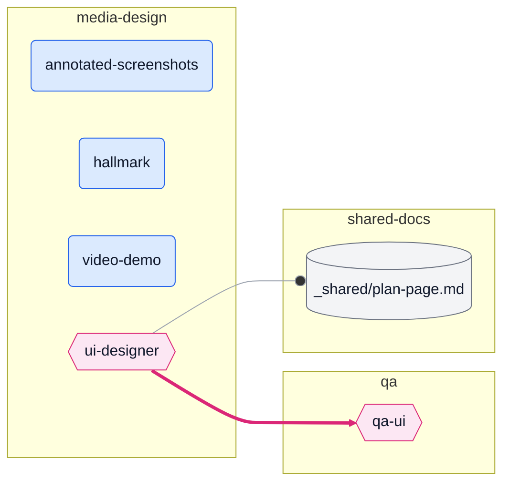
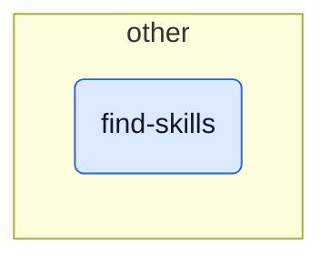
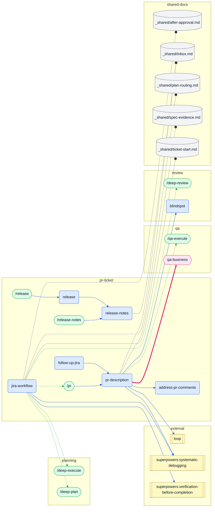
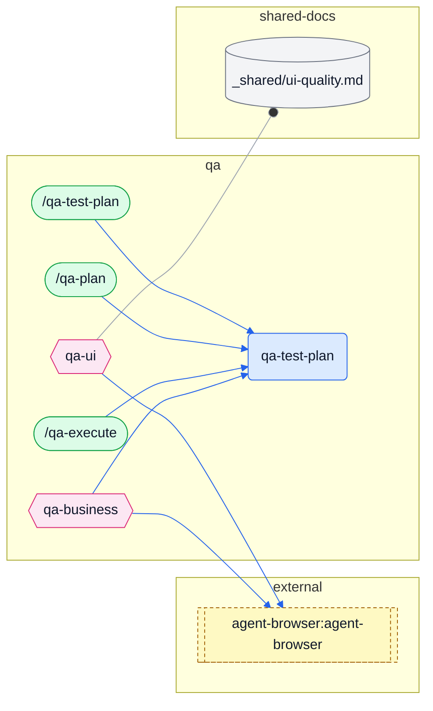
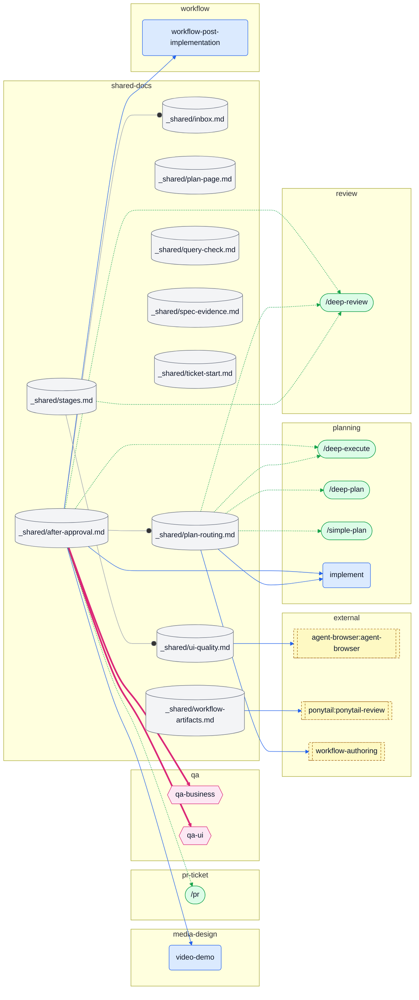
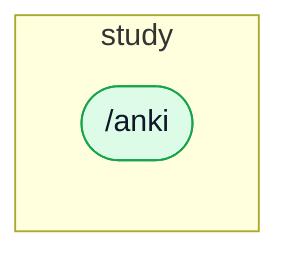
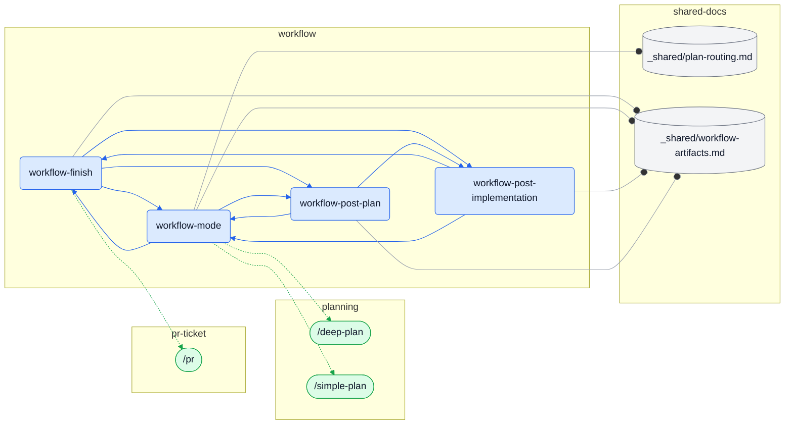

# Skills map

<!-- Generated by docs/skills-map.mjs. Do not edit by hand. Edit docs/skills-map.notes.md for the duplicates section. -->

This page maps the Claude Code skills, commands and agents in this repository, and the flows between them.
A generator reads the source files and draws the graph. The "Possible duplicates" section is hand-written.

## How to regenerate

Run `just skills-map`, or `node docs/skills-map.mjs` from the repository root.
The generator reads `dot_claude/skills/**/*.md`, `dot_claude/commands/*.md`, `dot_claude/agents/*.md` and `dot_agents/skills/**/*.md`.
It writes `docs/skills-map.md` and `docs/skills-map.html`. A second run gives no diff.
Run `node --test docs/skills-map.test.mjs` to test the edge extraction.

Counts: 24 skills, 14 commands, 3 agents, 10 shared docs, 16 external references. 157 edges: 73 invokes skill, 6 spawns agent, 33 runs command, 45 reads shared doc.

## Diagram 1: the main chains

Blue is the build chain of `deep-plan` and `simple-plan` (`_shared/after-approval.md`).
Green is the workflow stage chain for a repository with `.workflow/config.json`.
Orange is the Jira path: `jira-workflow` claims the ticket, then hands off to the blue chain. Dashed white boxes are steps, not files.

```mermaid
flowchart LR
  subgraph ph_intake["Intake"]
    direction TB
    jw("jira-workflow"):::skill
    jw_setup("ticket, branch"):::step
    ts("_shared/ticket-start.md"):::shared
    wm("workflow-mode"):::skill
  end
  subgraph ph_plan["Plan"]
    direction TB
    dp("/deep-plan"):::command
    sp("/simple-plan"):::command
    qap("/qa-plan"):::command
    pa("Plannotator approval"):::step
    wpp("workflow-post-plan"):::skill
  end
  subgraph ph_build["Build"]
    direction TB
    aa("_shared/after-approval.md"):::shared
    rt("_shared/plan-routing.md"):::shared
    de("/deep-execute (option A)"):::command
    impl("implement (option B)"):::skill
    fast("fast mode: implement and test"):::step
  end
  subgraph ph_review["Review"]
    direction TB
    dr("/deep-review"):::command
    simp("simplify"):::skill
    wpi("workflow-post-implementation"):::skill
  end
  subgraph ph_qa["QA"]
    direction TB
    qaui("qa-ui agent"):::agent
    qabiz("qa-business agent"):::agent
    qtp("/qa-test-plan"):::command
    fix("separate fixer agent"):::step
  end
  subgraph ph_pr["PR"]
    direction TB
    wf("workflow-finish"):::skill
    pr("/pr (pr-description)"):::command
    bs("blindspot"):::skill
    rep("HTML run report"):::step
  end
  subgraph ph_watch["Watch"]
    direction TB
    watch("PR watch: Monitor, then loop"):::step
    apc("address-pr-comments"):::skill
    fuj("follow-up-jira"):::skill
  end
  dp -->|"Phase 2.4"| qap
  qap --> pa
  sp --> pa
  dp -->|"Phase 0.4"| rt
  sp -->|"Phase 0.5"| rt
  pa -->|"approved"| aa
  aa -->|"executor"| rt
  rt -->|"A"| de
  rt -->|"B"| impl
  de --> dr
  impl --> dr
  dr -->|"Phase 5"| simp
  dr --> qaui
  dr --> qabiz
  qabiz -->|"qa-plan.yaml"| qtp
  qaui --> fix
  qabiz --> fix
  fix --> pr
  pr -->|"Phase 2.7"| bs
  pr --> rep
  pr -->|"Phase 5"| watch
  watch --> apc
  wm -->|"criteria"| rt
  wm -->|"standard"| dp
  wm -->|"standard"| sp
  pa --> wpp
  wpp --> aa
  dr -->|"step 7.0"| wpi
  wpi --> wf
  wf --> pr
  wm -->|"fast"| fast
  fast --> wf
  jw --> jw_setup
  jw_setup --> ts
  ts -->|"--ticket"| dp
  sp -->|"Jira key"| ts
  watch -->|"after deploy"| fuj
  fuj -->|"new PR"| pr
  linkStyle 0 stroke:#2563eb,stroke-width:2px
  linkStyle 1 stroke:#2563eb,stroke-width:2px
  linkStyle 2 stroke:#2563eb,stroke-width:2px
  linkStyle 3 stroke:#2563eb,stroke-width:2px
  linkStyle 4 stroke:#2563eb,stroke-width:2px
  linkStyle 5 stroke:#2563eb,stroke-width:2px
  linkStyle 6 stroke:#2563eb,stroke-width:2px
  linkStyle 7 stroke:#2563eb,stroke-width:2px
  linkStyle 8 stroke:#2563eb,stroke-width:2px
  linkStyle 9 stroke:#2563eb,stroke-width:2px
  linkStyle 10 stroke:#2563eb,stroke-width:2px
  linkStyle 11 stroke:#2563eb,stroke-width:2px
  linkStyle 12 stroke:#2563eb,stroke-width:2px
  linkStyle 13 stroke:#2563eb,stroke-width:2px
  linkStyle 14 stroke:#2563eb,stroke-width:2px
  linkStyle 15 stroke:#2563eb,stroke-width:2px
  linkStyle 16 stroke:#2563eb,stroke-width:2px
  linkStyle 17 stroke:#2563eb,stroke-width:2px
  linkStyle 18 stroke:#2563eb,stroke-width:2px
  linkStyle 19 stroke:#2563eb,stroke-width:2px
  linkStyle 20 stroke:#2563eb,stroke-width:2px
  linkStyle 21 stroke:#2563eb,stroke-width:2px
  linkStyle 22 stroke:#16a34a,stroke-width:2px
  linkStyle 23 stroke:#16a34a,stroke-width:2px
  linkStyle 24 stroke:#16a34a,stroke-width:2px
  linkStyle 25 stroke:#16a34a,stroke-width:2px
  linkStyle 26 stroke:#16a34a,stroke-width:2px
  linkStyle 27 stroke:#16a34a,stroke-width:2px
  linkStyle 28 stroke:#16a34a,stroke-width:2px
  linkStyle 29 stroke:#16a34a,stroke-width:2px
  linkStyle 30 stroke:#16a34a,stroke-width:2px
  linkStyle 31 stroke:#16a34a,stroke-width:2px
  linkStyle 32 stroke:#ea580c,stroke-width:2px
  linkStyle 33 stroke:#ea580c,stroke-width:2px
  linkStyle 34 stroke:#ea580c,stroke-width:2px
  linkStyle 35 stroke:#ea580c,stroke-width:2px
  linkStyle 36 stroke:#ea580c,stroke-width:2px
  linkStyle 37 stroke:#ea580c,stroke-width:2px
  classDef skill fill:#dbeafe,stroke:#2563eb,color:#0f172a
  classDef command fill:#dcfce7,stroke:#16a34a,color:#0f172a
  classDef agent fill:#fce7f3,stroke:#db2777,color:#0f172a
  classDef shared fill:#f3f4f6,stroke:#6b7280,color:#0f172a
  classDef external fill:#fef9c3,stroke:#a16207,color:#0f172a,stroke-dasharray:4 3
  classDef step fill:#ffffff,stroke:#6b7280,color:#0f172a,stroke-dasharray:2 2
```

## Diagram 2: the full graph

Shapes: a rounded box is a skill, a stadium is a command, a hexagon is an agent, a cylinder is a shared doc, and a double-edged box is a reference to a skill that is not in this repository.
Edges: blue solid arrows invoke a skill, thick pink arrows spawn an agent, green dotted arrows mention or run a command (`/name`), and grey lines with a circle read a shared doc.

The graph is too large for one diagram. Each cluster diagram shows the nodes of the cluster and the edges that start there. A node from another cluster appears as the target of such an edge.

### Cluster: media-design

### Cluster: other

### Cluster: planning

```mermaid
flowchart LR
  subgraph cl_external["external"]
    direction TB
    x_frontend_design_frontend_design[["frontend-design:frontend-design"]]:::external
    x_mattpocock_skills_domain_modeling[["mattpocock-skills:domain-modeling"]]:::external
    x_mattpocock_skills_grilling[["mattpocock-skills:grilling"]]:::external
    x_ponytail_ponytail_review[["ponytail:ponytail-review"]]:::external
    x_superpowers_brainstorming[["superpowers:brainstorming"]]:::external
    x_superpowers_executing_plans[["superpowers:executing-plans"]]:::external
    x_superpowers_subagent_driven_development[["superpowers:subagent-driven-development"]]:::external
    x_superpowers_systematic_debugging[["superpowers:systematic-debugging"]]:::external
    x_superpowers_test_driven_development[["superpowers:test-driven-development"]]:::external
    x_superpowers_writing_plans[["superpowers:writing-plans"]]:::external
    x_ui_ux_pro_max_ui_ux_pro_max[["ui-ux-pro-max:ui-ux-pro-max"]]:::external
    x_writing_plans[["writing-plans"]]:::external
  end
  subgraph cl_media_design["media-design"]
    direction TB
    a_ui_designer{{"ui-designer"}}:::agent
  end
  subgraph cl_planning["planning"]
    direction TB
    c_deep_execute(["/deep-execute"]):::command
    c_deep_plan(["/deep-plan"]):::command
    c_simple_plan(["/simple-plan"]):::command
    s_deep_execute("deep-execute"):::skill
    s_deep_plan("deep-plan"):::skill
    s_explore_options("explore-options"):::skill
    s_implement("implement"):::skill
    s_simple_plan("simple-plan"):::skill
  end
  subgraph cl_pr_ticket["pr-ticket"]
    direction TB
    c_pr(["/pr"]):::command
  end
  subgraph cl_qa["qa"]
    direction TB
    c_qa_plan(["/qa-plan"]):::command
  end
  subgraph cl_review["review"]
    direction TB
    c_deep_review(["/deep-review"]):::command
    s_blindspot("blindspot"):::skill
    s_deep_review("deep-review"):::skill
    s_shed_light("shed-light"):::skill
  end
  subgraph cl_shared_docs["shared-docs"]
    direction TB
    d_after_approval[("_shared/after-approval.md")]:::shared
    d_inbox[("_shared/inbox.md")]:::shared
    d_plan_page[("_shared/plan-page.md")]:::shared
    d_plan_routing[("_shared/plan-routing.md")]:::shared
    d_query_check[("_shared/query-check.md")]:::shared
    d_spec_evidence[("_shared/spec-evidence.md")]:::shared
    d_stages[("_shared/stages.md")]:::shared
    d_ticket_start[("_shared/ticket-start.md")]:::shared
    d_ui_quality[("_shared/ui-quality.md")]:::shared
  end
  subgraph cl_workflow["workflow"]
    direction TB
    s_workflow_post_plan("workflow-post-plan"):::skill
  end
  c_deep_execute -.-> c_deep_plan
  c_deep_execute -.-> c_deep_review
  c_deep_execute --o d_after_approval
  c_deep_execute --> s_deep_execute
  c_deep_plan -.-> c_qa_plan
  c_deep_plan --o d_after_approval
  c_deep_plan --o d_plan_routing
  c_deep_plan --> s_deep_plan
  c_deep_plan --> x_superpowers_brainstorming
  c_deep_plan --> x_superpowers_writing_plans
  c_simple_plan -.-> c_deep_plan
  c_simple_plan -.-> c_qa_plan
  c_simple_plan --o d_after_approval
  c_simple_plan --o d_plan_routing
  c_simple_plan --> s_simple_plan
  c_simple_plan --> x_ponytail_ponytail_review
  c_simple_plan --> x_superpowers_brainstorming
  c_simple_plan --> x_superpowers_writing_plans
  c_simple_plan --> x_ui_ux_pro_max_ui_ux_pro_max
  s_deep_execute -.-> c_deep_review
  s_deep_execute --o d_after_approval
  s_deep_execute --o d_inbox
  s_deep_execute --o d_plan_routing
  s_deep_execute --o d_spec_evidence
  s_deep_execute --> s_deep_review
  s_deep_plan ==> a_ui_designer
  s_deep_plan -.-> c_deep_execute
  s_deep_plan -.-> c_deep_review
  s_deep_plan -.-> c_pr
  s_deep_plan -.-> c_qa_plan
  s_deep_plan -.-> c_simple_plan
  s_deep_plan --o d_after_approval
  s_deep_plan --o d_plan_page
  s_deep_plan --o d_plan_routing
  s_deep_plan --o d_query_check
  s_deep_plan --o d_spec_evidence
  s_deep_plan --o d_stages
  s_deep_plan --o d_ticket_start
  s_deep_plan --o d_ui_quality
  s_deep_plan --> s_implement
  s_deep_plan --> s_workflow_post_plan
  s_deep_plan --> x_mattpocock_skills_domain_modeling
  s_deep_plan --> x_mattpocock_skills_grilling
  s_deep_plan --> x_superpowers_brainstorming
  s_deep_plan --> x_superpowers_subagent_driven_development
  s_deep_plan --> x_superpowers_test_driven_development
  s_deep_plan --> x_superpowers_writing_plans
  s_deep_plan --> x_writing_plans
  s_explore_options --> x_superpowers_brainstorming
  s_implement --o d_after_approval
  s_implement --> x_superpowers_executing_plans
  s_implement --> x_superpowers_subagent_driven_development
  s_implement --> x_superpowers_systematic_debugging
  s_implement --> x_superpowers_test_driven_development
  s_simple_plan ==> a_ui_designer
  s_simple_plan -.-> c_deep_plan
  s_simple_plan -.-> c_pr
  s_simple_plan -.-> c_qa_plan
  s_simple_plan --o d_after_approval
  s_simple_plan --o d_plan_page
  s_simple_plan --o d_plan_routing
  s_simple_plan --o d_query_check
  s_simple_plan --o d_spec_evidence
  s_simple_plan --o d_stages
  s_simple_plan --o d_ticket_start
  s_simple_plan --o d_ui_quality
  s_simple_plan --> s_blindspot
  s_simple_plan --> s_implement
  s_simple_plan --> s_shed_light
  s_simple_plan --> s_workflow_post_plan
  s_simple_plan --> x_frontend_design_frontend_design
  s_simple_plan --> x_ponytail_ponytail_review
  s_simple_plan --> x_superpowers_brainstorming
  s_simple_plan --> x_superpowers_test_driven_development
  s_simple_plan --> x_superpowers_writing_plans
  s_simple_plan --> x_ui_ux_pro_max_ui_ux_pro_max
  linkStyle 0 stroke:#16a34a
  linkStyle 1 stroke:#16a34a
  linkStyle 2 stroke:#9ca3af
  linkStyle 3 stroke:#2563eb
  linkStyle 4 stroke:#16a34a
  linkStyle 5 stroke:#9ca3af
  linkStyle 6 stroke:#9ca3af
  linkStyle 7 stroke:#2563eb
  linkStyle 8 stroke:#2563eb
  linkStyle 9 stroke:#2563eb
  linkStyle 10 stroke:#16a34a
  linkStyle 11 stroke:#16a34a
  linkStyle 12 stroke:#9ca3af
  linkStyle 13 stroke:#9ca3af
  linkStyle 14 stroke:#2563eb
  linkStyle 15 stroke:#2563eb
  linkStyle 16 stroke:#2563eb
  linkStyle 17 stroke:#2563eb
  linkStyle 18 stroke:#2563eb
  linkStyle 19 stroke:#16a34a
  linkStyle 20 stroke:#9ca3af
  linkStyle 21 stroke:#9ca3af
  linkStyle 22 stroke:#9ca3af
  linkStyle 23 stroke:#9ca3af
  linkStyle 24 stroke:#2563eb
  linkStyle 25 stroke:#db2777
  linkStyle 26 stroke:#16a34a
  linkStyle 27 stroke:#16a34a
  linkStyle 28 stroke:#16a34a
  linkStyle 29 stroke:#16a34a
  linkStyle 30 stroke:#16a34a
  linkStyle 31 stroke:#9ca3af
  linkStyle 32 stroke:#9ca3af
  linkStyle 33 stroke:#9ca3af
  linkStyle 34 stroke:#9ca3af
  linkStyle 35 stroke:#9ca3af
  linkStyle 36 stroke:#9ca3af
  linkStyle 37 stroke:#9ca3af
  linkStyle 38 stroke:#9ca3af
  linkStyle 39 stroke:#2563eb
  linkStyle 40 stroke:#2563eb
  linkStyle 41 stroke:#2563eb
  linkStyle 42 stroke:#2563eb
  linkStyle 43 stroke:#2563eb
  linkStyle 44 stroke:#2563eb
  linkStyle 45 stroke:#2563eb
  linkStyle 46 stroke:#2563eb
  linkStyle 47 stroke:#2563eb
  linkStyle 48 stroke:#2563eb
  linkStyle 49 stroke:#9ca3af
  linkStyle 50 stroke:#2563eb
  linkStyle 51 stroke:#2563eb
  linkStyle 52 stroke:#2563eb
  linkStyle 53 stroke:#2563eb
  linkStyle 54 stroke:#db2777
  linkStyle 55 stroke:#16a34a
  linkStyle 56 stroke:#16a34a
  linkStyle 57 stroke:#16a34a
  linkStyle 58 stroke:#9ca3af
  linkStyle 59 stroke:#9ca3af
  linkStyle 60 stroke:#9ca3af
  linkStyle 61 stroke:#9ca3af
  linkStyle 62 stroke:#9ca3af
  linkStyle 63 stroke:#9ca3af
  linkStyle 64 stroke:#9ca3af
  linkStyle 65 stroke:#9ca3af
  linkStyle 66 stroke:#2563eb
  linkStyle 67 stroke:#2563eb
  linkStyle 68 stroke:#2563eb
  linkStyle 69 stroke:#2563eb
  linkStyle 70 stroke:#2563eb
  linkStyle 71 stroke:#2563eb
  linkStyle 72 stroke:#2563eb
  linkStyle 73 stroke:#2563eb
  linkStyle 74 stroke:#2563eb
  linkStyle 75 stroke:#2563eb
  classDef skill fill:#dbeafe,stroke:#2563eb,color:#0f172a
  classDef command fill:#dcfce7,stroke:#16a34a,color:#0f172a
  classDef agent fill:#fce7f3,stroke:#db2777,color:#0f172a
  classDef shared fill:#f3f4f6,stroke:#6b7280,color:#0f172a
  classDef external fill:#fef9c3,stroke:#a16207,color:#0f172a,stroke-dasharray:4 3
  classDef step fill:#ffffff,stroke:#6b7280,color:#0f172a,stroke-dasharray:2 2
```

### Cluster: pr-ticket

### Cluster: qa

### Cluster: review

### Cluster: shared-docs

### Cluster: study

### Cluster: workflow

## Possible duplicates

<!-- Hand-written. docs/skills-map.mjs copies this file into docs/skills-map.md. -->

The table lists flows that two or more files defined at the first review. Each row gives the status and the change, or the reason to keep the overlap. Three shared docs now hold the single copy of a flow: `_shared/after-approval.md` (the build chain), `_shared/plan-routing.md` (which pipeline plans and which executor builds) and `_shared/ticket-start.md` (claim a Jira issue and move it to in progress). The `implement` skill is the single-session executor (option B).

| # | Overlap | Status | Change or reason |
|---|---|---|---|
| 1 | The build chain after plan approval had five descriptions. | Resolved | `after-approval.md` is the only full copy. `commands/deep-plan.md`, `commands/simple-plan.md`, `skills/simple-plan/SKILL.md` Phase 5 and `skills/deep-plan/SKILL.md` Phase 3.5 point to it in one line. |
| 2 | Three files said that `deep-plan` stops at the approved plan. | Resolved | `commands/deep-plan.md`, `skills/deep-plan/README.md` and `skills/jira-workflow/SKILL.md` now say that it builds through to the PR unless the user said to stop. The README handoff with `/simplify` x2 and `/qa-test-plan` is replaced by a pointer. |
| 3 | `jira-workflow` had its own serial build, review and QA path. | Resolved | `jira-workflow` section 3 now delegates to the chain and keeps only the Jira steps: debugging for a bug ticket, verification before `/pr`, the commit body, the `/pr` arguments, the ticket comment and the notifications. |
| 4 | `simplify` could run three times on one change. | Resolved | The `/simplify` x2 step left `jira-workflow`. The deep-review Phase 5 pass is the only one. |
| 5 | QA execution had four routes. | Resolved | One route: the chain starts the `qa-ui` and `qa-business` agents. `qa-business` runs `qa-test-plan --phase execute` when a `qa-plan.yaml` exists, else `agent-browser`. Its optional `qa-testing` route and the `qa-testing` step of `jira-workflow` are gone. `commands/deep-execute.md` now matches the skill. |
| 6 | QA had three skills and three commands for one workflow. | Resolved | The `qa-plan` and `qa-execute` skills are deleted. Their trigger phrases and the `--plan PATH` rule moved into the `qa-test-plan` description and arguments. The three commands stay. |
| 7 | Every command repeats its skill. | Kept, reduced | The commands reach Codex, so they stay. The restated chain and QA text left `deep-plan`, `simple-plan` and `deep-execute` commands, which caused rows 2 and 5. The phase overviews and argument grammars stay as user documentation. |
| 8 | Three skills chose the pipeline or the mode with their own criteria. | Resolved | The criteria and the question rules are in `plan-routing.md`. `deep-plan` Phase 0.4, `simple-plan` Phase 0.5 and `workflow-mode` section 2 point to it and keep their own question. |
| 9 | Two places replied to PR review threads. | Resolved | The pr-description watch step 3 is deleted. `address-pr-comments` replies and resolves. |
| 10 | Two skills opened a pull request. | Resolved | `follow-up-jira` opens a new PR with `Skill(skill="pr-description")`. |
| 11 | Two watch loops. | Kept | They watch different sources: PR review and CI, and the reporter's ticket comment after deploy. |
| 12 | Two copies of the Jira status transition. | Resolved, one kept | The start transition of `jira-workflow` moved to `ticket-start.md`, which `deep-plan` and `simple-plan` also read. `follow-up-jira` keeps its own transitions, because they move the issue to done or back to investigation, not to in progress. |
| 13 | Two run reports. | Kept | `build-run-report.sh` reads the lane records of a `deep-execute` run (`manifest.json`, `events.jsonl`, `decision.sh` output). Options B, C and D do not write them. `after-approval.md` section 8 states this reason. |
| 14 | Four checks for over-engineering. | Kept | They run at different stages: plan upkeep (`shed-light`), plan review (`ponytail-review`), diff review and cleanup (`simplify`). In the diff review, `simplicity` flags local constructs and `code-judo` looks for a different shape of the whole change. |
| 15 | The demo video ran only in one pipeline. | Resolved | The `video-demo` step moved into `after-approval.md` section 7, so every pipeline runs it. |
| 16 | Two screenshot annotators. | Kept | The descriptions split the use: QA evidence and stakeholder images. |
| 17 | The name `plan` had two meanings. | Resolved | The journal skills `log`, `plan` and `retro` are deleted, with the journal system. |
| 18 | `deep-execute` had its own delivery tail (review, QA, PR, report) beside `after-approval.md`, and its per-round `/deep-review` ran its own fixer. | Resolved | `deep-execute` Phase 4 runs `after-approval.md` steps 2 to 9. Every `/deep-review` inside it runs `--no-fix --no-simplify`, and the owning lane applies each fix. The PR opens with `--no-watch`; the watch is step 9, after the report. |

## Orphans

Nodes with no inbound edge and no user trigger (no command, and no "use when" in the description):

- None.

Skills that no other file references. Only the user or the description trigger starts them:

- `annotated-screenshots` (`dot_claude/skills/annotated-screenshots/SKILL.md`)
- `explore-options` (`dot_claude/skills/explore-options/SKILL.md`)
- `find-skills` (`dot_claude/skills/find-skills/SKILL.md`)
- `follow-up-jira` (`dot_claude/skills/follow-up-jira/SKILL.md`)
- `hallmark` (`dot_agents/skills/hallmark/SKILL.md`)
- `jira-workflow` (`dot_claude/skills/jira-workflow/SKILL.md`)

References to skills, agents or shared docs that this repository does not define. A name with a colon comes from a plugin. A name without a colon is a local skill, a plugin skill or a built-in, or the reference is broken:

- `agent-browser:agent-browser`: `dot_claude/agents/qa-business.md:68`, `dot_claude/agents/qa-ui.md:37`, `dot_claude/skills/_shared/ui-quality.md:125`
- `frontend-design:frontend-design`: `dot_claude/skills/simple-plan/SKILL.md:182`
- `loop`: `dot_claude/skills/pr-description/SKILL.md:333`
- `mattpocock-skills:domain-modeling`: `dot_claude/skills/deep-plan/README.md:90`, `dot_claude/skills/deep-plan/SKILL.md:134`
- `mattpocock-skills:grilling`: `dot_claude/skills/deep-plan/README.md:90`, `dot_claude/skills/deep-plan/SKILL.md:133`
- `ponytail:ponytail-review`: `dot_claude/skills/simple-plan/SKILL.md:343`, `dot_claude/commands/simple-plan.md:39`, `dot_claude/skills/_shared/workflow-artifacts.md:96`
- `superpowers:brainstorming`: `dot_claude/skills/deep-plan/SKILL.md:151`, `dot_claude/skills/explore-options/SKILL.md:135`, `dot_claude/skills/simple-plan/SKILL.md:80`, `dot_claude/commands/deep-plan.md:16`, `dot_claude/commands/simple-plan.md:29`
- `superpowers:executing-plans`: `dot_claude/skills/implement/SKILL.md:22`
- `superpowers:subagent-driven-development`: `dot_claude/skills/deep-plan/SKILL.md:351`, `dot_claude/skills/implement/SKILL.md:20`
- `superpowers:systematic-debugging`: `dot_claude/skills/implement/SKILL.md:26`, `dot_claude/skills/jira-workflow/SKILL.md:187`, `dot_claude/skills/pr-description/SKILL.md:320`
- `superpowers:test-driven-development`: `dot_claude/skills/deep-plan/SKILL.md:383`, `dot_claude/skills/implement/SKILL.md:23`, `dot_claude/skills/simple-plan/SKILL.md:325`
- `superpowers:verification-before-completion`: `dot_claude/skills/jira-workflow/SKILL.md:188`
- `superpowers:writing-plans`: `dot_claude/skills/deep-plan/README.md:68`, `dot_claude/skills/deep-plan/SKILL.md:160`, `dot_claude/skills/deep-plan/SKILL.md:169`, `dot_claude/skills/deep-plan/SKILL.md:266`, `dot_claude/skills/deep-plan/personas/planner-opus.md:20`, `dot_claude/skills/deep-plan/templates/plan.md:12`, `dot_claude/skills/deep-plan/templates/plan.md:271`, `dot_claude/skills/deep-plan/templates/plan.md:345`, `dot_claude/skills/deep-plan/templates/subplan.md:28`, `dot_claude/skills/simple-plan/SKILL.md:34`, `dot_claude/skills/simple-plan/SKILL.md:187`, `dot_claude/skills/simple-plan/SKILL.md:191`, `dot_claude/commands/deep-plan.md:17`, `dot_claude/commands/simple-plan.md:36`
- `ui-ux-pro-max:ui-ux-pro-max`: `dot_claude/skills/deep-review/personas/senior-frontend.md:90`, `dot_claude/skills/deep-review/personas/ui-ux.md:9`, `dot_claude/skills/simple-plan/SKILL.md:158`, `dot_claude/commands/simple-plan.md:34`
- `workflow-authoring`: `dot_claude/skills/_shared/plan-routing.md:99`
- `writing-plans`: `dot_claude/skills/deep-plan/personas/planner-codex.md:29`, `dot_claude/skills/deep-plan/personas/planner-codex.md:30`

## Edge list

Every edge, with the first line that creates it

| from | edge | to | evidence |
|---|---|---|---|
| qa-business | invokes skill | qa-test-plan | `dot_claude/agents/qa-business.md:65` |
| qa-business | invokes skill | agent-browser:agent-browser | `dot_claude/agents/qa-business.md:68` |
| qa-ui | reads shared doc | ui-quality.md | `dot_claude/agents/qa-ui.md:44` |
| qa-ui | invokes skill | agent-browser:agent-browser | `dot_claude/agents/qa-ui.md:37` |
| ui-designer | spawns agent | qa-ui | `dot_claude/agents/ui-designer.md:72` |
| ui-designer | reads shared doc | plan-page.md | `dot_claude/agents/ui-designer.md:71` |
| /blindspot | invokes skill | blindspot | `dot_claude/commands/blindspot.md:21` |
| /deep-execute | runs command | /deep-plan | `dot_claude/commands/deep-execute.md:8` |
| /deep-execute | runs command | /deep-review | `dot_claude/commands/deep-execute.md:41` |
| /deep-execute | reads shared doc | after-approval.md | `dot_claude/commands/deep-execute.md:41` |
| /deep-execute | invokes skill | deep-execute | `dot_claude/commands/deep-execute.md:30` |
| /deep-plan | runs command | /qa-plan | `dot_claude/commands/deep-plan.md:23` |
| /deep-plan | reads shared doc | after-approval.md | `dot_claude/commands/deep-plan.md:9` |
| /deep-plan | reads shared doc | plan-routing.md | `dot_claude/commands/deep-plan.md:29` |
| /deep-plan | invokes skill | deep-plan | `dot_claude/commands/deep-plan.md:49` |
| /deep-plan | invokes skill | superpowers:brainstorming | `dot_claude/commands/deep-plan.md:16` |
| /deep-plan | invokes skill | superpowers:writing-plans | `dot_claude/commands/deep-plan.md:17` |
| /deep-review | runs command | /simplify | `dot_claude/commands/deep-review.md:43` |
| /deep-review | invokes skill | deep-review | `dot_claude/commands/deep-review.md:56` |
| /pr | invokes skill | pr-description | `dot_claude/commands/pr.md:46` |
| /qa-execute | invokes skill | qa-test-plan | `dot_claude/commands/qa-execute.md:16` |
| /qa-plan | invokes skill | qa-test-plan | `dot_claude/commands/qa-plan.md:16` |
| /qa-test-plan | invokes skill | qa-test-plan | `dot_claude/commands/qa-test-plan.md:18` |
| /release | invokes skill | release | `dot_claude/commands/release.md:21` |
| /release-notes | invokes skill | release-notes | `dot_claude/commands/release-notes.md:21` |
| /shed-light | invokes skill | shed-light | `dot_claude/commands/shed-light.md:20` |
| /simple-plan | runs command | /deep-plan | `dot_claude/commands/simple-plan.md:26` |
| /simple-plan | runs command | /qa-plan | `dot_claude/commands/simple-plan.md:50` |
| /simple-plan | reads shared doc | after-approval.md | `dot_claude/commands/simple-plan.md:9` |
| /simple-plan | reads shared doc | plan-routing.md | `dot_claude/commands/simple-plan.md:27` |
| /simple-plan | invokes skill | simple-plan | `dot_claude/commands/simple-plan.md:56` |
| /simple-plan | invokes skill | ponytail:ponytail-review | `dot_claude/commands/simple-plan.md:39` |
| /simple-plan | invokes skill | superpowers:brainstorming | `dot_claude/commands/simple-plan.md:29` |
| /simple-plan | invokes skill | superpowers:writing-plans | `dot_claude/commands/simple-plan.md:36` |
| /simple-plan | invokes skill | ui-ux-pro-max:ui-ux-pro-max | `dot_claude/commands/simple-plan.md:34` |
| /simplify | invokes skill | simplify | `dot_claude/commands/simplify.md:19` |
| after-approval.md | spawns agent | qa-business | `dot_claude/skills/_shared/after-approval.md:101` |
| after-approval.md | spawns agent | qa-ui | `dot_claude/skills/_shared/after-approval.md:33` |
| after-approval.md | runs command | /deep-execute | `dot_claude/skills/_shared/after-approval.md:47` |
| after-approval.md | runs command | /deep-review | `dot_claude/skills/_shared/after-approval.md:58` |
| after-approval.md | runs command | /pr | `dot_claude/skills/_shared/after-approval.md:125` |
| after-approval.md | reads shared doc | inbox.md | `dot_claude/skills/_shared/after-approval.md:117` |
| after-approval.md | reads shared doc | plan-routing.md | `dot_claude/skills/_shared/after-approval.md:46` |
| after-approval.md | invokes skill | implement | `dot_claude/skills/_shared/after-approval.md:47` |
| after-approval.md | invokes skill | video-demo | `dot_claude/skills/_shared/after-approval.md:128` |
| after-approval.md | invokes skill | workflow-post-implementation | `dot_claude/skills/_shared/after-approval.md:123` |
| plan-routing.md | runs command | /deep-execute | `dot_claude/skills/_shared/plan-routing.md:44` |
| plan-routing.md | runs command | /deep-plan | `dot_claude/skills/_shared/plan-routing.md:10` |
| plan-routing.md | runs command | /deep-review | `dot_claude/skills/_shared/plan-routing.md:111` |
| plan-routing.md | runs command | /simple-plan | `dot_claude/skills/_shared/plan-routing.md:19` |
| plan-routing.md | invokes skill | implement | `dot_claude/skills/_shared/plan-routing.md:45` |
| plan-routing.md | invokes skill | workflow-authoring | `dot_claude/skills/_shared/plan-routing.md:99` |
| stages.md | runs command | /deep-review | `dot_claude/skills/_shared/stages.md:47` |
| stages.md | reads shared doc | ui-quality.md | `dot_claude/skills/_shared/stages.md:48` |
| ui-quality.md | invokes skill | agent-browser:agent-browser | `dot_claude/skills/_shared/ui-quality.md:125` |
| workflow-artifacts.md | invokes skill | ponytail:ponytail-review | `dot_claude/skills/_shared/workflow-artifacts.md:96` |
| deep-execute | runs command | /deep-review | `dot_claude/skills/deep-execute/README.md:126` |
| deep-execute | reads shared doc | after-approval.md | `dot_claude/skills/deep-execute/SKILL.md:67` |
| deep-execute | reads shared doc | inbox.md | `dot_claude/skills/deep-execute/SKILL.md:62` |
| deep-execute | reads shared doc | plan-routing.md | `dot_claude/skills/deep-execute/README.md:14` |
| deep-execute | reads shared doc | spec-evidence.md | `dot_claude/skills/deep-execute/SKILL.md:81` |
| deep-execute | invokes skill | deep-review | `dot_claude/skills/deep-execute/SKILL.md:96` |
| deep-plan | spawns agent | ui-designer | `dot_claude/skills/deep-plan/SKILL.md:178` |
| deep-plan | runs command | /deep-execute | `dot_claude/skills/deep-plan/SKILL.md:11` |
| deep-plan | runs command | /deep-review | `dot_claude/skills/deep-plan/SKILL.md:36` |
| deep-plan | runs command | /pr | `dot_claude/skills/deep-plan/README.md:109` |
| deep-plan | runs command | /qa-plan | `dot_claude/skills/deep-plan/SKILL.md:27` |
| deep-plan | runs command | /simple-plan | `dot_claude/skills/deep-plan/SKILL.md:111` |
| deep-plan | reads shared doc | after-approval.md | `dot_claude/skills/deep-plan/README.md:63` |
| deep-plan | reads shared doc | plan-page.md | `dot_claude/skills/deep-plan/README.md:81` |
| deep-plan | reads shared doc | plan-routing.md | `dot_claude/skills/deep-plan/README.md:64` |
| deep-plan | reads shared doc | query-check.md | `dot_claude/skills/deep-plan/SKILL.md:288` |
| deep-plan | reads shared doc | spec-evidence.md | `dot_claude/skills/deep-plan/SKILL.md:335` |
| deep-plan | reads shared doc | stages.md | `dot_claude/skills/deep-plan/SKILL.md:49` |
| deep-plan | reads shared doc | ticket-start.md | `dot_claude/skills/deep-plan/SKILL.md:105` |
| deep-plan | reads shared doc | ui-quality.md | `dot_claude/skills/deep-plan/SKILL.md:290` |
| deep-plan | invokes skill | implement | `dot_claude/skills/deep-plan/SKILL.md:351` |
| deep-plan | invokes skill | workflow-post-plan | `dot_claude/skills/deep-plan/SKILL.md:377` |
| deep-plan | invokes skill | mattpocock-skills:domain-modeling | `dot_claude/skills/deep-plan/README.md:90` |
| deep-plan | invokes skill | mattpocock-skills:grilling | `dot_claude/skills/deep-plan/README.md:90` |
| deep-plan | invokes skill | superpowers:brainstorming | `dot_claude/skills/deep-plan/SKILL.md:151` |
| deep-plan | invokes skill | superpowers:subagent-driven-development | `dot_claude/skills/deep-plan/SKILL.md:351` |
| deep-plan | invokes skill | superpowers:test-driven-development | `dot_claude/skills/deep-plan/SKILL.md:383` |
| deep-plan | invokes skill | superpowers:writing-plans | `dot_claude/skills/deep-plan/README.md:68` |
| deep-plan | invokes skill | writing-plans | `dot_claude/skills/deep-plan/personas/planner-codex.md:29` |
| deep-review | runs command | /deep-execute | `dot_claude/skills/deep-review/SKILL.md:182` |
| deep-review | runs command | /simplify | `dot_claude/skills/deep-review/README.md:44` |
| deep-review | reads shared doc | query-check.md | `dot_claude/skills/deep-review/SKILL.md:108` |
| deep-review | reads shared doc | stages.md | `dot_claude/skills/deep-review/README.md:51` |
| deep-review | reads shared doc | ui-quality.md | `dot_claude/skills/deep-review/personas/ui-ux.md:16` |
| deep-review | invokes skill | simplify | `dot_claude/skills/deep-review/SKILL.md:134` |
| deep-review | invokes skill | ui-ux-pro-max:ui-ux-pro-max | `dot_claude/skills/deep-review/personas/senior-frontend.md:90` |
| explore-options | invokes skill | superpowers:brainstorming | `dot_claude/skills/explore-options/SKILL.md:135` |
| follow-up-jira | invokes skill | pr-description | `dot_claude/skills/follow-up-jira/SKILL.md:183` |
| implement | reads shared doc | after-approval.md | `dot_claude/skills/implement/SKILL.md:9` |
| implement | invokes skill | superpowers:executing-plans | `dot_claude/skills/implement/SKILL.md:22` |
| implement | invokes skill | superpowers:subagent-driven-development | `dot_claude/skills/implement/SKILL.md:20` |
| implement | invokes skill | superpowers:systematic-debugging | `dot_claude/skills/implement/SKILL.md:26` |
| implement | invokes skill | superpowers:test-driven-development | `dot_claude/skills/implement/SKILL.md:23` |
| jira-workflow | runs command | /deep-execute | `dot_claude/skills/jira-workflow/SKILL.md:17` |
| jira-workflow | runs command | /deep-plan | `dot_claude/skills/jira-workflow/SKILL.md:15` |
| jira-workflow | runs command | /deep-review | `dot_claude/skills/jira-workflow/SKILL.md:18` |
| jira-workflow | runs command | /pr | `dot_claude/skills/jira-workflow/SKILL.md:19` |
| jira-workflow | reads shared doc | after-approval.md | `dot_claude/skills/jira-workflow/SKILL.md:61` |
| jira-workflow | reads shared doc | plan-routing.md | `dot_claude/skills/jira-workflow/SKILL.md:182` |
| jira-workflow | reads shared doc | ticket-start.md | `dot_claude/skills/jira-workflow/SKILL.md:156` |
| jira-workflow | invokes skill | superpowers:systematic-debugging | `dot_claude/skills/jira-workflow/SKILL.md:187` |
| jira-workflow | invokes skill | superpowers:verification-before-completion | `dot_claude/skills/jira-workflow/SKILL.md:188` |
| pr-description | spawns agent | qa-business | `dot_claude/skills/pr-description/SKILL.md:174` |
| pr-description | runs command | /qa-execute | `dot_claude/skills/pr-description/SKILL.md:174` |
| pr-description | reads shared doc | inbox.md | `dot_claude/skills/pr-description/SKILL.md:339` |
| pr-description | reads shared doc | spec-evidence.md | `dot_claude/skills/pr-description/SKILL.md:62` |
| pr-description | invokes skill | address-pr-comments | `dot_claude/skills/pr-description/SKILL.md:318` |
| pr-description | invokes skill | blindspot | `dot_claude/skills/pr-description/SKILL.md:244` |
| pr-description | invokes skill | loop | `dot_claude/skills/pr-description/SKILL.md:333` |
| pr-description | invokes skill | superpowers:systematic-debugging | `dot_claude/skills/pr-description/SKILL.md:320` |
| release | invokes skill | release-notes | `dot_claude/skills/release/SKILL.md:168` |
| release-notes | reads shared doc | inbox.md | `dot_claude/skills/release-notes/SKILL.md:122` |
| simple-plan | spawns agent | ui-designer | `dot_claude/skills/simple-plan/SKILL.md:173` |
| simple-plan | runs command | /deep-plan | `dot_claude/skills/simple-plan/SKILL.md:71` |
| simple-plan | runs command | /pr | `dot_claude/skills/simple-plan/SKILL.md:440` |
| simple-plan | runs command | /qa-plan | `dot_claude/skills/simple-plan/SKILL.md:333` |
| simple-plan | reads shared doc | after-approval.md | `dot_claude/skills/simple-plan/SKILL.md:12` |
| simple-plan | reads shared doc | plan-page.md | `dot_claude/skills/simple-plan/SKILL.md:416` |
| simple-plan | reads shared doc | plan-routing.md | `dot_claude/skills/simple-plan/SKILL.md:72` |
| simple-plan | reads shared doc | query-check.md | `dot_claude/skills/simple-plan/SKILL.md:266` |
| simple-plan | reads shared doc | spec-evidence.md | `dot_claude/skills/simple-plan/SKILL.md:406` |
| simple-plan | reads shared doc | stages.md | `dot_claude/skills/simple-plan/SKILL.md:131` |
| simple-plan | reads shared doc | ticket-start.md | `dot_claude/skills/simple-plan/SKILL.md:64` |
| simple-plan | reads shared doc | ui-quality.md | `dot_claude/skills/simple-plan/SKILL.md:156` |
| simple-plan | invokes skill | blindspot | `dot_claude/skills/simple-plan/SKILL.md:393` |
| simple-plan | invokes skill | implement | `dot_claude/skills/simple-plan/SKILL.md:434` |
| simple-plan | invokes skill | shed-light | `dot_claude/skills/simple-plan/SKILL.md:411` |
| simple-plan | invokes skill | workflow-post-plan | `dot_claude/skills/simple-plan/SKILL.md:422` |
| simple-plan | invokes skill | frontend-design:frontend-design | `dot_claude/skills/simple-plan/SKILL.md:182` |
| simple-plan | invokes skill | ponytail:ponytail-review | `dot_claude/skills/simple-plan/SKILL.md:343` |
| simple-plan | invokes skill | superpowers:brainstorming | `dot_claude/skills/simple-plan/SKILL.md:80` |
| simple-plan | invokes skill | superpowers:test-driven-development | `dot_claude/skills/simple-plan/SKILL.md:325` |
| simple-plan | invokes skill | superpowers:writing-plans | `dot_claude/skills/simple-plan/SKILL.md:34` |
| simple-plan | invokes skill | ui-ux-pro-max:ui-ux-pro-max | `dot_claude/skills/simple-plan/SKILL.md:158` |
| workflow-finish | runs command | /pr | `dot_claude/skills/workflow-finish/SKILL.md:3` |
| workflow-finish | reads shared doc | workflow-artifacts.md | `dot_claude/skills/workflow-finish/SKILL.md:15` |
| workflow-finish | invokes skill | workflow-mode | `dot_claude/skills/workflow-finish/SKILL.md:19` |
| workflow-finish | invokes skill | workflow-post-implementation | `dot_claude/skills/workflow-finish/SKILL.md:43` |
| workflow-finish | invokes skill | workflow-post-plan | `dot_claude/skills/workflow-finish/SKILL.md:42` |
| workflow-mode | runs command | /deep-plan | `dot_claude/skills/workflow-mode/SKILL.md:57` |
| workflow-mode | runs command | /simple-plan | `dot_claude/skills/workflow-mode/SKILL.md:57` |
| workflow-mode | reads shared doc | plan-routing.md | `dot_claude/skills/workflow-mode/SKILL.md:26` |
| workflow-mode | reads shared doc | workflow-artifacts.md | `dot_claude/skills/workflow-mode/SKILL.md:15` |
| workflow-mode | invokes skill | workflow-finish | `dot_claude/skills/workflow-mode/SKILL.md:60` |
| workflow-mode | invokes skill | workflow-post-plan | `dot_claude/skills/workflow-mode/SKILL.md:58` |
| workflow-post-implementation | reads shared doc | workflow-artifacts.md | `dot_claude/skills/workflow-post-implementation/SKILL.md:15` |
| workflow-post-implementation | invokes skill | workflow-finish | `dot_claude/skills/workflow-post-implementation/SKILL.md:62` |
| workflow-post-implementation | invokes skill | workflow-mode | `dot_claude/skills/workflow-post-implementation/SKILL.md:19` |
| workflow-post-plan | reads shared doc | workflow-artifacts.md | `dot_claude/skills/workflow-post-plan/SKILL.md:15` |
| workflow-post-plan | invokes skill | workflow-mode | `dot_claude/skills/workflow-post-plan/SKILL.md:19` |
| workflow-post-plan | invokes skill | workflow-post-implementation | `dot_claude/skills/workflow-post-plan/SKILL.md:61` |

