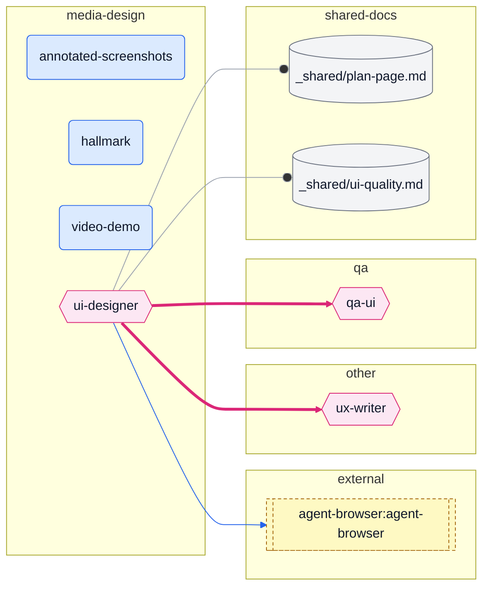
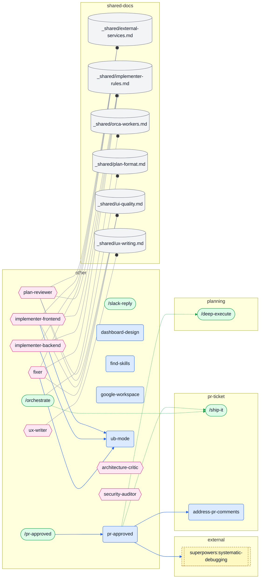
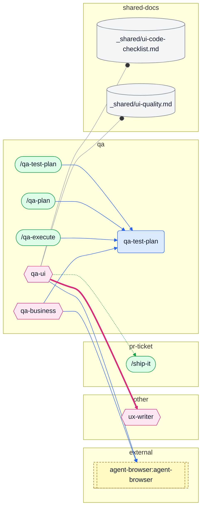
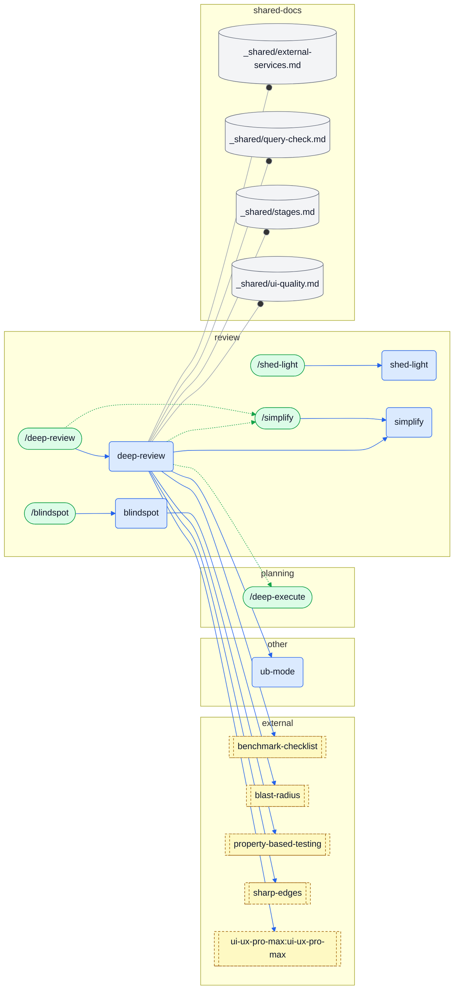
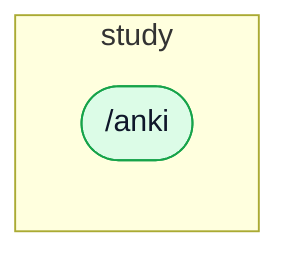

# Skills map

<!-- Generated by docs/skills-map.mjs. Do not edit by hand. -->

This page maps the Claude Code skills, commands and agents in this repository, and the flows between them.
A generator reads the source files and draws the graph.

## How to regenerate

Run `just skills-map`, or `node docs/skills-map.mjs` from the repository root.
The generator reads `dot_claude/skills/**/*.md`, `dot_claude/commands/*.md`, `dot_claude/agents/*.md` and `dot_agents/skills/**/*.md`.
It writes `docs/skills-map.md` and `docs/skills-map.html`. A second run gives no diff.
Run `node --test docs/skills-map.test.mjs` to test the edge extraction.

Counts: 29 skills, 18 commands, 10 agents, 17 shared docs, 26 external references. 267 edges: 102 invokes skill, 21 spawns agent, 56 runs command, 88 reads shared doc.

## Diagram 1: the main chains

Blue is the build chain of `deep-plan` and `simple-plan` (`_shared/after-approval.md`).
Green is the workflow stage chain for a repository with `.workflow/config.json`.
Orange is the Jira path: `jira-workflow` claims the ticket, then hands off to the blue chain. Dashed white boxes are steps, not files.

```mermaid
flowchart LR
  subgraph ph_intake["Intake"]
    direction TB
    jw("jira-workflow"):::skill
    jw_setup("ticket, branch"):::step
    ts("_shared/ticket-start.md"):::shared
    wm("workflow-mode"):::skill
  end
  subgraph ph_plan["Plan"]
    direction TB
    dp("/deep-plan"):::command
    sp("/simple-plan"):::command
    qap("/qa-plan"):::command
    rw("_shared/repo-workflow.md"):::shared
    prv("plan-reviewer agents"):::agent
    pa("Plannotator approval"):::step
    wpp("workflow-post-plan"):::skill
  end
  subgraph ph_build["Build"]
    direction TB
    aa("_shared/after-approval.md"):::shared
    rt("_shared/plan-routing.md"):::shared
    de("/deep-execute (option A)"):::command
    impl("implement (option B)"):::skill
    fast("fast mode: implement and test"):::step
  end
  subgraph ph_review["Review"]
    direction TB
    dr("/deep-review"):::command
    simp("simplify"):::skill
    wpi("workflow-post-implementation"):::skill
  end
  subgraph ph_qa["QA"]
    direction TB
    qaui("qa-ui agent"):::agent
    qabiz("qa-business agent"):::agent
    qtp("/qa-test-plan"):::command
    fix("separate fixer agent"):::step
  end
  subgraph ph_pr["PR"]
    direction TB
    wf("workflow-finish"):::skill
    pr("/ship-it (pr-description)"):::command
    bs("blindspot"):::skill
    rep("HTML run report"):::step
  end
  subgraph ph_watch["Watch"]
    direction TB
    watch("PR watch: Monitor, then loop"):::step
    apc("address-pr-comments"):::skill
    fuj("follow-up-jira"):::skill
    pra("/pr-approved (on your call)"):::command
  end
  dp -->|"Phase 2.4"| qap
  dp -->|"Phase 0"| rw
  sp -->|"Phase 0"| rw
  sp -->|"Phase 3"| prv
  qap --> pa
  prv --> pa
  dp -->|"Phase 0.4"| rt
  sp -->|"Phase 0.5"| rt
  pa -->|"approved"| aa
  aa -->|"executor"| rt
  rt -->|"A"| de
  rt -->|"B"| impl
  de --> dr
  impl --> dr
  dr -->|"Phase 5"| simp
  dr --> qaui
  dr --> qabiz
  qabiz -->|"qa-plan.yaml"| qtp
  qaui --> fix
  qabiz --> fix
  fix --> pr
  pr -->|"Phase 2.7"| bs
  pr --> rep
  pr -->|"Phase 5"| watch
  watch -->|"one push per round"| apc
  watch -->|"you approve"| pra
  wm -->|"criteria"| rt
  wm -->|"standard"| dp
  wm -->|"standard"| sp
  pa --> wpp
  wpp --> aa
  dr -->|"step 7.0"| wpi
  wpi --> wf
  wf --> pr
  wm -->|"fast"| fast
  fast --> wf
  jw --> jw_setup
  jw_setup --> ts
  ts -->|"--ticket"| dp
  sp -->|"Jira key"| ts
  watch -->|"after deploy"| fuj
  fuj -->|"new PR"| pr
  linkStyle 0 stroke:#2563eb,stroke-width:2px
  linkStyle 1 stroke:#2563eb,stroke-width:2px
  linkStyle 2 stroke:#2563eb,stroke-width:2px
  linkStyle 3 stroke:#2563eb,stroke-width:2px
  linkStyle 4 stroke:#2563eb,stroke-width:2px
  linkStyle 5 stroke:#2563eb,stroke-width:2px
  linkStyle 6 stroke:#2563eb,stroke-width:2px
  linkStyle 7 stroke:#2563eb,stroke-width:2px
  linkStyle 8 stroke:#2563eb,stroke-width:2px
  linkStyle 9 stroke:#2563eb,stroke-width:2px
  linkStyle 10 stroke:#2563eb,stroke-width:2px
  linkStyle 11 stroke:#2563eb,stroke-width:2px
  linkStyle 12 stroke:#2563eb,stroke-width:2px
  linkStyle 13 stroke:#2563eb,stroke-width:2px
  linkStyle 14 stroke:#2563eb,stroke-width:2px
  linkStyle 15 stroke:#2563eb,stroke-width:2px
  linkStyle 16 stroke:#2563eb,stroke-width:2px
  linkStyle 17 stroke:#2563eb,stroke-width:2px
  linkStyle 18 stroke:#2563eb,stroke-width:2px
  linkStyle 19 stroke:#2563eb,stroke-width:2px
  linkStyle 20 stroke:#2563eb,stroke-width:2px
  linkStyle 21 stroke:#2563eb,stroke-width:2px
  linkStyle 22 stroke:#2563eb,stroke-width:2px
  linkStyle 23 stroke:#2563eb,stroke-width:2px
  linkStyle 24 stroke:#2563eb,stroke-width:2px
  linkStyle 25 stroke:#2563eb,stroke-width:2px
  linkStyle 26 stroke:#16a34a,stroke-width:2px
  linkStyle 27 stroke:#16a34a,stroke-width:2px
  linkStyle 28 stroke:#16a34a,stroke-width:2px
  linkStyle 29 stroke:#16a34a,stroke-width:2px
  linkStyle 30 stroke:#16a34a,stroke-width:2px
  linkStyle 31 stroke:#16a34a,stroke-width:2px
  linkStyle 32 stroke:#16a34a,stroke-width:2px
  linkStyle 33 stroke:#16a34a,stroke-width:2px
  linkStyle 34 stroke:#16a34a,stroke-width:2px
  linkStyle 35 stroke:#16a34a,stroke-width:2px
  linkStyle 36 stroke:#ea580c,stroke-width:2px
  linkStyle 37 stroke:#ea580c,stroke-width:2px
  linkStyle 38 stroke:#ea580c,stroke-width:2px
  linkStyle 39 stroke:#ea580c,stroke-width:2px
  linkStyle 40 stroke:#ea580c,stroke-width:2px
  linkStyle 41 stroke:#ea580c,stroke-width:2px
  classDef skill fill:#dbeafe,stroke:#2563eb,color:#0f172a
  classDef command fill:#dcfce7,stroke:#16a34a,color:#0f172a
  classDef agent fill:#fce7f3,stroke:#db2777,color:#0f172a
  classDef shared fill:#f3f4f6,stroke:#6b7280,color:#0f172a
  classDef external fill:#fef9c3,stroke:#a16207,color:#0f172a,stroke-dasharray:4 3
  classDef step fill:#ffffff,stroke:#6b7280,color:#0f172a,stroke-dasharray:2 2
```

## Diagram 2: the full graph

Shapes: a rounded box is a skill, a stadium is a command, a hexagon is an agent, a cylinder is a shared doc, and a double-edged box is a reference to a skill that is not in this repository.
Edges: blue solid arrows invoke a skill, thick pink arrows spawn an agent, green dotted arrows mention or run a command (`/name`), and grey lines with a circle read a shared doc.

The graph is too large for one diagram. Each cluster diagram shows the nodes of the cluster and the edges that start there. A node from another cluster appears as the target of such an edge.

### Cluster: media-design

### Cluster: other

### Cluster: planning

```mermaid
flowchart LR
  subgraph cl_external["external"]
    direction TB
    x_frontend_design_frontend_design[["frontend-design:frontend-design"]]:::external
    x_mattpocock_skills_domain_modeling[["mattpocock-skills:domain-modeling"]]:::external
    x_mattpocock_skills_grilling[["mattpocock-skills:grilling"]]:::external
    x_statechart[["statechart"]]:::external
    x_superpowers_brainstorming[["superpowers:brainstorming"]]:::external
    x_superpowers_executing_plans[["superpowers:executing-plans"]]:::external
    x_superpowers_finishing_a_development_branch[["superpowers:finishing-a-development-branch"]]:::external
    x_superpowers_subagent_driven_development[["superpowers:subagent-driven-development"]]:::external
    x_superpowers_systematic_debugging[["superpowers:systematic-debugging"]]:::external
    x_superpowers_test_driven_development[["superpowers:test-driven-development"]]:::external
    x_superpowers_writing_plans[["superpowers:writing-plans"]]:::external
    x_tdd[["tdd"]]:::external
    x_ui_ux_pro_max_ui_ux_pro_max[["ui-ux-pro-max:ui-ux-pro-max"]]:::external
  end
  subgraph cl_media_design["media-design"]
    direction TB
    a_ui_designer{{"ui-designer"}}:::agent
  end
  subgraph cl_other["other"]
    direction TB
    c_pr_approved(["/pr-approved"]):::command
    s_ub_mode("ub-mode"):::skill
    a_plan_reviewer{{"plan-reviewer"}}:::agent
    a_ux_writer{{"ux-writer"}}:::agent
  end
  subgraph cl_planning["planning"]
    direction TB
    c_deep_execute(["/deep-execute"]):::command
    c_deep_plan(["/deep-plan"]):::command
    c_simple_plan(["/simple-plan"]):::command
    s_deep_execute("deep-execute"):::skill
    s_deep_plan("deep-plan"):::skill
    s_explore_options("explore-options"):::skill
    s_implement("implement"):::skill
    s_simple_plan("simple-plan"):::skill
  end
  subgraph cl_pr_ticket["pr-ticket"]
    direction TB
    c_ship_it(["/ship-it"]):::command
  end
  subgraph cl_qa["qa"]
    direction TB
    c_qa_plan(["/qa-plan"]):::command
  end
  subgraph cl_review["review"]
    direction TB
    c_deep_review(["/deep-review"]):::command
    c_simplify(["/simplify"]):::command
    s_blindspot("blindspot"):::skill
    s_shed_light("shed-light"):::skill
    s_simplify("simplify"):::skill
  end
  subgraph cl_shared_docs["shared-docs"]
    direction TB
    d_after_approval[("_shared/after-approval.md")]:::shared
    d_external_services[("_shared/external-services.md")]:::shared
    d_implementer_rules[("_shared/implementer-rules.md")]:::shared
    d_inbox[("_shared/inbox.md")]:::shared
    d_orca_workers[("_shared/orca-workers.md")]:::shared
    d_plan_format[("_shared/plan-format.md")]:::shared
    d_plan_page[("_shared/plan-page.md")]:::shared
    d_plan_routing[("_shared/plan-routing.md")]:::shared
    d_query_check[("_shared/query-check.md")]:::shared
    d_repo_workflow[("_shared/repo-workflow.md")]:::shared
    d_spec_evidence[("_shared/spec-evidence.md")]:::shared
    d_stages[("_shared/stages.md")]:::shared
    d_ticket_start[("_shared/ticket-start.md")]:::shared
    d_ui_quality[("_shared/ui-quality.md")]:::shared
  end
  subgraph cl_workflow["workflow"]
    direction TB
    s_workflow_post_plan("workflow-post-plan"):::skill
  end
  c_deep_execute -.-> c_deep_plan
  c_deep_execute -.-> c_deep_review
  c_deep_execute --o d_after_approval
  c_deep_execute --> s_deep_execute
  c_deep_plan -.-> c_qa_plan
  c_deep_plan --o d_after_approval
  c_deep_plan --o d_plan_format
  c_deep_plan --o d_plan_routing
  c_deep_plan --> s_deep_plan
  c_deep_plan --> x_superpowers_brainstorming
  c_simple_plan ==> a_plan_reviewer
  c_simple_plan -.-> c_deep_plan
  c_simple_plan -.-> c_qa_plan
  c_simple_plan --o d_after_approval
  c_simple_plan --o d_plan_format
  c_simple_plan --o d_plan_routing
  c_simple_plan --> s_simple_plan
  c_simple_plan --> x_mattpocock_skills_grilling
  c_simple_plan --> x_superpowers_brainstorming
  c_simple_plan --> x_ui_ux_pro_max_ui_ux_pro_max
  s_deep_execute -.-> c_deep_review
  s_deep_execute -.-> c_pr_approved
  s_deep_execute -.-> c_ship_it
  s_deep_execute -.-> c_simplify
  s_deep_execute --o d_after_approval
  s_deep_execute --o d_implementer_rules
  s_deep_execute --o d_inbox
  s_deep_execute --o d_orca_workers
  s_deep_execute --o d_plan_routing
  s_deep_execute --o d_spec_evidence
  s_deep_execute --> s_simplify
  s_deep_execute --> s_ub_mode
  s_deep_plan ==> a_ui_designer
  s_deep_plan ==> a_ux_writer
  s_deep_plan -.-> c_deep_execute
  s_deep_plan -.-> c_deep_review
  s_deep_plan -.-> c_qa_plan
  s_deep_plan -.-> c_ship_it
  s_deep_plan -.-> c_simple_plan
  s_deep_plan --o d_after_approval
  s_deep_plan --o d_external_services
  s_deep_plan --o d_inbox
  s_deep_plan --o d_orca_workers
  s_deep_plan --o d_plan_format
  s_deep_plan --o d_plan_page
  s_deep_plan --o d_plan_routing
  s_deep_plan --o d_query_check
  s_deep_plan --o d_repo_workflow
  s_deep_plan --o d_spec_evidence
  s_deep_plan --o d_stages
  s_deep_plan --o d_ticket_start
  s_deep_plan --o d_ui_quality
  s_deep_plan --> s_implement
  s_deep_plan --> s_ub_mode
  s_deep_plan --> s_workflow_post_plan
  s_deep_plan --> x_mattpocock_skills_domain_modeling
  s_deep_plan --> x_mattpocock_skills_grilling
  s_deep_plan --> x_statechart
  s_deep_plan --> x_superpowers_brainstorming
  s_deep_plan --> x_superpowers_finishing_a_development_branch
  s_deep_plan --> x_superpowers_test_driven_development
  s_deep_plan --> x_superpowers_writing_plans
  s_explore_options --> x_superpowers_brainstorming
  s_implement -.-> c_deep_review
  s_implement -.-> c_ship_it
  s_implement --o d_after_approval
  s_implement --o d_orca_workers
  s_implement --> s_ub_mode
  s_implement --> x_superpowers_executing_plans
  s_implement --> x_superpowers_finishing_a_development_branch
  s_implement --> x_superpowers_subagent_driven_development
  s_implement --> x_superpowers_systematic_debugging
  s_implement --> x_superpowers_test_driven_development
  s_implement --> x_tdd
  s_simple_plan ==> a_plan_reviewer
  s_simple_plan ==> a_ui_designer
  s_simple_plan ==> a_ux_writer
  s_simple_plan -.-> c_deep_plan
  s_simple_plan -.-> c_qa_plan
  s_simple_plan -.-> c_ship_it
  s_simple_plan --o d_after_approval
  s_simple_plan --o d_external_services
  s_simple_plan --o d_orca_workers
  s_simple_plan --o d_plan_format
  s_simple_plan --o d_plan_page
  s_simple_plan --o d_plan_routing
  s_simple_plan --o d_query_check
  s_simple_plan --o d_repo_workflow
  s_simple_plan --o d_spec_evidence
  s_simple_plan --o d_stages
  s_simple_plan --o d_ticket_start
  s_simple_plan --o d_ui_quality
  s_simple_plan --> s_blindspot
  s_simple_plan --> s_implement
  s_simple_plan --> s_shed_light
  s_simple_plan --> s_ub_mode
  s_simple_plan --> s_workflow_post_plan
  s_simple_plan --> x_frontend_design_frontend_design
  s_simple_plan --> x_mattpocock_skills_grilling
  s_simple_plan --> x_superpowers_brainstorming
  s_simple_plan --> x_superpowers_test_driven_development
  s_simple_plan --> x_superpowers_writing_plans
  s_simple_plan --> x_ui_ux_pro_max_ui_ux_pro_max
  linkStyle 0 stroke:#16a34a
  linkStyle 1 stroke:#16a34a
  linkStyle 2 stroke:#9ca3af
  linkStyle 3 stroke:#2563eb
  linkStyle 4 stroke:#16a34a
  linkStyle 5 stroke:#9ca3af
  linkStyle 6 stroke:#9ca3af
  linkStyle 7 stroke:#9ca3af
  linkStyle 8 stroke:#2563eb
  linkStyle 9 stroke:#2563eb
  linkStyle 10 stroke:#db2777
  linkStyle 11 stroke:#16a34a
  linkStyle 12 stroke:#16a34a
  linkStyle 13 stroke:#9ca3af
  linkStyle 14 stroke:#9ca3af
  linkStyle 15 stroke:#9ca3af
  linkStyle 16 stroke:#2563eb
  linkStyle 17 stroke:#2563eb
  linkStyle 18 stroke:#2563eb
  linkStyle 19 stroke:#2563eb
  linkStyle 20 stroke:#16a34a
  linkStyle 21 stroke:#16a34a
  linkStyle 22 stroke:#16a34a
  linkStyle 23 stroke:#16a34a
  linkStyle 24 stroke:#9ca3af
  linkStyle 25 stroke:#9ca3af
  linkStyle 26 stroke:#9ca3af
  linkStyle 27 stroke:#9ca3af
  linkStyle 28 stroke:#9ca3af
  linkStyle 29 stroke:#9ca3af
  linkStyle 30 stroke:#2563eb
  linkStyle 31 stroke:#2563eb
  linkStyle 32 stroke:#db2777
  linkStyle 33 stroke:#db2777
  linkStyle 34 stroke:#16a34a
  linkStyle 35 stroke:#16a34a
  linkStyle 36 stroke:#16a34a
  linkStyle 37 stroke:#16a34a
  linkStyle 38 stroke:#16a34a
  linkStyle 39 stroke:#9ca3af
  linkStyle 40 stroke:#9ca3af
  linkStyle 41 stroke:#9ca3af
  linkStyle 42 stroke:#9ca3af
  linkStyle 43 stroke:#9ca3af
  linkStyle 44 stroke:#9ca3af
  linkStyle 45 stroke:#9ca3af
  linkStyle 46 stroke:#9ca3af
  linkStyle 47 stroke:#9ca3af
  linkStyle 48 stroke:#9ca3af
  linkStyle 49 stroke:#9ca3af
  linkStyle 50 stroke:#9ca3af
  linkStyle 51 stroke:#9ca3af
  linkStyle 52 stroke:#2563eb
  linkStyle 53 stroke:#2563eb
  linkStyle 54 stroke:#2563eb
  linkStyle 55 stroke:#2563eb
  linkStyle 56 stroke:#2563eb
  linkStyle 57 stroke:#2563eb
  linkStyle 58 stroke:#2563eb
  linkStyle 59 stroke:#2563eb
  linkStyle 60 stroke:#2563eb
  linkStyle 61 stroke:#2563eb
  linkStyle 62 stroke:#2563eb
  linkStyle 63 stroke:#16a34a
  linkStyle 64 stroke:#16a34a
  linkStyle 65 stroke:#9ca3af
  linkStyle 66 stroke:#9ca3af
  linkStyle 67 stroke:#2563eb
  linkStyle 68 stroke:#2563eb
  linkStyle 69 stroke:#2563eb
  linkStyle 70 stroke:#2563eb
  linkStyle 71 stroke:#2563eb
  linkStyle 72 stroke:#2563eb
  linkStyle 73 stroke:#2563eb
  linkStyle 74 stroke:#db2777
  linkStyle 75 stroke:#db2777
  linkStyle 76 stroke:#db2777
  linkStyle 77 stroke:#16a34a
  linkStyle 78 stroke:#16a34a
  linkStyle 79 stroke:#16a34a
  linkStyle 80 stroke:#9ca3af
  linkStyle 81 stroke:#9ca3af
  linkStyle 82 stroke:#9ca3af
  linkStyle 83 stroke:#9ca3af
  linkStyle 84 stroke:#9ca3af
  linkStyle 85 stroke:#9ca3af
  linkStyle 86 stroke:#9ca3af
  linkStyle 87 stroke:#9ca3af
  linkStyle 88 stroke:#9ca3af
  linkStyle 89 stroke:#9ca3af
  linkStyle 90 stroke:#9ca3af
  linkStyle 91 stroke:#9ca3af
  linkStyle 92 stroke:#2563eb
  linkStyle 93 stroke:#2563eb
  linkStyle 94 stroke:#2563eb
  linkStyle 95 stroke:#2563eb
  linkStyle 96 stroke:#2563eb
  linkStyle 97 stroke:#2563eb
  linkStyle 98 stroke:#2563eb
  linkStyle 99 stroke:#2563eb
  linkStyle 100 stroke:#2563eb
  linkStyle 101 stroke:#2563eb
  linkStyle 102 stroke:#2563eb
  classDef skill fill:#dbeafe,stroke:#2563eb,color:#0f172a
  classDef command fill:#dcfce7,stroke:#16a34a,color:#0f172a
  classDef agent fill:#fce7f3,stroke:#db2777,color:#0f172a
  classDef shared fill:#f3f4f6,stroke:#6b7280,color:#0f172a
  classDef external fill:#fef9c3,stroke:#a16207,color:#0f172a,stroke-dasharray:4 3
  classDef step fill:#ffffff,stroke:#6b7280,color:#0f172a,stroke-dasharray:2 2
```

### Cluster: pr-ticket

### Cluster: qa

### Cluster: review

### Cluster: shared-docs

```mermaid
flowchart LR
  subgraph cl_external["external"]
    direction TB
    x_agent_browser_agent_browser[["agent-browser:agent-browser"]]:::external
    x_benchmark_checklist[["benchmark-checklist"]]:::external
    x_frontend_design[["frontend-design"]]:::external
    x_supabase_postgres_best_practices[["supabase-postgres-best-practices"]]:::external
    x_superpowers_finishing_a_development_branch[["superpowers:finishing-a-development-branch"]]:::external
    x_superpowers_writing_plans[["superpowers:writing-plans"]]:::external
    x_ux_copy[["ux-copy"]]:::external
    x_ux_writing[["ux-writing"]]:::external
    x_workflow_authoring[["workflow-authoring"]]:::external
  end
  subgraph cl_media_design["media-design"]
    direction TB
    s_hallmark("hallmark"):::skill
    s_video_demo("video-demo"):::skill
    a_ui_designer{{"ui-designer"}}:::agent
  end
  subgraph cl_other["other"]
    direction TB
    a_fixer{{"fixer"}}:::agent
    a_implementer_frontend{{"implementer-frontend"}}:::agent
    a_ux_writer{{"ux-writer"}}:::agent
  end
  subgraph cl_planning["planning"]
    direction TB
    c_deep_execute(["/deep-execute"]):::command
    c_deep_plan(["/deep-plan"]):::command
    c_simple_plan(["/simple-plan"]):::command
    s_implement("implement"):::skill
  end
  subgraph cl_pr_ticket["pr-ticket"]
    direction TB
    c_ship_it(["/ship-it"]):::command
    s_pr_description("pr-description"):::skill
  end
  subgraph cl_qa["qa"]
    direction TB
    a_qa_business{{"qa-business"}}:::agent
    a_qa_ui{{"qa-ui"}}:::agent
  end
  subgraph cl_review["review"]
    direction TB
    c_deep_review(["/deep-review"]):::command
    c_simplify(["/simplify"]):::command
  end
  subgraph cl_shared_docs["shared-docs"]
    direction TB
    d_after_approval[("_shared/after-approval.md")]:::shared
    d_external_services[("_shared/external-services.md")]:::shared
    d_implementer_rules[("_shared/implementer-rules.md")]:::shared
    d_inbox[("_shared/inbox.md")]:::shared
    d_orca_workers[("_shared/orca-workers.md")]:::shared
    d_plan_format[("_shared/plan-format.md")]:::shared
    d_plan_page[("_shared/plan-page.md")]:::shared
    d_plan_routing[("_shared/plan-routing.md")]:::shared
    d_query_check[("_shared/query-check.md")]:::shared
    d_repo_workflow[("_shared/repo-workflow.md")]:::shared
    d_spec_evidence[("_shared/spec-evidence.md")]:::shared
    d_stages[("_shared/stages.md")]:::shared
    d_ticket_start[("_shared/ticket-start.md")]:::shared
    d_ui_code_checklist[("_shared/ui-code-checklist.md")]:::shared
    d_ui_quality[("_shared/ui-quality.md")]:::shared
    d_ux_writing[("_shared/ux-writing.md")]:::shared
    d_workflow_artifacts[("_shared/workflow-artifacts.md")]:::shared
  end
  subgraph cl_workflow["workflow"]
    direction TB
    s_workflow_post_implementation("workflow-post-implementation"):::skill
  end
  d_after_approval ==> a_fixer
  d_after_approval ==> a_qa_business
  d_after_approval ==> a_qa_ui
  d_after_approval ==> a_ux_writer
  d_after_approval -.-> c_deep_execute
  d_after_approval -.-> c_deep_review
  d_after_approval -.-> c_ship_it
  d_after_approval --o d_inbox
  d_after_approval --o d_orca_workers
  d_after_approval --o d_plan_routing
  d_after_approval --o d_repo_workflow
  d_after_approval -.-> s_implement
  d_after_approval --> s_implement
  d_after_approval --> s_video_demo
  d_after_approval --> s_workflow_post_implementation
  d_implementer_rules ==> a_qa_ui
  d_implementer_rules ==> a_ui_designer
  d_implementer_rules -.-> c_deep_execute
  d_implementer_rules -.-> c_deep_review
  d_implementer_rules -.-> c_ship_it
  d_implementer_rules --o d_external_services
  d_implementer_rules --o d_ui_quality
  d_implementer_rules --> s_pr_description
  d_implementer_rules --> x_benchmark_checklist
  d_implementer_rules --> x_supabase_postgres_best_practices
  d_inbox -.-> c_ship_it
  d_orca_workers -.-> c_deep_execute
  d_plan_format --o d_after_approval
  d_plan_format --o d_plan_routing
  d_plan_format --o d_ui_quality
  d_plan_format --> s_implement
  d_plan_format --> x_superpowers_finishing_a_development_branch
  d_plan_format --> x_superpowers_writing_plans
  d_plan_routing -.-> c_deep_execute
  d_plan_routing -.-> c_deep_plan
  d_plan_routing -.-> c_deep_review
  d_plan_routing -.-> c_simple_plan
  d_plan_routing --> s_implement
  d_plan_routing --> x_workflow_authoring
  d_query_check --> x_benchmark_checklist
  d_repo_workflow -.-> c_deep_review
  d_repo_workflow -.-> c_ship_it
  d_repo_workflow -.-> c_simplify
  d_stages -.-> c_deep_review
  d_stages --o d_ui_quality
  d_ui_code_checklist ==> a_implementer_frontend
  d_ui_code_checklist ==> a_qa_ui
  d_ui_quality ==> a_qa_ui
  d_ui_quality ==> a_ux_writer
  d_ui_quality -.-> c_ship_it
  d_ui_quality --o d_ui_code_checklist
  d_ui_quality --o d_ux_writing
  d_ui_quality --> s_hallmark
  d_ui_quality --> x_agent_browser_agent_browser
  d_ui_quality --> x_frontend_design
  d_ux_writing ==> a_ux_writer
  d_ux_writing --o d_ui_quality
  d_ux_writing --> x_ux_copy
  d_ux_writing --> x_ux_writing
  linkStyle 0 stroke:#db2777
  linkStyle 1 stroke:#db2777
  linkStyle 2 stroke:#db2777
  linkStyle 3 stroke:#db2777
  linkStyle 4 stroke:#16a34a
  linkStyle 5 stroke:#16a34a
  linkStyle 6 stroke:#16a34a
  linkStyle 7 stroke:#9ca3af
  linkStyle 8 stroke:#9ca3af
  linkStyle 9 stroke:#9ca3af
  linkStyle 10 stroke:#9ca3af
  linkStyle 11 stroke:#16a34a
  linkStyle 12 stroke:#2563eb
  linkStyle 13 stroke:#2563eb
  linkStyle 14 stroke:#2563eb
  linkStyle 15 stroke:#db2777
  linkStyle 16 stroke:#db2777
  linkStyle 17 stroke:#16a34a
  linkStyle 18 stroke:#16a34a
  linkStyle 19 stroke:#16a34a
  linkStyle 20 stroke:#9ca3af
  linkStyle 21 stroke:#9ca3af
  linkStyle 22 stroke:#2563eb
  linkStyle 23 stroke:#2563eb
  linkStyle 24 stroke:#2563eb
  linkStyle 25 stroke:#16a34a
  linkStyle 26 stroke:#16a34a
  linkStyle 27 stroke:#9ca3af
  linkStyle 28 stroke:#9ca3af
  linkStyle 29 stroke:#9ca3af
  linkStyle 30 stroke:#2563eb
  linkStyle 31 stroke:#2563eb
  linkStyle 32 stroke:#2563eb
  linkStyle 33 stroke:#16a34a
  linkStyle 34 stroke:#16a34a
  linkStyle 35 stroke:#16a34a
  linkStyle 36 stroke:#16a34a
  linkStyle 37 stroke:#2563eb
  linkStyle 38 stroke:#2563eb
  linkStyle 39 stroke:#2563eb
  linkStyle 40 stroke:#16a34a
  linkStyle 41 stroke:#16a34a
  linkStyle 42 stroke:#16a34a
  linkStyle 43 stroke:#16a34a
  linkStyle 44 stroke:#9ca3af
  linkStyle 45 stroke:#db2777
  linkStyle 46 stroke:#db2777
  linkStyle 47 stroke:#db2777
  linkStyle 48 stroke:#db2777
  linkStyle 49 stroke:#16a34a
  linkStyle 50 stroke:#9ca3af
  linkStyle 51 stroke:#9ca3af
  linkStyle 52 stroke:#2563eb
  linkStyle 53 stroke:#2563eb
  linkStyle 54 stroke:#2563eb
  linkStyle 55 stroke:#db2777
  linkStyle 56 stroke:#9ca3af
  linkStyle 57 stroke:#2563eb
  linkStyle 58 stroke:#2563eb
  classDef skill fill:#dbeafe,stroke:#2563eb,color:#0f172a
  classDef command fill:#dcfce7,stroke:#16a34a,color:#0f172a
  classDef agent fill:#fce7f3,stroke:#db2777,color:#0f172a
  classDef shared fill:#f3f4f6,stroke:#6b7280,color:#0f172a
  classDef external fill:#fef9c3,stroke:#a16207,color:#0f172a,stroke-dasharray:4 3
  classDef step fill:#ffffff,stroke:#6b7280,color:#0f172a,stroke-dasharray:2 2
```

### Cluster: study

### Cluster: workflow

