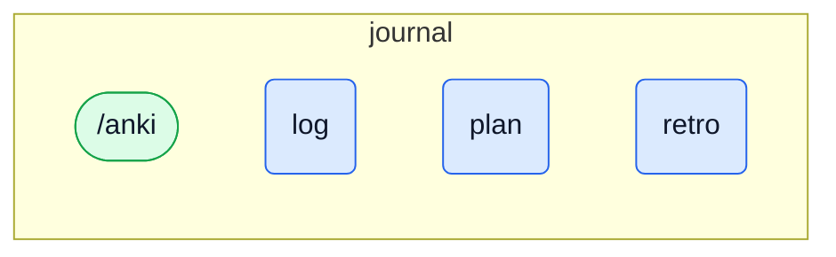
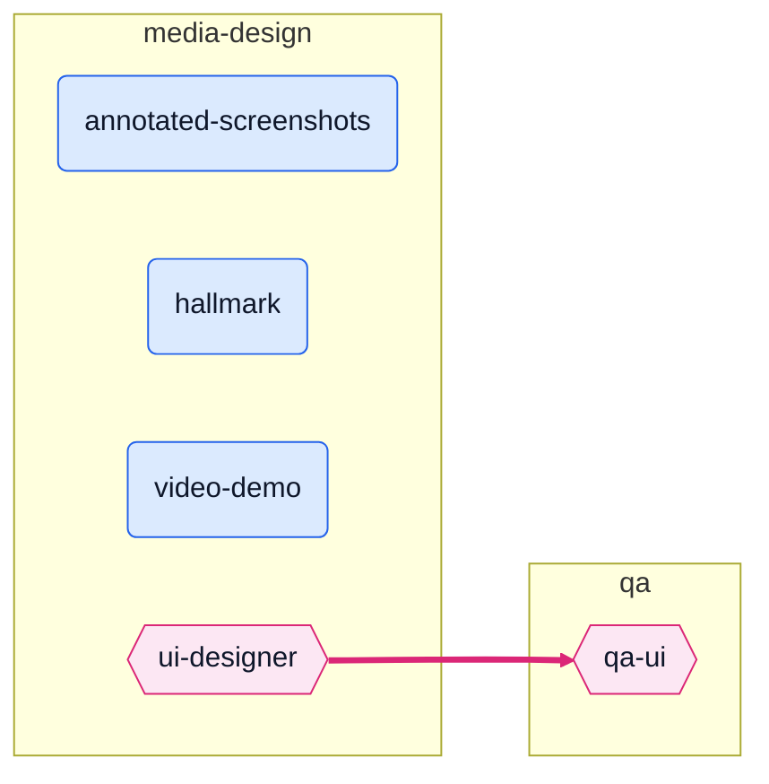
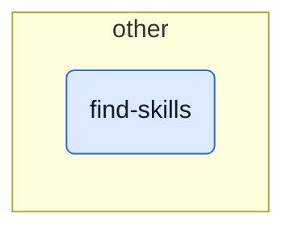
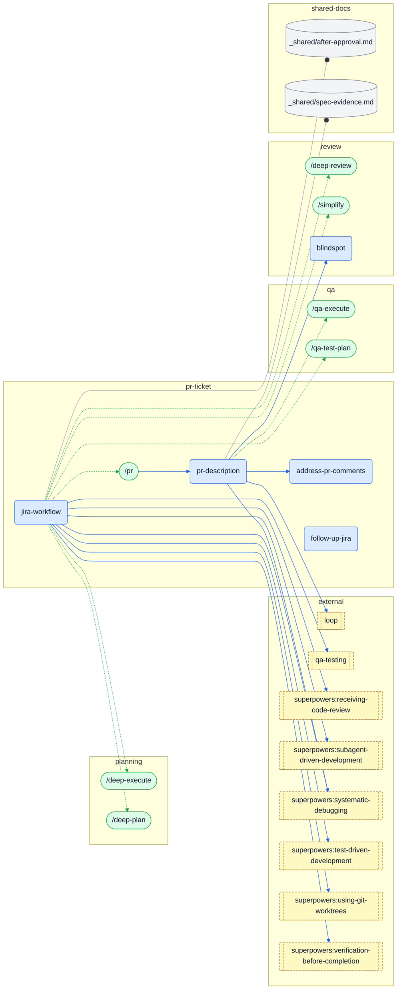
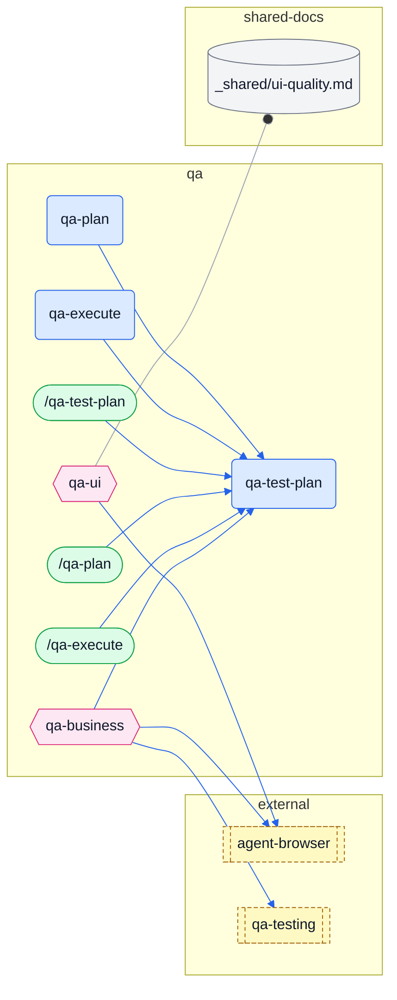
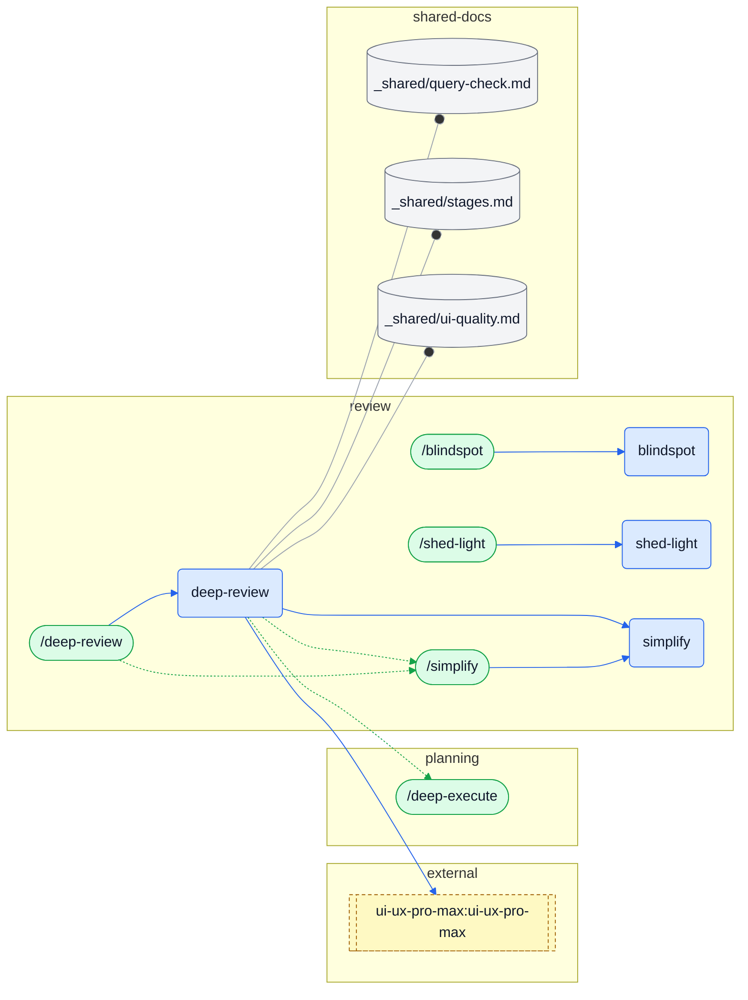
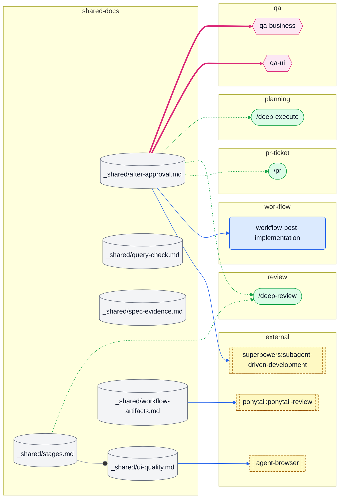
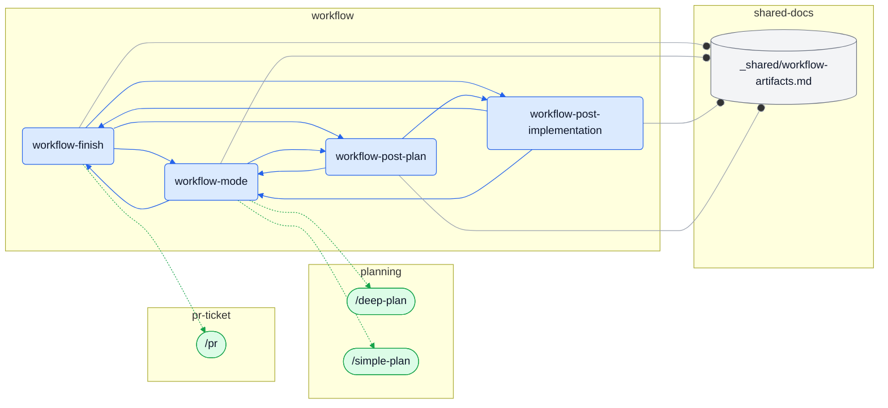

# Skills map

<!-- Generated by docs/skills-map.mjs. Do not edit by hand. Edit docs/skills-map.notes.md for the duplicates section. -->

This page maps the Claude Code skills, commands and agents in this repository, and the flows between them.
A generator reads the source files and draws the graph. The "Possible duplicates" section is hand-written.

## How to regenerate

Run `just skills-map`, or `node docs/skills-map.mjs` from the repository root.
The generator reads `dot_claude/skills/**/*.md`, `dot_claude/commands/*.md`, `dot_claude/agents/*.md` and `dot_agents/skills/**/*.md`.
It writes `docs/skills-map.md` and `docs/skills-map.html`. A second run gives no diff.
Run `node --test docs/skills-map.test.mjs` to test the edge extraction.

Counts: 26 skills, 12 commands, 3 agents, 6 shared docs, 20 external references. 157 edges: 78 invokes skill, 10 spawns agent, 43 runs command, 26 reads shared doc.

## Diagram 1: the main chains

Blue is the build chain of `deep-plan` and `simple-plan` (`_shared/after-approval.md`).
Green is the workflow stage chain for a repository with `.workflow/config.json`.
Orange is the extra path of `jira-workflow`. Dashed white boxes are steps, not files.

```mermaid
flowchart LR
  subgraph ph_intake["Intake"]
    direction TB
    jw("jira-workflow"):::skill
    jw_setup("ticket, branch, Jira status"):::step
    wm("workflow-mode"):::skill
  end
  subgraph ph_plan["Plan"]
    direction TB
    dp("/deep-plan"):::command
    sp("/simple-plan"):::command
    qap("/qa-plan"):::command
    pa("Plannotator approval"):::step
    wpp("workflow-post-plan"):::skill
  end
  subgraph ph_build["Build"]
    direction TB
    aa("_shared/after-approval.md"):::shared
    de("/deep-execute (option A)"):::command
    sdd("superpowers:subagent-driven-development (option B)"):::external
    jw_serial("jira-workflow serial path"):::skill
    fast("fast mode: implement and test"):::step
  end
  subgraph ph_review["Review"]
    direction TB
    dr("/deep-review"):::command
    simp("simplify"):::skill
    wpi("workflow-post-implementation"):::skill
  end
  subgraph ph_qa["QA"]
    direction TB
    qaui("qa-ui agent"):::agent
    qabiz("qa-business agent"):::agent
    qtp("/qa-test-plan"):::command
    fix("separate fixer agent"):::step
  end
  subgraph ph_pr["PR"]
    direction TB
    wf("workflow-finish"):::skill
    pr("/pr (pr-description)"):::command
    bs("blindspot"):::skill
    rep("HTML run report"):::step
  end
  subgraph ph_watch["Watch"]
    direction TB
    watch("PR watch: Monitor, then loop"):::step
    apc("address-pr-comments"):::skill
    fuj("follow-up-jira"):::skill
  end
  dp -->|"Phase 2.4"| qap
  qap --> pa
  sp --> pa
  pa -->|"approved"| aa
  aa -->|"A"| de
  aa -->|"B"| sdd
  de --> dr
  sdd --> dr
  dr -->|"Phase 5"| simp
  dr --> qaui
  dr --> qabiz
  qaui --> fix
  qabiz --> fix
  fix --> pr
  pr -->|"Phase 2.7"| bs
  pr --> rep
  pr -->|"Phase 5"| watch
  watch --> apc
  wm -->|"standard"| dp
  wm -->|"standard"| sp
  pa --> wpp
  wpp --> aa
  dr -->|"step 7.0"| wpi
  wpi --> wf
  wf --> pr
  wm -->|"fast"| fast
  fast --> wf
  jw --> jw_setup
  jw_setup -->|"--ticket"| dp
  dp -->|"serial mode"| jw_serial
  jw_serial -->|"x2"| simp
  jw_serial --> dr
  jw_serial -->|"section 4"| qtp
  qtp --> pr
  watch -->|"after deploy"| fuj
  linkStyle 0 stroke:#2563eb,stroke-width:2px
  linkStyle 1 stroke:#2563eb,stroke-width:2px
  linkStyle 2 stroke:#2563eb,stroke-width:2px
  linkStyle 3 stroke:#2563eb,stroke-width:2px
  linkStyle 4 stroke:#2563eb,stroke-width:2px
  linkStyle 5 stroke:#2563eb,stroke-width:2px
  linkStyle 6 stroke:#2563eb,stroke-width:2px
  linkStyle 7 stroke:#2563eb,stroke-width:2px
  linkStyle 8 stroke:#2563eb,stroke-width:2px
  linkStyle 9 stroke:#2563eb,stroke-width:2px
  linkStyle 10 stroke:#2563eb,stroke-width:2px
  linkStyle 11 stroke:#2563eb,stroke-width:2px
  linkStyle 12 stroke:#2563eb,stroke-width:2px
  linkStyle 13 stroke:#2563eb,stroke-width:2px
  linkStyle 14 stroke:#2563eb,stroke-width:2px
  linkStyle 15 stroke:#2563eb,stroke-width:2px
  linkStyle 16 stroke:#2563eb,stroke-width:2px
  linkStyle 17 stroke:#2563eb,stroke-width:2px
  linkStyle 18 stroke:#16a34a,stroke-width:2px
  linkStyle 19 stroke:#16a34a,stroke-width:2px
  linkStyle 20 stroke:#16a34a,stroke-width:2px
  linkStyle 21 stroke:#16a34a,stroke-width:2px
  linkStyle 22 stroke:#16a34a,stroke-width:2px
  linkStyle 23 stroke:#16a34a,stroke-width:2px
  linkStyle 24 stroke:#16a34a,stroke-width:2px
  linkStyle 25 stroke:#16a34a,stroke-width:2px
  linkStyle 26 stroke:#16a34a,stroke-width:2px
  linkStyle 27 stroke:#ea580c,stroke-width:2px
  linkStyle 28 stroke:#ea580c,stroke-width:2px
  linkStyle 29 stroke:#ea580c,stroke-width:2px
  linkStyle 30 stroke:#ea580c,stroke-width:2px
  linkStyle 31 stroke:#ea580c,stroke-width:2px
  linkStyle 32 stroke:#ea580c,stroke-width:2px
  linkStyle 33 stroke:#ea580c,stroke-width:2px
  linkStyle 34 stroke:#ea580c,stroke-width:2px
  classDef skill fill:#dbeafe,stroke:#2563eb,color:#0f172a
  classDef command fill:#dcfce7,stroke:#16a34a,color:#0f172a
  classDef agent fill:#fce7f3,stroke:#db2777,color:#0f172a
  classDef shared fill:#f3f4f6,stroke:#6b7280,color:#0f172a
  classDef external fill:#fef9c3,stroke:#a16207,color:#0f172a,stroke-dasharray:4 3
  classDef step fill:#ffffff,stroke:#6b7280,color:#0f172a,stroke-dasharray:2 2
```

## Diagram 2: the full graph

Shapes: a rounded box is a skill, a stadium is a command, a hexagon is an agent, a cylinder is a shared doc, and a double-edged box is a reference to a skill that is not in this repository.
Edges: blue solid arrows invoke a skill, thick pink arrows spawn an agent, green dotted arrows mention or run a command (`/name`), and grey lines with a circle read a shared doc.

The graph is too large for one diagram. Each cluster diagram shows the nodes of the cluster and the edges that start there. A node from another cluster appears as the target of such an edge.

### Cluster: journal

### Cluster: media-design

### Cluster: other

### Cluster: planning

```mermaid
flowchart LR
  subgraph cl_external["external"]
    direction TB
    x_continuity_ledger[["continuity-ledger"]]:::external
    x_frontend_design[["frontend-design"]]:::external
    x_humanizing_plans[["humanizing-plans"]]:::external
    x_mattpocock_skills_domain_modeling[["mattpocock-skills:domain-modeling"]]:::external
    x_mattpocock_skills_grilling[["mattpocock-skills:grilling"]]:::external
    x_plannotator_annotate[["plannotator-annotate"]]:::external
    x_ponytail_ponytail_review[["ponytail:ponytail-review"]]:::external
    x_superpowers_brainstorming[["superpowers:brainstorming"]]:::external
    x_superpowers_subagent_driven_development[["superpowers:subagent-driven-development"]]:::external
    x_superpowers_test_driven_development[["superpowers:test-driven-development"]]:::external
    x_superpowers_using_git_worktrees[["superpowers:using-git-worktrees"]]:::external
    x_superpowers_writing_plans[["superpowers:writing-plans"]]:::external
    x_ui_ux_pro_max_ui_ux_pro_max[["ui-ux-pro-max:ui-ux-pro-max"]]:::external
    x_writing_plans[["writing-plans"]]:::external
  end
  subgraph cl_media_design["media-design"]
    direction TB
    s_video_demo("video-demo"):::skill
    a_ui_designer{{"ui-designer"}}:::agent
  end
  subgraph cl_planning["planning"]
    direction TB
    c_deep_execute(["/deep-execute"]):::command
    c_deep_plan(["/deep-plan"]):::command
    c_simple_plan(["/simple-plan"]):::command
    s_deep_execute("deep-execute"):::skill
    s_deep_plan("deep-plan"):::skill
    s_explore_options("explore-options"):::skill
    s_simple_plan("simple-plan"):::skill
  end
  subgraph cl_pr_ticket["pr-ticket"]
    direction TB
    c_pr(["/pr"]):::command
    s_pr_description("pr-description"):::skill
  end
  subgraph cl_qa["qa"]
    direction TB
    c_qa_execute(["/qa-execute"]):::command
    c_qa_plan(["/qa-plan"]):::command
    c_qa_test_plan(["/qa-test-plan"]):::command
    a_qa_business{{"qa-business"}}:::agent
    a_qa_ui{{"qa-ui"}}:::agent
  end
  subgraph cl_review["review"]
    direction TB
    c_deep_review(["/deep-review"]):::command
    c_simplify(["/simplify"]):::command
    s_blindspot("blindspot"):::skill
    s_deep_review("deep-review"):::skill
    s_shed_light("shed-light"):::skill
  end
  subgraph cl_shared_docs["shared-docs"]
    direction TB
    d_after_approval[("_shared/after-approval.md")]:::shared
    d_query_check[("_shared/query-check.md")]:::shared
    d_spec_evidence[("_shared/spec-evidence.md")]:::shared
    d_stages[("_shared/stages.md")]:::shared
    d_ui_quality[("_shared/ui-quality.md")]:::shared
  end
  subgraph cl_workflow["workflow"]
    direction TB
    s_workflow_post_plan("workflow-post-plan"):::skill
  end
  c_deep_execute -.-> c_deep_plan
  c_deep_execute -.-> c_deep_review
  c_deep_execute -.-> c_pr
  c_deep_execute -.-> c_qa_execute
  c_deep_execute --> s_deep_execute
  c_deep_plan ==> a_qa_business
  c_deep_plan ==> a_qa_ui
  c_deep_plan -.-> c_deep_execute
  c_deep_plan -.-> c_deep_review
  c_deep_plan -.-> c_pr
  c_deep_plan -.-> c_qa_plan
  c_deep_plan --o d_after_approval
  c_deep_plan --> s_deep_plan
  c_deep_plan --> x_superpowers_brainstorming
  c_deep_plan --> x_superpowers_subagent_driven_development
  c_deep_plan --> x_superpowers_writing_plans
  c_simple_plan ==> a_qa_business
  c_simple_plan -.-> c_deep_plan
  c_simple_plan -.-> c_deep_review
  c_simple_plan -.-> c_pr
  c_simple_plan -.-> c_qa_plan
  c_simple_plan --o d_after_approval
  c_simple_plan --> s_simple_plan
  c_simple_plan --> s_video_demo
  c_simple_plan --> x_ponytail_ponytail_review
  c_simple_plan --> x_superpowers_brainstorming
  c_simple_plan --> x_superpowers_writing_plans
  c_simple_plan --> x_ui_ux_pro_max_ui_ux_pro_max
  s_deep_execute ==> a_qa_business
  s_deep_execute ==> a_qa_ui
  s_deep_execute -.-> c_deep_review
  s_deep_execute --o d_after_approval
  s_deep_execute --o d_spec_evidence
  s_deep_execute --o d_ui_quality
  s_deep_execute --> s_deep_review
  s_deep_execute --> s_pr_description
  s_deep_plan ==> a_ui_designer
  s_deep_plan -.-> c_deep_execute
  s_deep_plan -.-> c_deep_review
  s_deep_plan -.-> c_pr
  s_deep_plan -.-> c_qa_execute
  s_deep_plan -.-> c_qa_plan
  s_deep_plan -.-> c_qa_test_plan
  s_deep_plan -.-> c_simple_plan
  s_deep_plan -.-> c_simplify
  s_deep_plan --o d_after_approval
  s_deep_plan --o d_query_check
  s_deep_plan --o d_spec_evidence
  s_deep_plan --o d_stages
  s_deep_plan --o d_ui_quality
  s_deep_plan --> s_workflow_post_plan
  s_deep_plan --> x_continuity_ledger
  s_deep_plan --> x_humanizing_plans
  s_deep_plan --> x_mattpocock_skills_domain_modeling
  s_deep_plan --> x_mattpocock_skills_grilling
  s_deep_plan --> x_plannotator_annotate
  s_deep_plan --> x_superpowers_brainstorming
  s_deep_plan --> x_superpowers_subagent_driven_development
  s_deep_plan --> x_superpowers_test_driven_development
  s_deep_plan --> x_superpowers_using_git_worktrees
  s_deep_plan --> x_superpowers_writing_plans
  s_deep_plan --> x_writing_plans
  s_explore_options --> x_superpowers_brainstorming
  s_simple_plan ==> a_ui_designer
  s_simple_plan -.-> c_deep_execute
  s_simple_plan -.-> c_deep_plan
  s_simple_plan -.-> c_deep_review
  s_simple_plan -.-> c_pr
  s_simple_plan -.-> c_qa_plan
  s_simple_plan --o d_after_approval
  s_simple_plan --o d_query_check
  s_simple_plan --o d_spec_evidence
  s_simple_plan --o d_stages
  s_simple_plan --o d_ui_quality
  s_simple_plan --> s_blindspot
  s_simple_plan --> s_shed_light
  s_simple_plan --> s_video_demo
  s_simple_plan --> s_workflow_post_plan
  s_simple_plan --> x_frontend_design
  s_simple_plan --> x_plannotator_annotate
  s_simple_plan --> x_ponytail_ponytail_review
  s_simple_plan --> x_superpowers_brainstorming
  s_simple_plan --> x_superpowers_subagent_driven_development
  s_simple_plan --> x_superpowers_test_driven_development
  s_simple_plan --> x_superpowers_writing_plans
  s_simple_plan --> x_ui_ux_pro_max_ui_ux_pro_max
  linkStyle 0 stroke:#16a34a
  linkStyle 1 stroke:#16a34a
  linkStyle 2 stroke:#16a34a
  linkStyle 3 stroke:#16a34a
  linkStyle 4 stroke:#2563eb
  linkStyle 5 stroke:#db2777
  linkStyle 6 stroke:#db2777
  linkStyle 7 stroke:#16a34a
  linkStyle 8 stroke:#16a34a
  linkStyle 9 stroke:#16a34a
  linkStyle 10 stroke:#16a34a
  linkStyle 11 stroke:#9ca3af
  linkStyle 12 stroke:#2563eb
  linkStyle 13 stroke:#2563eb
  linkStyle 14 stroke:#2563eb
  linkStyle 15 stroke:#2563eb
  linkStyle 16 stroke:#db2777
  linkStyle 17 stroke:#16a34a
  linkStyle 18 stroke:#16a34a
  linkStyle 19 stroke:#16a34a
  linkStyle 20 stroke:#16a34a
  linkStyle 21 stroke:#9ca3af
  linkStyle 22 stroke:#2563eb
  linkStyle 23 stroke:#2563eb
  linkStyle 24 stroke:#2563eb
  linkStyle 25 stroke:#2563eb
  linkStyle 26 stroke:#2563eb
  linkStyle 27 stroke:#2563eb
  linkStyle 28 stroke:#db2777
  linkStyle 29 stroke:#db2777
  linkStyle 30 stroke:#16a34a
  linkStyle 31 stroke:#9ca3af
  linkStyle 32 stroke:#9ca3af
  linkStyle 33 stroke:#9ca3af
  linkStyle 34 stroke:#2563eb
  linkStyle 35 stroke:#2563eb
  linkStyle 36 stroke:#db2777
  linkStyle 37 stroke:#16a34a
  linkStyle 38 stroke:#16a34a
  linkStyle 39 stroke:#16a34a
  linkStyle 40 stroke:#16a34a
  linkStyle 41 stroke:#16a34a
  linkStyle 42 stroke:#16a34a
  linkStyle 43 stroke:#16a34a
  linkStyle 44 stroke:#16a34a
  linkStyle 45 stroke:#9ca3af
  linkStyle 46 stroke:#9ca3af
  linkStyle 47 stroke:#9ca3af
  linkStyle 48 stroke:#9ca3af
  linkStyle 49 stroke:#9ca3af
  linkStyle 50 stroke:#2563eb
  linkStyle 51 stroke:#2563eb
  linkStyle 52 stroke:#2563eb
  linkStyle 53 stroke:#2563eb
  linkStyle 54 stroke:#2563eb
  linkStyle 55 stroke:#2563eb
  linkStyle 56 stroke:#2563eb
  linkStyle 57 stroke:#2563eb
  linkStyle 58 stroke:#2563eb
  linkStyle 59 stroke:#2563eb
  linkStyle 60 stroke:#2563eb
  linkStyle 61 stroke:#2563eb
  linkStyle 62 stroke:#2563eb
  linkStyle 63 stroke:#db2777
  linkStyle 64 stroke:#16a34a
  linkStyle 65 stroke:#16a34a
  linkStyle 66 stroke:#16a34a
  linkStyle 67 stroke:#16a34a
  linkStyle 68 stroke:#16a34a
  linkStyle 69 stroke:#9ca3af
  linkStyle 70 stroke:#9ca3af
  linkStyle 71 stroke:#9ca3af
  linkStyle 72 stroke:#9ca3af
  linkStyle 73 stroke:#9ca3af
  linkStyle 74 stroke:#2563eb
  linkStyle 75 stroke:#2563eb
  linkStyle 76 stroke:#2563eb
  linkStyle 77 stroke:#2563eb
  linkStyle 78 stroke:#2563eb
  linkStyle 79 stroke:#2563eb
  linkStyle 80 stroke:#2563eb
  linkStyle 81 stroke:#2563eb
  linkStyle 82 stroke:#2563eb
  linkStyle 83 stroke:#2563eb
  linkStyle 84 stroke:#2563eb
  linkStyle 85 stroke:#2563eb
  classDef skill fill:#dbeafe,stroke:#2563eb,color:#0f172a
  classDef command fill:#dcfce7,stroke:#16a34a,color:#0f172a
  classDef agent fill:#fce7f3,stroke:#db2777,color:#0f172a
  classDef shared fill:#f3f4f6,stroke:#6b7280,color:#0f172a
  classDef external fill:#fef9c3,stroke:#a16207,color:#0f172a,stroke-dasharray:4 3
  classDef step fill:#ffffff,stroke:#6b7280,color:#0f172a,stroke-dasharray:2 2
```

### Cluster: pr-ticket

### Cluster: qa

### Cluster: review

### Cluster: shared-docs

### Cluster: workflow

## Possible duplicates

<!-- Hand-written. docs/skills-map.mjs copies this file into docs/skills-map.md. Line numbers refer to the source at the time of writing; check them again after an edit. -->

The table lists flows that two or more files define. Each row gives the evidence and one suggestion. This section reports facts and changes no skill.

| # | Overlap | Evidence | Suggestion |
|---|---|---|---|
| 1 | The build chain after plan approval has five descriptions. | `dot_claude/skills/_shared/after-approval.md:40-133` is the chain. `dot_claude/commands/deep-plan.md:75-87`, `dot_claude/commands/simple-plan.md:54-61`, `dot_claude/skills/simple-plan/SKILL.md:453-457` and `dot_claude/skills/deep-plan/SKILL.md:390-392` each restate it. | Delegate. Keep the steps only in `after-approval.md`. The other files point at it in one sentence. |
| 2 | Three files still say that `deep-plan` stops at the approved plan. The skill now builds through to the PR. | `dot_claude/commands/deep-plan.md:48-50`, `dot_claude/skills/deep-plan/README.md:62-66` and `dot_claude/skills/jira-workflow/SKILL.md:200` say it stops. `dot_claude/skills/deep-plan/SKILL.md:408-412` and `dot_claude/commands/deep-plan.md:7-10` say it builds. | Delete the stale sentences. The README handoff (`README.md:60-66`) also lists an older chain with `/simplify` x2 and `/qa-test-plan`. |
| 3 | `jira-workflow` has its own serial build, review and QA path beside the shared chain. | `dot_claude/skills/jira-workflow/SKILL.md:231-257` (serial path) and `:266-277` (section 4, `/qa-test-plan`). The same file at `:208-211` says to run `after-approval.md` once and not start a second build. | Delegate. Keep only the Jira steps: intake, branch, status, PR comment, notifications. |
| 4 | `simplify` can run three times on one change. | `dot_claude/skills/jira-workflow/SKILL.md:243-244` runs `/simplify` x2, then `/deep-review`. `dot_claude/skills/deep-review/SKILL.md:125-134` (Phase 5) runs `simplify` by default. | Delete the x2 step in `jira-workflow`. The deep-review Phase 5 pass covers it. |
| 5 | QA execution has four routes. | `dot_claude/agents/qa-business.md:63-69` runs `qa-test-plan --phase execute`, or drives `agent-browser` itself. `dot_claude/skills/qa-test-plan/SKILL.md:145-176` executes the plan. `dot_claude/skills/jira-workflow/SKILL.md:249-254` uses `qa-testing`. `dot_claude/commands/deep-execute.md:44-46` names `/qa-testing`, `/qa-execute` or a plain browser agent. The skill it wraps uses the `qa-ui` and `qa-business` agents (`dot_claude/skills/deep-execute/SKILL.md:142-146`). | Delegate. Make the `qa-business` agent the one QA executor, and update the command text to match the skill. |
| 6 | QA has three skills and three commands for one workflow. | `dot_claude/skills/qa-plan/SKILL.md:8-14` and `dot_claude/skills/qa-execute/SKILL.md:8-14` only call `qa-test-plan`. `dot_claude/commands/qa-plan.md:16` and `dot_claude/commands/qa-execute.md:16` call `qa-test-plan` directly, so no file reaches the two wrapper skills. | Merge. Keep `qa-test-plan` and the three commands. Delete the `qa-plan` and `qa-execute` skills, or keep them only for their trigger descriptions. |
| 7 | Every command repeats its skill. | All 12 files in `dot_claude/commands/` invoke the skill of the same name, for example `dot_claude/commands/simplify.md:19`. The commands reach Codex through `.chezmoiscripts/run_after_14_sync_codex_prompts.sh.tmpl`. | Keep, for Codex. Reduce each command to the argument grammar and one "invoke the skill" line, so that the text cannot drift (see rows 2 and 5). |
| 8 | Two skills choose between `simple-plan` and `deep-plan`, and a third chooses the mode. | `dot_claude/skills/deep-plan/SKILL.md:109-122` (Phase 0.4), `dot_claude/skills/simple-plan/SKILL.md:68-95` (Phase 0.5), `dot_claude/skills/workflow-mode/SKILL.md:25-34` and `:60-61`. | Merge the criteria into one shared doc that all three read. Keep the question in each skill. |
| 9 | Two places reply to PR review threads. | `dot_claude/skills/pr-description/SKILL.md:317-321` (Phase 5, steps 2 and 3) calls `address-pr-comments`, then replies in each thread itself. `dot_claude/skills/address-pr-comments/SKILL.md:61-78` already replies and resolves. | Delete step 3 of the pr-description watch. |
| 10 | Two skills open a pull request. | `dot_claude/skills/pr-description/SKILL.md:255-295` (Phase 3) opens and updates the PR. `dot_claude/skills/follow-up-jira/SKILL.md:180-182` opens a fresh branch and PR itself when the original PR merged. | Delegate. `follow-up-jira` runs `/pr` for a new PR. |
| 11 | Two watch loops. | `dot_claude/skills/pr-description/SKILL.md:305-343` watches the PR with `Monitor`, then `loop`. `dot_claude/skills/follow-up-jira/SKILL.md:71-88` watches the ticket with `ScheduleWakeup` every 1800 seconds. `dot_claude/skills/jira-workflow/SKILL.md:332-335` already defers to the PR watch. | Keep. They watch different sources: PR review and CI, and the reporter's ticket comment after deploy. |
| 12 | Two copies of the Jira status transition. | `dot_claude/skills/jira-workflow/SKILL.md:166-183` and `dot_claude/skills/follow-up-jira/SKILL.md:112-120`, `:143-145` both list transitions, then match a name. | Keep. Each copy is short. Move it to a shared doc when a third skill needs it. |
| 13 | Two run reports. | `dot_claude/skills/_shared/after-approval.md:118-133` has the session write `report/index.html` for options B, C and D. `dot_claude/skills/deep-execute/SKILL.md:161-185` builds it with `build-run-report.sh` and forbids a hand-written page. | Delegate, if the script can run without lanes. Otherwise keep, and say why in `after-approval.md`. |
| 14 | Four checks for over-engineering. | `dot_claude/skills/shed-light/SKILL.md:3` (plan upkeep), `ponytail:ponytail-review` in `dot_claude/skills/simple-plan/SKILL.md:364`, the `simplicity` and `code-judo` personas in `dot_claude/skills/deep-review/personas/`, and the `simplify` pass in `dot_claude/skills/deep-review/SKILL.md:125-134`. | Keep. They run at different stages: plan, diff review, cleanup. Check that `simplicity` and `code-judo` do not report the same finding. |
| 15 | The demo video runs only in one pipeline. | `dot_claude/skills/simple-plan/SKILL.md:466-468` and `dot_claude/commands/simple-plan.md:60` run `video-demo` after the PR. `after-approval.md` and `deep-plan` do not. | Move the step into `after-approval.md` section 7, so both pipelines run it. |
| 16 | Two screenshot annotators. | `dot_claude/skills/qa-test-plan/SKILL.md:191` renders annotated PNGs. `dot_claude/skills/annotated-screenshots/SKILL.md:3` draws callouts and sends QA evidence to `qa-test-plan`. | Keep. The descriptions already split the use: QA evidence and stakeholder images. |
| 17 | The name `plan` has two meanings. | `dot_claude/skills/plan/SKILL.md:3` plans the week in the journal. `simple-plan` and `deep-plan` plan code. | Keep. Consider a journal prefix, such as `journal-plan`, if the trigger fires on code planning. |

## Orphans

Nodes with no inbound edge and no user trigger (no command, and no "use when" in the description):

- None.

Skills that no other file references. Only the user or the description trigger starts them:

- `annotated-screenshots` (`dot_claude/skills/annotated-screenshots/SKILL.md`)
- `explore-options` (`dot_claude/skills/explore-options/SKILL.md`)
- `find-skills` (`dot_claude/skills/find-skills/SKILL.md`)
- `follow-up-jira` (`dot_claude/skills/follow-up-jira/SKILL.md`)
- `hallmark` (`dot_agents/skills/hallmark/SKILL.md`)
- `jira-workflow` (`dot_claude/skills/jira-workflow/SKILL.md`)
- `log` (`dot_claude/skills/log/SKILL.md`)
- `plan` (`dot_claude/skills/plan/SKILL.md`)
- `qa-execute` (`dot_claude/skills/qa-execute/SKILL.md`)
- `qa-plan` (`dot_claude/skills/qa-plan/SKILL.md`)
- `retro` (`dot_claude/skills/retro/SKILL.md`)

References to skills, agents or shared docs that this repository does not define. A name with a colon comes from a plugin. A name without a colon is a local skill, a plugin skill or a built-in, or the reference is broken:

- `agent-browser`: `dot_claude/agents/qa-business.md:68`, `dot_claude/agents/qa-ui.md:33`, `dot_claude/agents/qa-ui.md:36`, `dot_claude/skills/_shared/ui-quality.md:125`
- `continuity-ledger`: `dot_claude/skills/deep-plan/SKILL.md:434`
- `frontend-design`: `dot_claude/skills/simple-plan/SKILL.md:203`
- `humanizing-plans`: `dot_claude/skills/deep-plan/SKILL.md:307`
- `loop`: `dot_claude/skills/pr-description/SKILL.md:336`
- `mattpocock-skills:domain-modeling`: `dot_claude/skills/deep-plan/SKILL.md:139`
- `mattpocock-skills:grilling`: `dot_claude/skills/deep-plan/SKILL.md:138`
- `plannotator-annotate`: `dot_claude/skills/deep-plan/SKILL.md:324`, `dot_claude/skills/simple-plan/SKILL.md:437`
- `ponytail:ponytail-review`: `dot_claude/skills/simple-plan/SKILL.md:364`, `dot_claude/commands/simple-plan.md:40`, `dot_claude/skills/_shared/workflow-artifacts.md:96`
- `qa-testing`: `dot_claude/skills/jira-workflow/SKILL.md:251`, `dot_claude/agents/qa-business.md:69`
- `superpowers:brainstorming`: `dot_claude/skills/deep-plan/SKILL.md:156`, `dot_claude/skills/explore-options/SKILL.md:135`, `dot_claude/skills/simple-plan/SKILL.md:101`, `dot_claude/commands/deep-plan.md:16`, `dot_claude/commands/simple-plan.md:30`
- `superpowers:receiving-code-review`: `dot_claude/skills/jira-workflow/SKILL.md:245`
- `superpowers:subagent-driven-development`: `dot_claude/skills/deep-plan/SKILL.md:381`, `dot_claude/skills/jira-workflow/SKILL.md:235`, `dot_claude/skills/simple-plan/SKILL.md:454`, `dot_claude/commands/deep-plan.md:67`, `dot_claude/skills/_shared/after-approval.md:47`
- `superpowers:systematic-debugging`: `dot_claude/skills/jira-workflow/SKILL.md:240`, `dot_claude/skills/pr-description/SKILL.md:322`
- `superpowers:test-driven-development`: `dot_claude/skills/deep-plan/SKILL.md:418`, `dot_claude/skills/jira-workflow/SKILL.md:237`, `dot_claude/skills/simple-plan/SKILL.md:346`
- `superpowers:using-git-worktrees`: `dot_claude/skills/deep-plan/README.md:63`, `dot_claude/skills/jira-workflow/SKILL.md:233`
- `superpowers:verification-before-completion`: `dot_claude/skills/jira-workflow/SKILL.md:256`
- `superpowers:writing-plans`: `dot_claude/skills/deep-plan/README.md:71`, `dot_claude/skills/deep-plan/SKILL.md:165`, `dot_claude/skills/deep-plan/SKILL.md:174`, `dot_claude/skills/deep-plan/SKILL.md:271`, `dot_claude/skills/deep-plan/personas/planner-opus.md:20`, `dot_claude/skills/deep-plan/templates/plan.md:12`, `dot_claude/skills/deep-plan/templates/plan.md:271`, `dot_claude/skills/deep-plan/templates/plan.md:345`, `dot_claude/skills/deep-plan/templates/subplan.md:28`, `dot_claude/skills/simple-plan/SKILL.md:34`, `dot_claude/skills/simple-plan/SKILL.md:208`, `dot_claude/skills/simple-plan/SKILL.md:212`, `dot_claude/commands/deep-plan.md:17`, `dot_claude/commands/simple-plan.md:37`
- `ui-ux-pro-max:ui-ux-pro-max`: `dot_claude/skills/deep-review/personas/senior-frontend.md:90`, `dot_claude/skills/deep-review/personas/ui-ux.md:9`, `dot_claude/skills/simple-plan/SKILL.md:179`, `dot_claude/commands/simple-plan.md:35`
- `writing-plans`: `dot_claude/skills/deep-plan/personas/planner-codex.md:29`, `dot_claude/skills/deep-plan/personas/planner-codex.md:30`

## Edge list

Every edge, with the first line that creates it

| from | edge | to | evidence |
|---|---|---|---|
| qa-business | invokes skill | qa-test-plan | `dot_claude/agents/qa-business.md:65` |
| qa-business | invokes skill | agent-browser | `dot_claude/agents/qa-business.md:68` |
| qa-business | invokes skill | qa-testing | `dot_claude/agents/qa-business.md:69` |
| qa-ui | reads shared doc | ui-quality.md | `dot_claude/agents/qa-ui.md:42` |
| qa-ui | invokes skill | agent-browser | `dot_claude/agents/qa-ui.md:33` |
| ui-designer | spawns agent | qa-ui | `dot_claude/agents/ui-designer.md:71` |
| /blindspot | invokes skill | blindspot | `dot_claude/commands/blindspot.md:21` |
| /deep-execute | runs command | /deep-plan | `dot_claude/commands/deep-execute.md:8` |
| /deep-execute | runs command | /deep-review | `dot_claude/commands/deep-execute.md:2` |
| /deep-execute | runs command | /pr | `dot_claude/commands/deep-execute.md:49` |
| /deep-execute | runs command | /qa-execute | `dot_claude/commands/deep-execute.md:45` |
| /deep-execute | invokes skill | deep-execute | `dot_claude/commands/deep-execute.md:25` |
| /deep-plan | spawns agent | qa-business | `dot_claude/commands/deep-plan.md:83` |
| /deep-plan | spawns agent | qa-ui | `dot_claude/commands/deep-plan.md:82` |
| /deep-plan | runs command | /deep-execute | `dot_claude/commands/deep-plan.md:2` |
| /deep-plan | runs command | /deep-review | `dot_claude/commands/deep-plan.md:81` |
| /deep-plan | runs command | /pr | `dot_claude/commands/deep-plan.md:86` |
| /deep-plan | runs command | /qa-plan | `dot_claude/commands/deep-plan.md:23` |
| /deep-plan | reads shared doc | after-approval.md | `dot_claude/commands/deep-plan.md:9` |
| /deep-plan | invokes skill | deep-plan | `dot_claude/commands/deep-plan.md:48` |
| /deep-plan | invokes skill | superpowers:brainstorming | `dot_claude/commands/deep-plan.md:16` |
| /deep-plan | invokes skill | superpowers:subagent-driven-development | `dot_claude/commands/deep-plan.md:67` |
| /deep-plan | invokes skill | superpowers:writing-plans | `dot_claude/commands/deep-plan.md:17` |
| /deep-review | runs command | /simplify | `dot_claude/commands/deep-review.md:43` |
| /deep-review | invokes skill | deep-review | `dot_claude/commands/deep-review.md:56` |
| /pr | invokes skill | pr-description | `dot_claude/commands/pr.md:46` |
| /qa-execute | invokes skill | qa-test-plan | `dot_claude/commands/qa-execute.md:16` |
| /qa-plan | invokes skill | qa-test-plan | `dot_claude/commands/qa-plan.md:16` |
| /qa-test-plan | invokes skill | qa-test-plan | `dot_claude/commands/qa-test-plan.md:18` |
| /shed-light | invokes skill | shed-light | `dot_claude/commands/shed-light.md:20` |
| /simple-plan | spawns agent | qa-business | `dot_claude/commands/simple-plan.md:59` |
| /simple-plan | runs command | /deep-plan | `dot_claude/commands/simple-plan.md:27` |
| /simple-plan | runs command | /deep-review | `dot_claude/commands/simple-plan.md:57` |
| /simple-plan | runs command | /pr | `dot_claude/commands/simple-plan.md:60` |
| /simple-plan | runs command | /qa-plan | `dot_claude/commands/simple-plan.md:51` |
| /simple-plan | reads shared doc | after-approval.md | `dot_claude/commands/simple-plan.md:9` |
| /simple-plan | invokes skill | simple-plan | `dot_claude/commands/simple-plan.md:65` |
| /simple-plan | invokes skill | video-demo | `dot_claude/commands/simple-plan.md:60` |
| /simple-plan | invokes skill | ponytail:ponytail-review | `dot_claude/commands/simple-plan.md:40` |
| /simple-plan | invokes skill | superpowers:brainstorming | `dot_claude/commands/simple-plan.md:30` |
| /simple-plan | invokes skill | superpowers:writing-plans | `dot_claude/commands/simple-plan.md:37` |
| /simple-plan | invokes skill | ui-ux-pro-max:ui-ux-pro-max | `dot_claude/commands/simple-plan.md:35` |
| /simplify | invokes skill | simplify | `dot_claude/commands/simplify.md:19` |
| after-approval.md | spawns agent | qa-business | `dot_claude/skills/_shared/after-approval.md:93` |
| after-approval.md | spawns agent | qa-ui | `dot_claude/skills/_shared/after-approval.md:29` |
| after-approval.md | runs command | /deep-execute | `dot_claude/skills/_shared/after-approval.md:46` |
| after-approval.md | runs command | /deep-review | `dot_claude/skills/_shared/after-approval.md:56` |
| after-approval.md | runs command | /pr | `dot_claude/skills/_shared/after-approval.md:115` |
| after-approval.md | invokes skill | workflow-post-implementation | `dot_claude/skills/_shared/after-approval.md:113` |
| after-approval.md | invokes skill | superpowers:subagent-driven-development | `dot_claude/skills/_shared/after-approval.md:47` |
| stages.md | runs command | /deep-review | `dot_claude/skills/_shared/stages.md:47` |
| stages.md | reads shared doc | ui-quality.md | `dot_claude/skills/_shared/stages.md:48` |
| ui-quality.md | invokes skill | agent-browser | `dot_claude/skills/_shared/ui-quality.md:125` |
| workflow-artifacts.md | invokes skill | ponytail:ponytail-review | `dot_claude/skills/_shared/workflow-artifacts.md:96` |
| deep-execute | spawns agent | qa-business | `dot_claude/skills/deep-execute/SKILL.md:144` |
| deep-execute | spawns agent | qa-ui | `dot_claude/skills/deep-execute/SKILL.md:144` |
| deep-execute | runs command | /deep-review | `dot_claude/skills/deep-execute/README.md:201` |
| deep-execute | reads shared doc | after-approval.md | `dot_claude/skills/deep-execute/SKILL.md:143` |
| deep-execute | reads shared doc | spec-evidence.md | `dot_claude/skills/deep-execute/SKILL.md:97` |
| deep-execute | reads shared doc | ui-quality.md | `dot_claude/skills/deep-execute/SKILL.md:134` |
| deep-execute | invokes skill | deep-review | `dot_claude/skills/deep-execute/SKILL.md:121` |
| deep-execute | invokes skill | pr-description | `dot_claude/skills/deep-execute/SKILL.md:156` |
| deep-plan | spawns agent | ui-designer | `dot_claude/skills/deep-plan/SKILL.md:183` |
| deep-plan | runs command | /deep-execute | `dot_claude/skills/deep-plan/README.md:4` |
| deep-plan | runs command | /deep-review | `dot_claude/skills/deep-plan/README.md:64` |
| deep-plan | runs command | /pr | `dot_claude/skills/deep-plan/README.md:65` |
| deep-plan | runs command | /qa-execute | `dot_claude/skills/deep-plan/SKILL.md:37` |
| deep-plan | runs command | /qa-plan | `dot_claude/skills/deep-plan/SKILL.md:27` |
| deep-plan | runs command | /qa-test-plan | `dot_claude/skills/deep-plan/README.md:64` |
| deep-plan | runs command | /simple-plan | `dot_claude/skills/deep-plan/SKILL.md:113` |
| deep-plan | runs command | /simplify | `dot_claude/skills/deep-plan/README.md:64` |
| deep-plan | reads shared doc | after-approval.md | `dot_claude/skills/deep-plan/SKILL.md:183` |
| deep-plan | reads shared doc | query-check.md | `dot_claude/skills/deep-plan/SKILL.md:293` |
| deep-plan | reads shared doc | spec-evidence.md | `dot_claude/skills/deep-plan/SKILL.md:359` |
| deep-plan | reads shared doc | stages.md | `dot_claude/skills/deep-plan/SKILL.md:50` |
| deep-plan | reads shared doc | ui-quality.md | `dot_claude/skills/deep-plan/SKILL.md:295` |
| deep-plan | invokes skill | workflow-post-plan | `dot_claude/skills/deep-plan/SKILL.md:412` |
| deep-plan | invokes skill | continuity-ledger | `dot_claude/skills/deep-plan/SKILL.md:434` |
| deep-plan | invokes skill | humanizing-plans | `dot_claude/skills/deep-plan/SKILL.md:307` |
| deep-plan | invokes skill | mattpocock-skills:domain-modeling | `dot_claude/skills/deep-plan/SKILL.md:139` |
| deep-plan | invokes skill | mattpocock-skills:grilling | `dot_claude/skills/deep-plan/SKILL.md:138` |
| deep-plan | invokes skill | plannotator-annotate | `dot_claude/skills/deep-plan/SKILL.md:324` |
| deep-plan | invokes skill | superpowers:brainstorming | `dot_claude/skills/deep-plan/SKILL.md:156` |
| deep-plan | invokes skill | superpowers:subagent-driven-development | `dot_claude/skills/deep-plan/SKILL.md:381` |
| deep-plan | invokes skill | superpowers:test-driven-development | `dot_claude/skills/deep-plan/SKILL.md:418` |
| deep-plan | invokes skill | superpowers:using-git-worktrees | `dot_claude/skills/deep-plan/README.md:63` |
| deep-plan | invokes skill | superpowers:writing-plans | `dot_claude/skills/deep-plan/README.md:71` |
| deep-plan | invokes skill | writing-plans | `dot_claude/skills/deep-plan/personas/planner-codex.md:29` |
| deep-review | runs command | /deep-execute | `dot_claude/skills/deep-review/SKILL.md:182` |
| deep-review | runs command | /simplify | `dot_claude/skills/deep-review/README.md:44` |
| deep-review | reads shared doc | query-check.md | `dot_claude/skills/deep-review/SKILL.md:108` |
| deep-review | reads shared doc | stages.md | `dot_claude/skills/deep-review/README.md:51` |
| deep-review | reads shared doc | ui-quality.md | `dot_claude/skills/deep-review/personas/ui-ux.md:16` |
| deep-review | invokes skill | simplify | `dot_claude/skills/deep-review/SKILL.md:134` |
| deep-review | invokes skill | ui-ux-pro-max:ui-ux-pro-max | `dot_claude/skills/deep-review/personas/senior-frontend.md:90` |
| explore-options | invokes skill | superpowers:brainstorming | `dot_claude/skills/explore-options/SKILL.md:135` |
| jira-workflow | runs command | /deep-execute | `dot_claude/skills/jira-workflow/SKILL.md:17` |
| jira-workflow | runs command | /deep-plan | `dot_claude/skills/jira-workflow/SKILL.md:15` |
| jira-workflow | runs command | /deep-review | `dot_claude/skills/jira-workflow/SKILL.md:18` |
| jira-workflow | runs command | /pr | `dot_claude/skills/jira-workflow/SKILL.md:20` |
| jira-workflow | runs command | /qa-test-plan | `dot_claude/skills/jira-workflow/SKILL.md:19` |
| jira-workflow | runs command | /simplify | `dot_claude/skills/jira-workflow/SKILL.md:69` |
| jira-workflow | reads shared doc | after-approval.md | `dot_claude/skills/jira-workflow/SKILL.md:209` |
| jira-workflow | invokes skill | qa-testing | `dot_claude/skills/jira-workflow/SKILL.md:251` |
| jira-workflow | invokes skill | superpowers:receiving-code-review | `dot_claude/skills/jira-workflow/SKILL.md:245` |
| jira-workflow | invokes skill | superpowers:subagent-driven-development | `dot_claude/skills/jira-workflow/SKILL.md:235` |
| jira-workflow | invokes skill | superpowers:systematic-debugging | `dot_claude/skills/jira-workflow/SKILL.md:240` |
| jira-workflow | invokes skill | superpowers:test-driven-development | `dot_claude/skills/jira-workflow/SKILL.md:237` |
| jira-workflow | invokes skill | superpowers:using-git-worktrees | `dot_claude/skills/jira-workflow/SKILL.md:233` |
| jira-workflow | invokes skill | superpowers:verification-before-completion | `dot_claude/skills/jira-workflow/SKILL.md:256` |
| pr-description | runs command | /qa-execute | `dot_claude/skills/pr-description/SKILL.md:174` |
| pr-description | reads shared doc | spec-evidence.md | `dot_claude/skills/pr-description/SKILL.md:62` |
| pr-description | invokes skill | address-pr-comments | `dot_claude/skills/pr-description/SKILL.md:318` |
| pr-description | invokes skill | blindspot | `dot_claude/skills/pr-description/SKILL.md:244` |
| pr-description | invokes skill | loop | `dot_claude/skills/pr-description/SKILL.md:336` |
| pr-description | invokes skill | superpowers:systematic-debugging | `dot_claude/skills/pr-description/SKILL.md:322` |
| qa-execute | invokes skill | qa-test-plan | `dot_claude/skills/qa-execute/SKILL.md:14` |
| qa-plan | invokes skill | qa-test-plan | `dot_claude/skills/qa-plan/SKILL.md:14` |
| simple-plan | spawns agent | ui-designer | `dot_claude/skills/simple-plan/SKILL.md:194` |
| simple-plan | runs command | /deep-execute | `dot_claude/skills/simple-plan/SKILL.md:454` |
| simple-plan | runs command | /deep-plan | `dot_claude/skills/simple-plan/SKILL.md:71` |
| simple-plan | runs command | /deep-review | `dot_claude/skills/simple-plan/SKILL.md:455` |
| simple-plan | runs command | /pr | `dot_claude/skills/simple-plan/SKILL.md:456` |
| simple-plan | runs command | /qa-plan | `dot_claude/skills/simple-plan/SKILL.md:354` |
| simple-plan | reads shared doc | after-approval.md | `dot_claude/skills/simple-plan/SKILL.md:12` |
| simple-plan | reads shared doc | query-check.md | `dot_claude/skills/simple-plan/SKILL.md:287` |
| simple-plan | reads shared doc | spec-evidence.md | `dot_claude/skills/simple-plan/SKILL.md:427` |
| simple-plan | reads shared doc | stages.md | `dot_claude/skills/simple-plan/SKILL.md:152` |
| simple-plan | reads shared doc | ui-quality.md | `dot_claude/skills/simple-plan/SKILL.md:177` |
| simple-plan | invokes skill | blindspot | `dot_claude/skills/simple-plan/SKILL.md:414` |
| simple-plan | invokes skill | shed-light | `dot_claude/skills/simple-plan/SKILL.md:432` |
| simple-plan | invokes skill | video-demo | `dot_claude/skills/simple-plan/SKILL.md:467` |
| simple-plan | invokes skill | workflow-post-plan | `dot_claude/skills/simple-plan/SKILL.md:442` |
| simple-plan | invokes skill | frontend-design | `dot_claude/skills/simple-plan/SKILL.md:203` |
| simple-plan | invokes skill | plannotator-annotate | `dot_claude/skills/simple-plan/SKILL.md:437` |
| simple-plan | invokes skill | ponytail:ponytail-review | `dot_claude/skills/simple-plan/SKILL.md:364` |
| simple-plan | invokes skill | superpowers:brainstorming | `dot_claude/skills/simple-plan/SKILL.md:101` |
| simple-plan | invokes skill | superpowers:subagent-driven-development | `dot_claude/skills/simple-plan/SKILL.md:454` |
| simple-plan | invokes skill | superpowers:test-driven-development | `dot_claude/skills/simple-plan/SKILL.md:346` |
| simple-plan | invokes skill | superpowers:writing-plans | `dot_claude/skills/simple-plan/SKILL.md:34` |
| simple-plan | invokes skill | ui-ux-pro-max:ui-ux-pro-max | `dot_claude/skills/simple-plan/SKILL.md:179` |
| workflow-finish | runs command | /pr | `dot_claude/skills/workflow-finish/SKILL.md:3` |
| workflow-finish | reads shared doc | workflow-artifacts.md | `dot_claude/skills/workflow-finish/SKILL.md:15` |
| workflow-finish | invokes skill | workflow-mode | `dot_claude/skills/workflow-finish/SKILL.md:19` |
| workflow-finish | invokes skill | workflow-post-implementation | `dot_claude/skills/workflow-finish/SKILL.md:43` |
| workflow-finish | invokes skill | workflow-post-plan | `dot_claude/skills/workflow-finish/SKILL.md:42` |
| workflow-mode | runs command | /deep-plan | `dot_claude/skills/workflow-mode/SKILL.md:60` |
| workflow-mode | runs command | /simple-plan | `dot_claude/skills/workflow-mode/SKILL.md:60` |
| workflow-mode | reads shared doc | workflow-artifacts.md | `dot_claude/skills/workflow-mode/SKILL.md:15` |
| workflow-mode | invokes skill | workflow-finish | `dot_claude/skills/workflow-mode/SKILL.md:63` |
| workflow-mode | invokes skill | workflow-post-plan | `dot_claude/skills/workflow-mode/SKILL.md:61` |
| workflow-post-implementation | reads shared doc | workflow-artifacts.md | `dot_claude/skills/workflow-post-implementation/SKILL.md:15` |
| workflow-post-implementation | invokes skill | workflow-finish | `dot_claude/skills/workflow-post-implementation/SKILL.md:62` |
| workflow-post-implementation | invokes skill | workflow-mode | `dot_claude/skills/workflow-post-implementation/SKILL.md:19` |
| workflow-post-plan | reads shared doc | workflow-artifacts.md | `dot_claude/skills/workflow-post-plan/SKILL.md:15` |
| workflow-post-plan | invokes skill | workflow-mode | `dot_claude/skills/workflow-post-plan/SKILL.md:19` |
| workflow-post-plan | invokes skill | workflow-post-implementation | `dot_claude/skills/workflow-post-plan/SKILL.md:61` |

